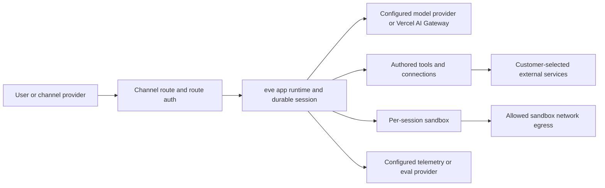

An eve agent runs in two contexts: the trusted app runtime and the isolated sandbox. Every secret stays in the app runtime. Use this model to decide what an agent, and the model driving it, can reach.

## Trust boundaries

|                         | App runtime  | Sandbox               |
| ----------------------- | ------------ | --------------------- |
| `process.env` / secrets | Yes          | No                    |
| Your Node.js code       | Yes          | No                    |
| Network                 | Unrestricted | Controlled by policy  |
| Filesystem              | App's own    | Isolated `/workspace` |

The app runtime is the trusted side. Your tool implementations, model calls, connections, and session state run here, with `process.env` and full Node.js available. On Vercel, this is a Vercel Function.

The sandbox is the isolated side. It has its own `/workspace` filesystem but no `process.env`, no secrets, and no path back into the app runtime. On Vercel, each sandbox is a [Vercel Sandbox](https://vercel.com/docs/sandbox) microVM with hardware-level isolation.

Only shell commands execute in the sandbox. The built-in `bash`, `read_file`, and `write_file` tools, and opt-in tools such as `glob` and `grep`, run in the app runtime and _proxy_ into the sandbox.

The model sees only tool definitions and results. When the model calls a custom `charge_card` tool, its `execute` runs in the app runtime, reads `process.env.STRIPE_KEY`, calls Stripe, and returns `{ ok: true }`. The model sees only `{ ok: true }`, and the call never touches the sandbox.

The [just-bash provider](../sandbox/just-bash) has a weaker boundary. Its shell is a JavaScript interpreter with a virtual filesystem inside the app runtime process, with no network isolation. Any `experimental.customCommands` you register run as host application code outside the virtual filesystem. Use a Vercel or Docker sandbox when the model runs commands you would not run in the app runtime.

See [Agent loop and sandbox](./execution-model-and-durability#agent-loop-and-sandbox) for how eve connects these contexts while keeping their state and lifetimes separate.

## Data flow at a glance

eve sends data only where your agent configuration sends it:

- Inbound channel data flows through the channel provider you configure, then into the eve app runtime.
- Model inputs and outputs flow to the model selected in `agent.ts`, such as a Vercel AI Gateway model id or a provider model instance (`EveLanguageModel`).
- Tool and connection calls flow to the external services, MCP servers, OpenAPI endpoints, and channels you configure.
- Sandbox commands can reach network destinations allowed by the sandbox network policy.
- Telemetry flows to destinations configured under `agent/instrumentation/`.
  By default, eve also records local traces during `eve dev` and exports to
  Vercel Agent Runs in preview and production.
- Eval data flows to the reporters configured in eval settings.

eve stores the session and workflow state it needs to resume conversations, stream events, replay completed steps, and show run observability.

You decide whether your channels, model providers, connected services, and sandbox egress destinations suit your data and use case. The same applies to telemetry exporters, retention settings, and deletion controls.

## Credential brokering

Credential brokering gives the model _authenticated_ network access from inside the sandbox, such as a `git clone` of a private repo. Use it when no [tool](../tools) or [connection](../connections) can route the call. On the Vercel Sandbox backend, the sandbox's network firewall injects auth headers for matching domains. The secret stays in the app runtime, and the sandbox process sees only the response. See [Vercel Sandbox Credential Brokering](https://vercel.com/docs/sandbox/concepts/firewall#credentials-brokering) for the platform mechanism, and [Sandbox](../sandbox) for the eve policy API.

## Connection credentials

[Connection](../connections) tokens (MCP and OpenAPI) come from either `getToken()` or an interactive OAuth flow. eve injects the resolved token into every outbound request and never saves it in session state.

## Channel verification

A [channel](../channels/overview) authenticates its own inbound traffic. The built-in platform channels follow two rules, and so must any channel you write:

- **Verify signatures in constant time.** Platform channels (Slack, GitHub,
  Telegram, Twilio) verify the platform's HMAC signature over the raw request
  body. They compare in constant time, so response timing can't reveal a forged
  signature. Never use `===` on a signature or secret.
- **Don't trust body-supplied identity.** Derive the caller from a _verified_
  signature or token. Never use a `principalId` (or similar) from the request
  body, because a body field is attacker-controlled.

## A turn runs as one principal

A turn's principal (its authenticator, issuer, principal type and id) never changes while the turn runs; only its claims may update. Only that principal's messages steer the turn or answer its pending questions by text. In a shared thread, another person's message waits for the turn to end and then runs as their own turn, so their text never drives the turn's credentials and the turn never continues under their identity. Another person can still settle a pending request with a button or structured answer; they are recorded as its responder, and the turn keeps its caller. See [What reaches `ctx.session.auth`](../guides/auth-and-route-protection#what-reaches-ctxsessionauth).

## Authored markdown is data

[Skill](../skills) and [schedule](../schedules) frontmatter is data: it must parse to a plain YAML object. A fence that names any language other than YAML, such as `---js`, throws instead of evaluating code.

## Auth fails closed

Routes reject unauthenticated traffic by default. If no `AuthFn` in the walk accepts the request, it gets a `401`; admitting anonymous callers takes an explicit `none()`. The scaffold's `placeholderAuth()` keeps a half-configured app closed in production until you replace it. See [Auth & route protection](../guides/auth-and-route-protection) for the full walk and verifiers.

## Pre-production checklist

Before exposing an agent to real traffic:

- [ ] Replace `placeholderAuth()` in `agent/channels/eve.ts` with a real
      `AuthFn` (`vercelOidc()`, `httpBasic()`, `oidc()`, or your own). Verify an
      unauthenticated production request gets `401`.
- [ ] Verify channel signatures. Each platform channel needs its signing
      secret set; custom channels must verify signatures in constant time and never
      trust body-supplied identity.
- [ ] Keep secrets in `process.env`, never in compiled artifacts, never
      passed into the sandbox. Route privileged calls through tools or connections.
- [ ] Limit connection tokens to the least privilege the agent needs; they
      reach hosts but never the model.
- [ ] Set a sandbox network policy tighter than `allow-all` if the model
      shouldn't have open egress; use credential brokering for authenticated egress.
- [ ] Don't surface untrusted text as markup. Model- or user-controlled
      strings rendered into a channel UI should be escaped for that surface.

## What to read next

- [Auth & route protection](../guides/auth-and-route-protection): the full auth walk and verifier helpers
- [Sandbox](../sandbox): backends, network policy, and brokering config
- [Execution model and durability](./execution-model-and-durability): how sessions run and resume
- [Connections](../connections): static-token and OAuth connections
- [Responsible use](../responsible-use): deployer responsibilities and safeguards to review before production
