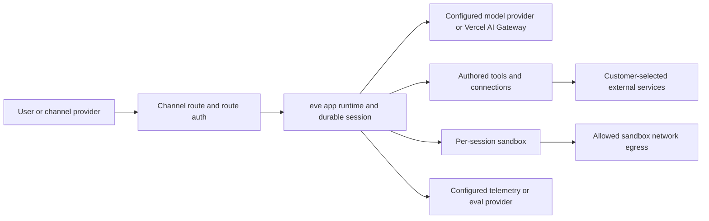

An eve agent runs in two contexts: the trusted app runtime and the isolated sandbox. Every secret stays in the app runtime. Use this model to decide what an agent, and the model driving it, can reach.

## Trust boundaries

|                         | App runtime  | Sandbox               |
| ----------------------- | ------------ | --------------------- |
| `process.env` / secrets | Yes          | No                    |
| Your Node.js code       | Yes          | No                    |
| Network                 | Unrestricted | Controlled by policy  |
| Filesystem              | App's own    | Isolated `/workspace` |

The app runtime is the trusted side. Your tool implementations, model calls, connections, and session state run here, with `process.env` and full Node.js available. On Vercel, this is a Vercel Function.

The sandbox is the isolated side. It has its own `/workspace` filesystem but no `process.env`, no secrets, and no path back into the app runtime. On Vercel, each sandbox is a [Vercel Sandbox](https://vercel.com/docs/sandbox) microVM with hardware-level isolation.

Only shell commands execute in the sandbox. The built-in `bash`, `read_file`, `write_file`, and `edit_file` tools, and opt-in tools such as `glob` and `grep`, run in the app runtime and _proxy_ into the sandbox.

The model sees only tool definitions and results. When the model calls a custom `charge_card` tool, its `execute` runs in the app runtime, reads `process.env.STRIPE_KEY`, calls Stripe, and returns `{ ok: true }`. The model sees only `{ ok: true }`, and the call never touches the sandbox.

The [just-bash provider](../sandbox/just-bash) has a weaker boundary. Its shell is a JavaScript interpreter with a virtual filesystem inside the app runtime process, with no network isolation. Any `experimental.customCommands` you register run as host application code outside the virtual filesystem. Use a Vercel or Docker sandbox when the model runs commands you would not run in the app runtime.

See [Agent loop and sandbox](./execution-model-and-durability#agent-loop-and-sandbox) for how eve connects these contexts while keeping their state and lifetimes separate.

## Data flow at a glance



eve sends data only where your agent configuration sends it:

- Inbound channel data flows through the channel provider you configure, then into the eve app runtime.
- Model inputs and outputs flow to the model selected in `agent.ts`, such as a Vercel AI Gateway model id or a provider model instance (`EveLanguageModel`).
- Tool and connection calls flow to the external services, MCP servers, OpenAPI endpoints, and channels you configure.
- Sandbox commands can reach network destinations allowed by the sandbox network policy.
- Telemetry flows to destinations configured under `agent/instrumentation/`.
  By default, eve also records local traces during `eve dev` and exports to
  Vercel Agent Runs in preview and production.
- Eval data flows to the reporters configured in eval settings.

eve stores the session and workflow state it needs to resume conversations, stream events, replay completed steps, and show run observability.

You decide whether your channels, model providers, connected services, and sandbox egress destinations suit your data and use case. The same applies to telemetry exporters, retention settings, and deletion controls.

## Credential brokering

Credential brokering gives the model _authenticated_ network access from inside the sandbox, such as a `git clone` of a private repo. Use it when no [tool](../tools) or [connection](../connections) can route the call. On the Vercel Sandbox backend, the sandbox's network firewall injects auth headers for matching domains. The secret stays in the app runtime, and the sandbox process sees only the response. See [Vercel Sandbox Credential Brokering](https://vercel.com/docs/sandbox/concepts/firewall#credentials-brokering) for the platform mechanism, and [Sandbox](../sandbox) for the eve policy API.

## Connection credentials

[Connection](../connections) tokens (MCP and OpenAPI) come from either `getToken()` or an interactive OAuth flow. eve injects the resolved token into every outbound request and never saves it in session state.

## Channel verification

A [channel](/docs/channels) authenticates its own inbound traffic. The built-in platform channels follow two rules, and so must any channel you write:

- **Verify signatures in constant time.** Platform channels (Slack, GitHub,
  Telegram, Twilio) verify the platform's HMAC signature over the raw request
  body. They compare in constant time, so response timing can't reveal a forged
  signature. Never use `===` on a signature or secret.
- **Don't trust body-supplied identity.** Derive the caller from a _verified_
  signature or token. Never use a `principalId` (or similar) from the request
  body, because a body field is attacker-controlled.

## Shared sessions

Several people can share one session, such as a Slack thread or a GitHub issue. A turn's caller is the person whose message started it, and the caller never changes while the turn runs. Their own messages update only their claims.

Anyone the channel lets into the session can steer the running turn. Their message changes what the model reads, never whose identity the turn uses. `ctx.session.auth.sender` names who spoke last. When the speaker changes, eve adds a line before the message that names its sender and the previous sender by `principalId`. A message joins even while the turn waits on an approval, sign-in, or question.

### Protect tools in a shared session

eve protects the caller's tokens and forwarded identity on its own. It doesn't know what else your code authorizes from the caller. For an agent that more than one person can reach, set `approval: steered()` in `agent.ts`. After someone else's message joins the turn, every call the model makes asks the caller first. A session with one person never asks.

```ts title="agent/agent.ts"
import { defineAgent } from "eve";
import { steered } from "eve/tools/approval";

export default defineAgent({
  model: "anthropic/claude-sonnet-4.6",
  approval: steered(),
});
```

| If your code                                                                                                                               | Do this                                                                                                                                                                         |
| ------------------------------------------------------------------------------------------------------------------------------------------ | ------------------------------------------------------------------------------------------------------------------------------------------------------------------------------- |
| Gets the caller's token from a `principalType: "user"` connection or `ctx.getToken()`, or uses a `forwardPrincipal` connection             | Nothing more. eve asks the caller first.                                                                                                                                        |
| Calls a remote agent that forwards the caller                                                                                              | Set `steered()`. Without it, the call fails until the caller speaks.                                                                                                            |
| Decides from the caller's role or tenant, or picks a credential for the caller, such as an app token, a tenant API key, or `ctx.to()` auth | Set `steered()`, or refuse unless `auth.sender` passes the same check. `samePrincipal(auth.sender, auth.current)` from `eve/context` tells you whether they're the same person. |
| Offers a dynamic skill or instructions from the caller's attributes                                                                        | Check `auth.sender` as well. `steered()` gates calls, not what the model reads.                                                                                                 |
| Uses a memory slot scoped to the caller                                                                                                    | Set `steered()` to gate the slot's tools. Memory recalled at the turn's start stays in context.                                                                                 |
| Admits only people who may act for each other, such as a fixed team in a channel hook                                                      | Checking `auth.current` is enough.                                                                                                                                              |

`once()` doesn't depend on who spoke: its approval keeps covering a tool after someone else speaks. `turnPolicy: "queue"` keeps a message out of a running turn, but a queued message still joins a turn that waits on an approval or sign-in. See [Ask the caller after someone else speaks](/docs/human-in-the-loop#ask-the-caller-after-someone-else-speaks) for how `steered()` works with a tool's own approval.

These checks gate new calls only. The model can still answer from what is already in the conversation, and a token a tool configured in the sandbox works for later commands until it expires or the tool removes it.

### How eve protects the caller's identity

eve hands the caller's identity to a call when the caller sent the latest message the model read as it made the call. It also does so when the caller approved that call, or approved an earlier one since anyone else last spoke. After someone else's message joins the turn, a call that uses the caller's identity stops before it gets it:

| Call                                                                                           | Identity it uses                        |
| ---------------------------------------------------------------------------------------------- | --------------------------------------- |
| A tool of a `principalType: "user"` connection, or `ctx.getToken()` for a user-scoped provider | The caller's token                      |
| A tool of a `forwardPrincipal` connection                                                      | The caller, forwarded                   |
| A remote agent that forwards the caller                                                        | The caller, forwarded                   |
| Creating a [dynamic schedule](../experimental/dynamic-schedules) or replacing its payload      | The caller, as the schedule's creator   |
| Subscribing to an MCP connection's [events](../connections/mcp#events-experimental)            | The caller, as the watch's creator      |
| [`openCodeChannel()`](../channels/slack#enable-code-channels)                                  | The caller, as the new session's caller |

Where the session can ask for input, eve asks the caller to approve the call. The request names the call by its tool and each input field, and quotes the latest message from someone else in the turn. It also says that approving lets later calls use the caller's identity, on any account, until someone else sends a message after the request. Only the caller can approve it, and anyone signed in can cancel it. Approving runs the tool again from its first line with the caller's identity. See [Approvals for a person's identity](/docs/human-in-the-loop#approvals-for-a-persons-identity).

Where eve can't ask, the call fails and eve doesn't retry it. That covers sessions that can't request input, such as scheduled runs, and token or connection calls in a workflow tool's own code. A connection or `ctx.getToken()` call fails with `ConnectionAuthorizationFailedError` and `reason: "confirmation_required"`. `openCodeChannel()` returns `unavailable`. Each message tells the model to ask the caller to confirm, and to retry only after a reply that plainly confirms the action. The caller's next message makes them the last to speak.

eve never asks before a call to a remote agent that forwards the caller. That call fails with a terminal error, which isn't a `ConnectionAuthorizationFailedError`, until the caller speaks or approves a call. With `steered()`, eve asks the caller before the call instead.

The caller's approval covers that call and later calls that use their identity, until anyone other than the caller sends a message. The next message from someone else, including the same person again, makes eve ask again. Approving a request after someone else's newer message covers only that call. A local subagent and a remote agent that forwards the caller honor the approval as it stood when the model called them, as does an agent a workflow tool calls. A token or connection call in a workflow tool's own code doesn't, so it keeps failing until the caller speaks.

An approval never changes `auth.sender`; only a message does. A call the caller approves reads the caller as `auth.sender`, but later calls their approval covers still read the other person. Another person's approval, which a `response` policy allows, doesn't release the caller's identity.

A call that waits on an approval or sign-in while the turn reads new messages runs as the model made it. Its `auth.sender` is whoever had spoken last when the model made the call, whatever messages arrive before it runs. A call the caller approves runs with the caller's identity. Completing a sign-in isn't an approval: a call that waited only for a sign-in keeps the sender it was asked under.

eve's own role checks cover both people. When someone other than the caller spoke last, the git extension's `gh` tool with app tokens and deployed self-modification call `authorize` for the caller and for that person, and need both to pass. A `gh` command that the caller approves itself reads the caller as its sender, so `authorize` runs only for the caller.

Another person can still answer a pending request with a button or structured answer. They are recorded as its responder, and the turn keeps its caller. See [What reaches `ctx.session.auth`](../guides/auth-and-route-protection#what-reaches-ctxsessionauth).

## Authored markdown is data

[Skill](../skills) and [schedule](../schedules) frontmatter is data: it must parse to a plain YAML object. A fence that names any language other than YAML, such as `---js`, throws instead of evaluating code.

## Auth fails closed

Routes reject unauthenticated traffic by default. If no `AuthFn` in the walk accepts the request, it gets a `401`; admitting anonymous callers takes an explicit `none()`. The scaffold's `placeholderAuth()` keeps a half-configured app closed in production until you replace it. See [Auth & route protection](../guides/auth-and-route-protection) for the full walk and verifiers.

## Pre-production checklist

Before exposing an agent to real traffic:

- [ ] Replace `placeholderAuth()` in `agent/channels/eve.ts` with a real
      `AuthFn` (`vercelOidc()`, `httpBasic()`, `oidc()`, or your own). Verify an
      unauthenticated production request gets `401`.
- [ ] Verify channel signatures. Each platform channel needs its signing
      secret set; custom channels must verify signatures in constant time and never
      trust body-supplied identity.
- [ ] Keep secrets in `process.env`, never in compiled artifacts, never
      passed into the sandbox. Route privileged calls through tools or connections.
- [ ] Limit connection tokens to the least privilege the agent needs; they
      reach hosts but never the model.
- [ ] Set a sandbox network policy tighter than `allow-all` if the model
      shouldn't have open egress; use credential brokering for authenticated egress.
- [ ] Don't surface untrusted text as markup. Model- or user-controlled
      strings rendered into a channel UI should be escaped for that surface.
- [ ] If more than one person can reach a session, such as a Slack thread or a
      GitHub issue, set `approval: steered()` in `agent.ts` or check
      `auth.sender` in code that authorizes from the caller. See
      [Shared sessions](#shared-sessions).

## What to read next

- [Auth & route protection](../guides/auth-and-route-protection): the full auth walk and verifier helpers
- [Sandbox](../sandbox): backends, network policy, and brokering config
- [Execution model and durability](./execution-model-and-durability): how sessions run and resume
- [Connections](../connections): static-token and OAuth connections
- [Responsible use](../responsible-use): deployer responsibilities and safeguards to review before production
