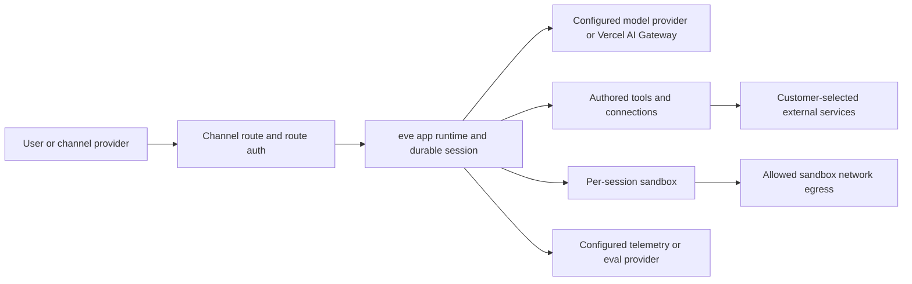

An eve agent runs in two contexts: the trusted app runtime and the isolated sandbox. Every secret stays in the app runtime. Use this model to decide what an agent, and the model driving it, can reach.

## Trust boundaries

|                         | App runtime  | Sandbox               |
| ----------------------- | ------------ | --------------------- |
| `process.env` / secrets | Yes          | No                    |
| Your Node.js code       | Yes          | No                    |
| Network                 | Unrestricted | Controlled by policy  |
| Filesystem              | App's own    | Isolated `/workspace` |

The app runtime is the trusted side. Your tool implementations, model calls, connections, and session state run here, with `process.env` and full Node.js available. On Vercel, this is a Vercel Function.

The sandbox is the isolated side. It has its own `/workspace` filesystem but no `process.env`, no secrets, and no path back into the app runtime. On Vercel, each sandbox is a [Vercel Sandbox](https://vercel.com/docs/sandbox) microVM with hardware-level isolation.

Only shell commands execute in the sandbox. The built-in `bash`, `read_file`, `write_file`, and `edit_file` tools, and opt-in tools such as `glob` and `grep`, run in the app runtime and _proxy_ into the sandbox.

The model sees only tool definitions and results. When the model calls a custom `charge_card` tool, its `execute` runs in the app runtime, reads `process.env.STRIPE_KEY`, calls Stripe, and returns `{ ok: true }`. The model sees only `{ ok: true }`, and the call never touches the sandbox.

The [just-bash provider](../sandbox/just-bash) has a weaker boundary. Its shell is a JavaScript interpreter with a virtual filesystem inside the app runtime process, with no network isolation. Any `experimental.customCommands` you register run as host application code outside the virtual filesystem. Use a Vercel or Docker sandbox when the model runs commands you would not run in the app runtime.

See [Agent loop and sandbox](./execution-model-and-durability#agent-loop-and-sandbox) for how eve connects these contexts while keeping their state and lifetimes separate.

## Data flow at a glance



eve sends data only where your agent configuration sends it:

- Inbound channel data flows through the channel provider you configure, then into the eve app runtime.
- Model inputs and outputs flow to the model selected in `agent.ts`, such as a Vercel AI Gateway model id or a provider model instance (`EveLanguageModel`).
- Tool and connection calls flow to the external services, MCP servers, OpenAPI endpoints, and channels you configure.
- Sandbox commands can reach network destinations allowed by the sandbox network policy.
- Telemetry flows to destinations configured under `agent/instrumentation/`.
  By default, eve also records local traces during `eve dev` and exports to
  Vercel Agent Runs in preview and production.
- Eval data flows to the reporters configured in eval settings.

eve stores the session and workflow state it needs to resume conversations, stream events, replay completed steps, and show run observability.

You decide whether your channels, model providers, connected services, and sandbox egress destinations suit your data and use case. The same applies to telemetry exporters, retention settings, and deletion controls.

## Credential brokering

Credential brokering gives the model _authenticated_ network access from inside the sandbox, such as a `git clone` of a private repo. Use it when no [tool](../tools) or [connection](../connections) can route the call. On the Vercel Sandbox backend, the sandbox's network firewall injects auth headers for matching domains. The secret stays in the app runtime, and the sandbox process sees only the response. See [Vercel Sandbox Credential Brokering](https://vercel.com/docs/sandbox/concepts/firewall#credentials-brokering) for the platform mechanism, and [Sandbox](../sandbox) for the eve policy API.

## Connection credentials

[Connection](../connections) tokens (MCP and OpenAPI) come from either `getToken()` or an interactive OAuth flow. eve injects the resolved token into every outbound request and never saves it in session state.

## Channel verification

A [channel](/docs/channels) authenticates its own inbound traffic. The built-in platform channels follow two rules, and so must any channel you write:

- **Verify signatures in constant time.** Platform channels (Slack, GitHub,
  Telegram, Twilio) verify the platform's HMAC signature over the raw request
  body. They compare in constant time, so response timing can't reveal a forged
  signature. Never use `===` on a signature or secret.
- **Don't trust body-supplied identity.** Derive the caller from a _verified_
  signature or token. Never use a `principalId` (or similar) from the request
  body, because a body field is attacker-controlled.

## A turn runs as one principal

By default, a turn's principal (its authenticator, issuer, principal type, and id) never changes while the turn runs; only its claims may update. `principalPolicy` is the one setting that changes this. Without `"retain-caller"` or `"adopt-sender"`, only the caller's messages steer the turn or answer its pending questions by text. In a shared thread, another person's message waits for the turn to end and then runs as their own turn. Another person can still settle a pending request with a button or structured answer, recorded as its responder, while the turn keeps its caller. See [What reaches `ctx.session.auth`](../guides/auth-and-route-protection#what-reaches-ctxsessionauth).

### Let another person's message join

`principalPolicy` decides what happens when a message arrives during a turn that runs as someone else:

| Value                      | Behavior                                                                                                                                                                                                 |
| -------------------------- | -------------------------------------------------------------------------------------------------------------------------------------------------------------------------------------------------------- |
| `"match-caller"` (default) | A message joins only a turn whose caller is its sender. Another person's message waits for the turn to end, then starts a turn as its sender.                                                            |
| `"retain-caller"`          | Another signed-in person's message joins the running turn as input. The turn retains its caller: `ctx.session.auth.current` and the turn ID stay the same.                                               |
| `"adopt-sender"`           | Another signed-in person's message joins the running turn. The turn adopts the sender as its caller from the next model call. `ctx.session.auth.current` becomes the sender; the turn ID stays the same. |

With no turn running, a message starts a turn as its sender, whatever its `principalPolicy`.

A `"retain-caller"` or `"adopt-sender"` message from another person joins only when three conditions hold. Its `turnPolicy` is `"steer"`, it has a signed-in sender, and no approval, question, or sign-in is open in the session. A message sent with `auth: null`, or as an anonymous caller, follows `"match-caller"`. While a request is open, the message waits. It joins when the turn continues, or starts its own turn if the turn ends first. If any other condition fails, it waits like a `"match-caller"` message.

A joined message steers like the caller's own, interrupting the model before it answers and ending waits on `execute` workflow tool calls; see [Overlapping messages](/docs/channels#overlapping-messages).

Set `principalPolicy` on a channel definition, such as `defineChannel({ principalPolicy: "retain-caller" })`, or in a built-in channel's config. Set it for one server-side send with `send(message, { auth, principalPolicy })`, or return it from a Slack message hook as `{ auth, principalPolicy: "adopt-sender" }`. A message's value wins over its channel's. It cannot be set from an HTTP request body or the client SDK, because it decides whose access a message can reach.

### Adopt the sender as the caller

With `"adopt-sender"`, the sender becomes the turn's caller from the next model call. `ctx.session.auth.current` is the sender, and `auth.initiator` does not change. `steeredBy` is absent, so the caller identity hold does not apply.

From that point, the turn can do only what the sender can do. Tools, approval policies, dynamic functions, and user-scoped credentials all see the sender as `ctx.session.auth.current`. Calls already running finish under the caller who started them. Work already in the conversation stays there.

The previous caller's later messages are another person's messages, and follow their own `principalPolicy`.

Use `"adopt-sender"` when the last person to speak should own the turn and that person has their own access. Use `"retain-caller"` when teammates may add input but only the caller's access should act.

### Who else steered the turn

`ctx.session.auth.steeredBy` lists the people, other than the caller, whose messages joined the running turn. The list covers messages since the caller last sent a message or approved a call. eve sets it only while at least one such person exists. Otherwise it is absent, including when a turn starts and in every session with one person. `if (ctx.session.auth.steeredBy)` therefore means someone else is steering this turn.

It is cleared when the caller sends a message, the caller approves a call, or a turn starts. A message that adopts its sender clears it. A message sent without a signed-in sender never releases the hold. A denial does not clear it, and an approval from anyone else does not clear it.

Read it anywhere `ctx.session` is available: tools, approval policies, dynamic functions, and hooks. A workflow tool call or local subagent started while it is set sees the same list.

### Caller identity hold

While `steeredBy` is set, a call the model makes cannot get the caller's identity from eve. The call fails before anything is sent, no sign-in starts, and the turn does not pause.

| Call                                                                                                  | Result                                                                        |
| ----------------------------------------------------------------------------------------------------- | ----------------------------------------------------------------------------- |
| The caller's token for a user-scoped connection's tools, `ctx.getToken()`, or `ctx.requireAuth()`     | Fails with `ConnectionAuthorizationFailedError` and `reason: "turn_steered"`. |
| A tool call on an MCP connection with `forwardPrincipal`                                              | Fails with the same error and reason.                                         |
| Connection event subscriptions                                                                        | Fails with the same error and reason.                                         |
| A call to a remote agent with `forwardPrincipal`                                                      | Fails with an error that carries the same message.                            |
| Dynamic schedule tools                                                                                | Fails with an error that carries the same message.                            |
| App-scoped credentials, or `ctx.approval.responder.getToken()`                                        | Available.                                                                    |
| eve's own listing of a connection's tools before a model call                                         | Available.                                                                    |
| A listing of a user-scoped connection's tools that a call starts through `eve__search` or `eve__tool` | Held; the connection shows as unavailable with the same message.              |

The model reads a message like:

```text
Another person's message joined this turn after its caller last spoke, so connection "github" can't use the caller's identity. Ask the caller to confirm in this conversation, then try again.
```

For a tool's own `ctx.getToken()` or `ctx.requireAuth()`, the subject is `tool "<tool name>"` instead of `connection "<name>"`.

The caller's next message, or the caller approving a call, releases the hold.

### Ask before a call while steered

`steered()` from `eve/tools/approval` asks the turn's caller before a call starts while `steeredBy` is set. Otherwise it returns `undefined`, which leaves the decision to the tool's and agent's other policies.

```ts title="agent/tools/refund_charge.ts"
import { defineTool } from "eve/tools";
import { steered } from "eve/tools/approval";
import { z } from "zod";

export default defineTool({
  description: "Refund a charge for the caller's tenant.",
  inputSchema: z.object({ chargeId: z.string() }),
  approval: steered(),
  async execute({ chargeId }, ctx) {
    return refund(chargeId, ctx.session.auth.current);
  },
});
```

Use `steered()` on a tool that authorizes from `ctx.session.auth.current` while using a shared credential, because eve cannot detect that check. Use it as the agent's `approval` in `agent.ts` to ask before every call made while steered. The caller gets an approval prompt instead of a failed call.

Among approvals, only the caller's own clears `steeredBy`. One approval covers later calls until someone else's message joins again. When the turn has no signed-in caller (`principalType` is not `"user"`), `steered()` denies the call instead of asking. An approval pauses the turn on the caller, so other people's messages wait until the caller answers. The identity hold alone never pauses a turn.

### Before you set a joining policy

- With `"retain-caller"`, tools that authorize from `ctx.session.auth.current` in their own code need `approval: steered()`.
- Dynamic functions run before every model call as the caller and are not calls. With `"retain-caller"`, read `steeredBy` there.
- Extension tools and subagents can check the caller too, and you can't add an approval to them. With `"retain-caller"`, set `approval: steered()` in `agent.ts` to ask the caller before every call made while steered. See [Gate every call from one policy](/docs/human-in-the-loop#gate-every-call-from-one-policy).
- The channel must show the model who sent each message. Slack does. eve adds no attribution.
- A steering message can ask the model to repeat anything already in the conversation.
- Memory: a turn is saved under the caller it has when it is saved. `"retain-caller"` saves it under the original caller; `"adopt-sender"` saves it under the sender. Messages other people sent are included.

## Authored markdown is data

[Skill](../skills) and [schedule](../schedules) frontmatter is data: it must parse to a plain YAML object. A fence that names any language other than YAML, such as `---js`, throws instead of evaluating code.

## Auth fails closed

Routes reject unauthenticated traffic by default. If no `AuthFn` in the walk accepts the request, it gets a `401`; admitting anonymous callers takes an explicit `none()`. The scaffold's `placeholderAuth()` keeps a half-configured app closed in production until you replace it. See [Auth & route protection](../guides/auth-and-route-protection) for the full walk and verifiers.

## Pre-production checklist

Before exposing an agent to real traffic:

- [ ] Replace `placeholderAuth()` in `agent/channels/eve.ts` with a real
      `AuthFn` (`vercelOidc()`, `httpBasic()`, `oidc()`, or your own). Verify an
      unauthenticated production request gets `401`.
- [ ] Verify channel signatures. Each platform channel needs its signing
      secret set; custom channels must verify signatures in constant time and never
      trust body-supplied identity.
- [ ] If a channel sets `principalPolicy: "retain-caller"`, add `approval: steered()` to every
      tool that authorizes from `ctx.session.auth.current` in its own code. Read
      `steeredBy` in dynamic functions. See [Before you set a joining policy](#before-you-set-a-joining-policy).
- [ ] Keep secrets in `process.env`, never in compiled artifacts, never
      passed into the sandbox. Route privileged calls through tools or connections.
- [ ] Limit connection tokens to the least privilege the agent needs; they
      reach hosts but never the model.
- [ ] Set a sandbox network policy tighter than `allow-all` if the model
      shouldn't have open egress; use credential brokering for authenticated egress.
- [ ] Don't surface untrusted text as markup. Model- or user-controlled
      strings rendered into a channel UI should be escaped for that surface.

## What to read next

- [Auth & route protection](../guides/auth-and-route-protection): the full auth walk and verifier helpers
- [Sandbox](../sandbox): backends, network policy, and brokering config
- [Execution model and durability](./execution-model-and-durability): how sessions run and resume
- [Connections](../connections): static-token and OAuth connections
- [Responsible use](../responsible-use): deployer responsibilities and safeguards to review before production
