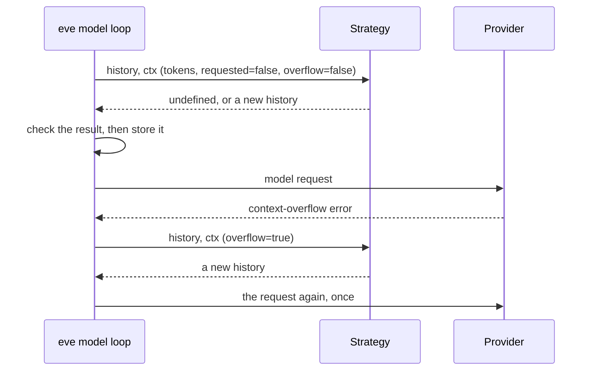

# Compaction strategies and OpenAI native compaction

> **AI status:** Written entirely by AI; human review pending.

Compaction on `main` is one fixed algorithm: once the next request would pass 90% of the context window, eve summarizes the older history into a text checkpoint. An agent can pick the summary model and the threshold, nothing else. This doc proposes `experimental: { compaction }` on `defineAgent`, a strategy function that decides both when and how the history is rewritten, and `openaiCompaction()`, a strategy that uses OpenAI's own compaction instead of a text summary. Stable `compaction` does not change.

## Why

1. **An agent can't choose how to compact.** Keeping the newest whole turns within a budget, clearing old tool outputs, or keeping only the newest user messages can't be written on eve today.
2. **A text summary loses work on OpenAI models.** In [eve#6735](https://github.com/vercel/eve/issues/6735), OpenAI reports that on Responses models a text rewrite of the history drops reasoning state and details from earlier tool results. In their synthetic task (400 customers, threshold 0.35, `gpt-6.1-sol`) a run with eve's text compaction re-read the same records 680 times, and 12 times with OpenAI's native compaction. At 2,000 customers and 0.9 the text run stopped at the observation limit after 2,100 re-reads. These are the issue author's numbers, not a general speed or cost claim.
3. **Whatever decides when must see the real size and be able to decline.** [eve#5290](https://github.com/vercel/eve/pull/5290) found that a compaction that can't get under the threshold compacts again on every step: ten steps cost $4.19 against $0.67 after the fix.

## Authoring API

A strategy is one function. It receives the stored history and a context, and returns the history to keep, or `undefined` to keep the history as it is.

```ts title="agent/agent.ts"
import { defineAgent } from "eve";
import { type CompactionStrategy } from "eve/experimental/compaction";

const keepLatestTurn: CompactionStrategy = async (history, ctx) => {
  const window = ctx.model.contextWindowTokens;
  if (!ctx.requested && !ctx.overflow && (window === undefined || ctx.tokens < 0.8 * window)) {
    return undefined;
  }
  const latest = history.findLastIndex((m) => m.role === "user" && m.kind === "user");
  const { text } = await ctx.call({
    messages: [
      ...history.slice(0, latest),
      {
        role: "user",
        kind: "context.compaction",
        content: "Summarize the conversation above.",
      },
    ],
  });
  return [
    {
      role: "user",
      kind: "context.compaction",
      content: "Summary of our conversation so far:",
    },
    { role: "assistant", content: text },
    ...history.slice(latest),
  ];
};

export default defineAgent({
  model: "anthropic/claude-opus-5.5",
  experimental: { compaction: keepLatestTurn },
});
```

`eve/experimental/compaction` exports `CompactionStrategy`, `CompactionContext`, `StoredHistoryMessage`, `CompactionOverflowError`, `defaultCompaction()`, `openaiCompaction()` and `withoutInjected()`. A strategy is set as `experimental: { compaction }` on `defineAgent`, or on a `ModelSelection` that a `defineDynamic` callback returns, so an agent that switches models can compact each its own way. Setting both a strategy and the agent's `compaction` rejects the agent.

### What the context holds

| Field                                                               | Meaning                                                                                                                                                                                                                                                                    |
| ------------------------------------------------------------------- | -------------------------------------------------------------------------------------------------------------------------------------------------------------------------------------------------------------------------------------------------------------------------- |
| `ctx.tokens`                                                        | The next request's input tokens: the provider's count for the last request plus eve's estimate of what joined the history since. Includes instructions, tools and recalled memory.                                                                                         |
| `ctx.requested`                                                     | `true` only when a client called `session.compact()`.                                                                                                                                                                                                                      |
| `ctx.overflow`                                                      | `true` only on the retry after the provider rejected a request as longer than the context window. Never `true` together with `requested`.                                                                                                                                  |
| `ctx.recompacting`                                                  | `true` when the previous rewrite didn't leave room and the history was due again within one response.                                                                                                                                                                      |
| `ctx.model`                                                         | The session model's `provider`, `modelId`, `contextWindowTokens` and `maxOutputTokens`.                                                                                                                                                                                    |
| `ctx.estimate(messages)`, `ctx.fixedTokens`, `ctx.estimateRatio`    | eve's estimate of a message list, what the request holds besides the history, and the measured ratio of the provider's count to the estimate.                                                                                                                              |
| `ctx.call({ messages, model?, system?, tools?, providerOptions? })` | Calls a model and returns `{ messages, text }`. eve sends exactly `messages`, billed to the compaction. `system` defaults to the agent's instructions, `tools` to `"none"`, `model` to the turn's model. A request past the window rejects with `CompactionOverflowError`. |

The threshold is not on the context. Each strategy keeps its own `threshold` option, so one strategy owns one budget.

### Built-in strategies

- `defaultCompaction({ model?, instructions?, threshold? })` is today's compaction as a strategy, and what runs when no strategy is set. It caps oversized tool results in older history and summarizes when capping doesn't fit. `threshold` defaults to 0.9. It counts the 406-token checkpoint prompt it adds, so it starts slightly before the conversation alone reaches the threshold, as `main` does. It reads only the public context.
- `openaiCompaction({ fallback?, threshold? })` is described below.
- `withoutInjected(history)` removes the messages eve adds to every request (memory, instructions, state, the previous checkpoint) so a strategy doesn't summarize them. eve adds them again after the compaction.

## Lifecycle

eve asks the strategy before every model-call attempt, retries included, and on `session.compact()`. It never asks at turn end.



- **Overflow.** With a strategy set, a provider's context-overflow error asks the strategy once more with `ctx.overflow` and retries the call once. Without a strategy, the error fails the turn, as on `main`.
- **Checks.** eve checks every result before storing it. A result fails the compaction and leaves the history unchanged when it drops a tool call or its result, answers a call twice or before it is made, drops half of a provider-executed exchange, puts a checkpoint after other messages, removes a user message's `kind`, or doesn't fit the window beside instructions, tools and recall. When a strategy fails, eve compacts with the fallback strategy instead, `defaultCompaction()` unless `experimental.compaction` is `{ strategy, fallback }` with another one, and logs why.
- **Isolation.** The strategy receives a copy of the history, so mutating it changes nothing.
- **Repeat detection.** In development and tests, a strategy that rewrites what it just returned fails, which catches the every-step loop from eve#5290.

## OpenAI native compaction

OpenAI's Responses API can compact on the server and return a `compaction` output item with encrypted content that replaces the history it covers ([OpenAI's compaction guide](https://developers.openai.com/api/docs/guides/compaction)). Only OpenAI can read it.

```ts title="agent/agent.ts"
import { defineAgent } from "eve";
import { openaiCompaction } from "eve/experimental/compaction";

export default defineAgent({
  model: "openai/gpt-5",
  experimental: { compaction: openaiCompaction({ threshold: 0.8 }) },
});
```

- **When.** Past `threshold` of the window (0.9 by default), or at any size when `ctx.requested` or `ctx.overflow` is set.
- **How.** One `ctx.call()` sends the turn's request with `providerOptions.openai.compactionTrigger: true`, the `compaction_trigger` input item. `@ai-sdk/openai` supports only the trigger, not `POST /v1/responses/compact`. The returned `openai.compaction` record, followed by the latest user message (OpenAI rejects a `store: false` request with no user message), becomes the stored history, and eve replays the record on every later request: inline with its encrypted content when `store: false`, by `item_reference` when the provider keeps the response.
- **Fallback.** Another model, a failed call, or an answer with no record compacts with `fallback` (`defaultCompaction({ threshold })` by default), and eve logs why. When the history already holds a record, eve keeps it and tries again later, because a text summary would drop what the record holds.
- **Model switch.** A session that moves to another model after a compaction sends the history without the record and logs a warning on each request.
- **AI Gateway.** It works with `openai("gpt-...")` and with a Gateway string such as `"openai/gpt-5"`. The record must reach OpenAI, so eve sets `providerOptions.gateway.only: ["openai"]` on the compaction request and on every later request that holds the record. An app's own `gateway.only` replaces eve's on the later requests; on the compaction request eve narrows the app's list, and when that list excludes `openai` it compacts with the fallback.
- **Prompt cache.** Measured on `openai/gpt-6.1-sol` through AI Gateway over two compactions: the first two requests after a compaction read only the instructions and tools from the cache (2,553 tokens), and the third read 10,908 of 18,461 input tokens. eve sends the same prefix on the first two, so the miss is on OpenAI's side. OpenAI's [caching guide](https://developers.openai.com/api/docs/guides/prompt-caching) says only that compaction "can prevent reuse from the first changed token onward".

### Why a strategy and not an `openai()` option

eve#6735 proposed `openai("gpt-...", { compaction: "native" })`. It is a strategy because compaction already has one place that decides it, a Gateway string takes no options, and the trigger, checks, usage accounting and fallback all come from the strategy API. It stays under `experimental` while the strategy contract settles.

## Alternatives

| Approach                                                                                                                     | Why not                                                                                                                                                                                                      |
| ---------------------------------------------------------------------------------------------------------------------------- | ------------------------------------------------------------------------------------------------------------------------------------------------------------------------------------------------------------ |
| `shouldCompact()` plus `compact()` ([eve#5332](https://github.com/vercel/eve/pull/5332))                                     | Two functions for one decision; replaced by authored strategies.                                                                                                                                             |
| A hook calls `ctx.compact()` ([eve#5410](https://github.com/vercel/eve/pull/5410))                                           | Puts "when" in hooks. Owen's research ([eve#5361](https://github.com/vercel/eve/pull/5361)) took the hook trigger out.                                                                                       |
| `compaction: { threshold, compact }` with `ctx.summarize()` ([eve#5573](https://github.com/vercel/eve/pull/5573))            | Parked until history came from one place; [eve#5609](https://github.com/vercel/eve/pull/5609) then gave every model call and `session.compact()` one path, `historyBeforeCall`, which this proposal runs on. |
| A `when` map of session events and fractions, with turn-end compaction ([eve#5661](https://github.com/vercel/eve/pull/5661)) | A second place that decides when, beside the strategy. Deleted with `compactAtTurnEnd` and the event types.                                                                                                  |

## Relation to the session kernel

Owen's [session kernel research](https://github.com/vercel/eve/pull/5644) asks one question before each model call, with size passed as data and `session.compact()` setting a flag. The harness `compact` stage in [eve#6305](https://github.com/vercel/eve/pull/6305) (not on `main`) has `tokens` and `requested` on its context and is never called at turn end. This proposal uses the same names, so a strategy can become a `compact` stage when `defineHarness` lands. It differs in two places: the threshold lives in each strategy's options, not the context, and `ctx.overflow` is new, because these PRs add recovery from a provider's overflow error.

## Real-path test

- `e2e/fixtures/agent-compaction-strategy` runs a custom strategy that keeps the latest turn past 20% of the window, plus a manual `session.compact()` eval (`evals/manual.eval.ts`).
- The request-layout goldens `native-compaction.requests.json` and `native-compaction.state.json` pin the compaction request and the replayed record.
- A probe in eve's CI with a real AI Gateway key on `openai/gpt-6.1-sol` returned the record and replayed it, with default options and with `store: false`.
