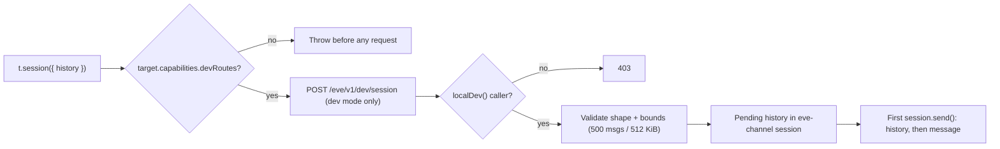

# Starting eval sessions from fixed history

## Problem

Eval authors want to grade a reply against an exact earlier conversation without running those earlier turns through a live model. Driving the prefix with `session.send()` burns extra model calls, slows down eval runs, and produces a different conversation prefix on every run.

Sessions can already start from prior history (`#4477`), but only server-authored code can supply it: a channel's `create()` and `send()`, or `eveChannel({ onMessage })`. That design deliberately kept `history` off `POST /eve/v1/session` and `eve/client`, because a client that can write prior assistant turns can make an agent treat arbitrary fabricated conversation as its own.

The design goal is twofold:

1. Let evals start a session from fixed prior conversation with zero production auth boilerplate.
2. Guarantee structurally that client-supplied history cannot leak into production deployments or pollute `eve/client` and `POST /eve/v1/session`.

## Design phases

We split the design into two backward-compatible phases. The eval authoring API (`t.session({ history })`) is identical in both phases, and neither phase exposes `history` on `eve/client` or `POST /eve/v1/session`.

- **Phase 1 (this change): Dev-only host route (`POST /eve/v1/dev/session`).** Covers local `eve eval` runs and CI runs that boot the local dev server. The route is omitted from production builds entirely.
- **Phase 2 (future, when preview `--url` targets need it): Dedicated eval control plane (`/eve/v1/eval/*` + `eveChannel({ evals })`).** Extends the same eval API to deployed preview targets behind an environment kill-switch and dedicated eval auth, unifying eval-only primitives without adding `allow*` boolean sprawl to `EveAuthResult`.

## Phase 1: Dev-only session creation (implemented)

### Authoring API

```ts title="evals/support/case-after-redirect.eval.ts"
import { defineEval } from "eve/evals";

export default defineEval({
  async test(t) {
    const session = await t.session({
      history: [
        { role: "user", text: "How do I redirect www.example.com to example.com?" },
        { role: "assistant", text: "Add both domains, then configure the redirect." },
      ],
    });

    const turn = await session.send("Can we submit a case anyway?");
    t.succeeded();
    t.judge("Offers to open a support case without repeating the redirect steps", {
      on: turn.reply,
    }).atLeast(0.7);
  },
});
```

- `EveEvalSessionOptions` from `eve/evals` extends `CreateSessionOptions` with `readonly history?: readonly SessionHistoryMessage[]`.
- `EveEvalContext.session(options?: EveEvalSessionOptions)` accepts `history` (and continues to accept `stubs`, `headers`, and `signal`).
- `eve/evals` exports `EveEvalSessionOptions` and `SessionHistoryMessage`.
- `eve/client` (`CreateSessionOptions`), `POST /eve/v1/session`, `EveAuthResult`, and `eveVercelOidc` do not change. The `#4477` invariant that `POST /eve/v1/session` never accepts client-supplied history remains intact.

### Semantics and boundary



- **Build-time omission:** `createHostRouteTable` mounts `POST /eve/v1/dev/session` only when `mode === "development"`, beside `POST /eve/v1/dev/schedules/:scheduleId`. `eve build` (`mode === "production"`) never compiles or mounts it.
- **Local caller guard:** Even in development mode, the handler checks `config.kind === "development"` (returning `404` otherwise) and runs `localDev()` (returning `403` for non-dev runtimes, cross-site browser origins, non-loopback hosts, and remote LAN peers).
- **Zero config for local evals:** `eve eval` starts its local dev server with `EVE_DEV=1` on `127.0.0.1`, so `t.session({ history })` works out of the box without modifying `agent/channels/eve.ts`.
- **Same session lifecycle:** The dev route resolves the compiled `eve` channel's adapter, name, and configured `auth` (enforcing `allowToolStubs` when `stubs` is also passed and preserving the authenticated principal for `auth` and `audienceAuth`), and creates a message-free session with `input: { history }`. History waits in pending session state until the first `session.send()` (which goes through normal `POST /eve/v1/session/:sessionId`, channel auth, and `onMessage`), joins model history ahead of the first message, and records in `delivery.consumed` `data.history`. No turn, model call, tool, or hook runs for imported entries.
- **Strict and bounded input:** The route requires `history`, accepts only `history` and `stubs`, rejects unknown fields with `400`, caps `history` at 500 messages and 512 KiB UTF-8, and validates entries with `validateSessionHistory`. Invalid history or stub targets return `400`, raised by the eval runner as a `ClientError`.
- **Fail-fast on production targets:** When `target.capabilities.devRoutes` is `false` (for example `eve eval --url <production>`), `t.session({ history })` throws immediately before issuing a request. Without `history`, `t.session()` continues to use `client.sessions.create()` unchanged.

## Phase 2: Dedicated eval control plane (future)

If teams later need `t.session({ history })` (or other eval-only setup) against deployed Vercel Preview targets (`eve eval --url "$PREVIEW_URL"`), Phase 1 evolves cleanly into a dedicated eval control plane without changing eval code or touching `POST /eve/v1/session` or `eve/client`:

- **Dedicated route namespace:** Introduce `/eve/v1/eval/*` (starting with `POST /eve/v1/eval/sessions`, and unifying stub verification, schedule dispatch, and future eval state seeding under one namespace).
- **Hard production kill-switch:** `/eve/v1/eval/*` unconditionally returns `404` when `VERCEL_ENV === "production"` (and is disabled by default on self-hosted production `eve start`). Even a misconfigured auth callback cannot expose eval routes in production.
- **Dedicated eval auth instead of `allow*` booleans:** Rather than expanding `EveAuthResult` and `eveVercelOidc` with per-feature flags (`allowToolStubs`, `allowHistoryImport`, …), agents opt in to remote preview evals once on `eveChannel` using ordinary `AuthFn` helpers:

```ts title="agent/channels/eve.ts (Phase 2 concept)"
import { eveChannel } from "eve/channels/eve";
import { localDev, vercelOidc, vercelSubject } from "eve/channels/auth";

export default eveChannel({
  auth: [appSession(), vercelOidc(), localDev()],
  evals: {
    auth: vercelOidc({
      subjects: [
        vercelSubject({ teamSlug: "acme", projectName: "eval-runner", environment: "preview" }),
      ],
    }),
  },
});
```

- **Local zero-config preserved:** Under local `eve eval`, the runner continues to authenticate automatically against the local dev server with no edits to `agent/channels/eve.ts`.
- **Backward compatibility:** Existing `t.session({ history })` and `t.session({ stubs })` evals require no changes when migrating from Phase 1 to Phase 2.

## Non-goals

- Assistant file attachments or files inside imported tool-result outputs. User file attachments and completed assistant tool exchanges are specified in [`session-history-parts.md`](./session-history-parts.md) and apply automatically to `t.session({ history })`.
- Client-supplied history on `POST /eve/v1/session`, `eve/client`, or follow-up message requests.
- `history` on `t.send()`.
- Per-turn scripted replies (`AX-5300`), which run the turn lifecycle rather than importing prior context.
- Running fixed-history seeding against live production deployments.

## Validation

- **Unit:** `host-routes.test.ts` (mounted in `development`, omitted in `production`), `dev-session-create.test.ts` (mode guard, `localDev` origin/peer guard, strict fields, history validation and bounds, stub validation, runtime dispatch), and `session-manager.test.ts` (`devRoutes` fail-fast, routing with and without `history`, `stubs` composition, `ClientError` propagation).
- **Integration:** `host-routes.integration.test.ts` (`POST /eve/v1/dev/session` dispatches in development and returns `404` in production).
- **E2E:**
  - `e2e/fixtures/agent-channels/evals/seeded-history/eval-history.eval.ts` (mock model): tests isolated seeded histories, `delivery.consumed`, `turn.settled`, transcript, follow-up continuity, and invalid role rejection when `devRoutes` is true; verifies `POST /eve/v1/dev/session` returns `404`, `POST /eve/v1/session` rejects `history` with `400`, and `t.session({ history })` fails fast on deployed production targets (`e2e-vercel`, `e2e:postgres`).
  - `e2e/fixtures/agent-tool-stubs/evals/seeded-history.eval.ts` (`real-model`, full model matrix): verifies `t.session({ history, stubs })` works end-to-end on real models, completing the named task from seeded history before listing remaining tasks (`toolOrder(["complete_task", "list_tasks"])`).
