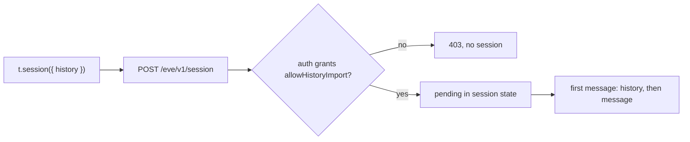

# Starting eval sessions from fixed history

> **AI status:** Written entirely by AI; human review pending.

## Summary

Eval authors want to grade one reply against an exact earlier conversation. Today they have to
generate that conversation first with live `session.send()` turns, which costs model calls and
gives a different prefix on every run.

Sessions can already start from prior history (#4477), but only authored server code can supply
it: a channel's `create()` and `send()`, or the eve channel's `onMessage`. That design left
client-supplied history out on purpose, because a client that can write assistant turns can make
the agent read any conversation as its own.

This plan lets an eval supply history through the eve channel's create request, behind a grant
that only the target's verified route auth can give.

## Authoring API

```ts
const session = await t.session({
  history: [
    { role: "user", text: "How do I redirect www.example.com to example.com?" },
    { role: "assistant", text: "Add both domains, then configure the redirect." },
  ],
});
const turn = await session.send("Can we submit a case anyway?");
```

`t.session()` takes the client's `CreateSessionOptions`, so the option is
`CreateSessionOptions.history`, a list of the existing `SessionHistoryMessage` (`id?`, `role`,
`text`). `client.sessions.create({ history })` and `client.sessions.create({ message, history })`
accept it too. `eve/client` and `eve/evals` export the type.

The target grants the permission in its eve channel, next to `allowToolStubs`:

```ts
eveVercelOidc({
  subjects: [{ subject: evalRunner, allowHistoryImport: true }],
});
```

`EveAuthResult.allowHistoryImport` is the flag a custom authenticator returns.

## Semantics

- **Same import as `create()`.** The route passes the entries to session creation as
  `input.history`, the path a channel's `create({ history })` already uses. They wait in session
  state, join model history with the first accepted message, and are recorded in
  `delivery.consumed` `history`. No turn, model call, tool, hook, or channel delivery runs for
  them, and compaction, handoff, and `clear()` treat them as ordinary history afterwards.
- **Create only.** `POST /eve/v1/session` accepts `history`, with or without a message.
  Follow-up requests keep rejecting it as an unknown field. With a message, the request's
  history comes before any history `onMessage` returns for that message.
- **Granted per request.** A create request with `history` needs `allowHistoryImport: true` in
  the route auth result, or it gets `403` and creates nothing. Request JSON and `onMessage`
  can't grant it, user principals never get it from `eveVercelOidc` subjects, and eve drops the
  flag before it saves or forwards the identity. `localDev()` doesn't grant it either, so a
  local target opts in the same way a deployed one does.
- **Strict input.** The route reuses `validateSessionHistory`. A malformed list, an unsupported
  role, empty text, a repeated id, or an unknown field answers `400` with the entry and rule,
  which the client raises as a `ClientError`. A server without this feature rejects the unknown
  `history` field the same way, so nothing is dropped silently.

## Boundary



The grant is separate from `allowToolStubs`. Stubs change what tools return; history changes
what the agent believes it said. A team can allow one without the other.

## Non-goals

- A separate entry shape for evals. This option takes whatever `SessionHistoryMessage` accepts,
  which includes completed tool calls; see `session-history-tool-calls.md`. Files stay with #5340.
- History on follow-up requests, or as an option of `t.send()`.
- Scripted replies for the turn under test. Imported history is context eve did not run; a
  scripted reply runs the turn's lifecycle and needs its own design.

## Validation

- Unit: the grant, including body and `onMessage` attempts to supply it; `eveVercelOidc`
  subject grants; rejected shapes; the client request body.
- E2E: two sessions start from different histories, each answers its first message from its own,
  a later turn still reads it, exactly one turn settles, and an unsupported role is rejected.
