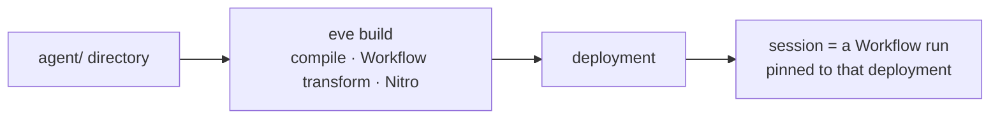
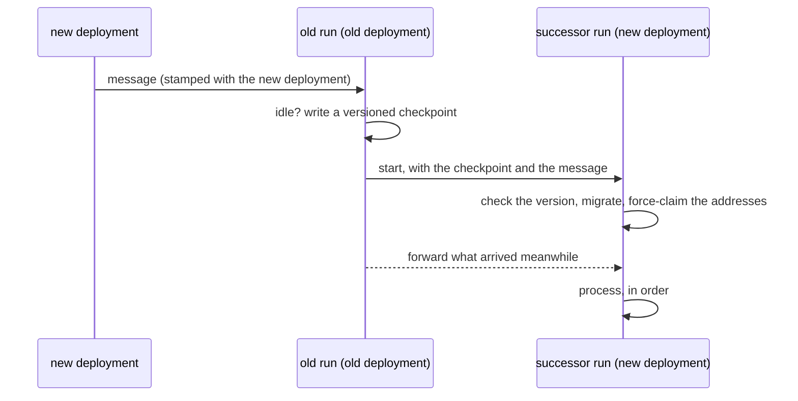
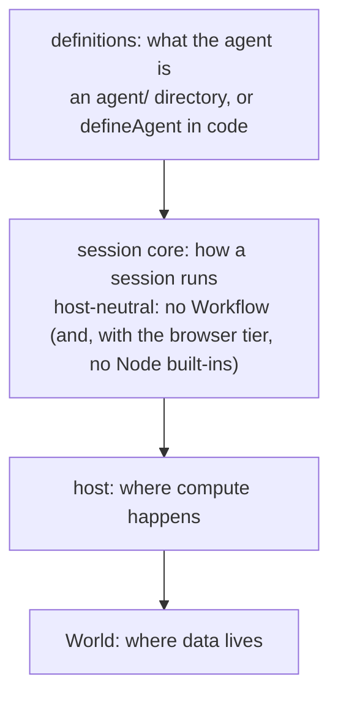

# Decomposing eve: the eve runtime on Worlds

## Goals

We have a few interlinked goals here:

- Make it possible to define eve agents with arbitrary code, independent of the filesystem layout
  - In essence, the filesystem-based loading should just be one expression of a more general "create an agent definition from arbitrary code". This implementation just happens to read through files on the filesystem to achieve this.
- Once we're able to do this, it feels natural to want to be able to invoke that agent purely in process without a build step or any sort of heavy machinery.
- If we're able to invoke this agent in process, is it a big leap to allow us to deploy these agents durably without going through an `eve build` at all?

## Coupling to Workflow

Currently, every deployed eve session is a Workflow run, associated with the deployment that kicked it off.



This leads to the following costs:

- **Compilation**: We needed all code to be available on disk at compile time so that we could run the Workflow transform. This obviously does not fit with a code-defined agent that could be doing arbitrarily complex things to generate an agent.
- **No in-process mode**: All sessions required a server and the Workflow runtime, including tests and the TUI.
- **Deployment pinning**: You can't safely replay an arbitrary event log against potentially different code, so old deployments need to stick around to handle new messages to idle sessions. eve compensates for this with a deployment handoff: when a newer deployment sends a message to an idle session, the old run writes a versioned checkpoint and starts a successor run on the new deployment, which takes over the session (same id, new run). The successor migrates a recent checkpoint in place. When the format changed too much for that, it imports the session instead, keeping its identity, state and conversation, and runs a compaction pass over the conversation before continuing. So a handoff sometimes compacts, depending on how far the format moved. A checkpoint too old for either stays on its old deployment. Separately, a session that compacts moves to a fresh run on its own deployment, so no single run's event log grows forever. But sessions can still become stranded if deployments aged out, or on non-Vercel worlds that don't allow for multiple active deployments.

The deployment handoff logic is quite complex:



So what if we could avoid these costs entirely?

## Durable program state -> durable data

Much of Workflow's value is that it stores program state for you automatically, and can resume completely transparently, without you having to model state shape explicitly.

But eve already _does_ model its state shape explicitly, and has tons of complexity built in to write things like the `SessionCheckpoint` into durable state explicitly. Conversation history and session state are modeled explicitly and written at eve-defined points in time. So we already pay the cost of thinking about this.

On the other hand, eve's control flow is trivial. We just run a simple while loop, waiting for input, calling the model, running tools, etc. The actual shape of the deployed code does not matter at all for resuming this loop. If eve knows "x tool calls are waiting for approval, and our model-facing history is y", then there's no reason it should need to replay the inner part of its while loop to proceed on, and even if our framework code or user code changes significantly, there's nothing that should stop eve from being able to resume immediately from that description of the world.

By relying on replay as we do, we're imposing constraints on ourselves such that we're able to deterministically rebuild state that we already had access to.

What eve needs from a durable substrate is:

- a durable record of inputs and checkpoints;
- output streams;
- addresses that accept input from anywhere;
- a way to wake a session, and timers;
- one writer at a time.

None of that is durable program state. A session is closer to an actor (an identity, a mailbox and private state, always running the latest code) than to a long-running durable function.

## One layer down

Workflow is a programming model built on Worlds, but we end up fighting it a lot as seen above. Instead, we can go down a level and just program on top of Worlds directly, which solves a lot of our pain points:

| eve needs                                 | World provides                                                  |
| ----------------------------------------- | --------------------------------------------------------------- |
| a record per session                      | a run, and events appended to it                                |
| output streams                            | the run's streams                                               |
| addresses that accept input from anywhere | hooks                                                           |
| wakes                                     | the queue                                                       |
| timers                                    | delayed queue messages                                          |
| one writer at a time                      | one delivery per run at a time, plus an in-band fence on writes |

## Decomposing eve

In my stack, I break up the core of eve into four layers, which can each have their own implementations:



A host provides four things: a store, a source of activations, timers, and a guarantee of one writer per session. Much of the early work in the stack is essentially purely mechanical moves to push the existing Workflow implementation of the host behind abstract interfaces that can be implemented in other ways. The seams that hide Workflow:

- **`SessionHost`**: what the session loop asks of its host. Run one turn step across the host's step boundary, start and apply the session's child runs, sleep, move the session to another owner, and (for a host that keeps sessions itself) record where the open turn is after every step.
- **`SessionInboxTransport`**: where a session's addresses come from: Workflow hooks on a deployment, or a host's own channels.
- **`SessionAgent`**: how a session reads its agent: a compiled bundle, or definitions a process holds.
- **`RunHost`**: what a workflow tool run (a subagent, a background task, `ask_question`) needs: its id, its hooks, a clock, and a way to resume other hooks.
- **`DurableHost`**: who answers for the hooks, runs and streams no host in this process holds: Workflow on a deployment, or the World host.

Workflow implements every one of them with the code it already had, moved behind the interface. The first new implementation outside of Workflow is an in-process host.

Later PRs in the stack sketch out a Worlds-native host, which allows production eve to completely move off of Workflow, outside of workflow tools. This ends up working pretty well, but does force us to adopt some complexity back into the framework. Ideally, there would be some sibling abstraction to Workflow, also built on Worlds, that eve could offload that complexity to. This would be possible to share with projects like libfx or durable-harness.

| Host       | Activations  | Timers        | One writer                           | Status                  |
| ---------- | ------------ | ------------- | ------------------------------------ | ----------------------- |
| in process | direct calls | in memory     | one process                          | experimental, in review |
| Workflow   | replay       | `sleep`       | Workflow                             | today's deployed eve    |
| World host | queue wakes  | delayed wakes | one delivery per run, plus the fence | experimental, internal  |
| actor      | messages     | alarms        | the platform                         | future                  |

## What this enables

We'll tinker with the exact user-facing APIs here, but these are all implemented fairly transparently on top of the internal core.

### A script

```ts
import { createSession, defineAgent, eve, localUser, memorySandbox } from "eve/experimental/embed";

const chat = defineAgent({
  name: "chat",
  model: "anthropic/claude-haiku-4.5",
  instructions: "You are a friendly assistant with a shell. Keep answers short.",
  definitions: eve.defaults({ sandbox: memorySandbox() }),
});

const session = await createSession(chat, { identity: localUser() });
const delivery = await session.send("What's today's date? Check with the shell.");
for await (const event of delivery.stream())
  if (event.type === "content.delta") process.stdout.write(event.data.delta);
```

This runs in process with no build and no Workflow.

### Persistence, with one line

```diff
-const session = await createSession(chat, { identity: localUser() });
+const world = localWorld({ dataDir: ".chat" });
+const [latest] = await listSessions(world);
+const session = await createSession(chat, { identity: localUser(), world, resume: latest?.id });
```

The session survives the process. In eve's terminal UI, `runTerminal(coder, { name: "coder", world, resume })` is a coding agent whose session continues after Ctrl-C or a crash, mid-turn included.

### The same session on another machine

```ts
const world = vercelWorld(); // the linked Vercel project's World
```

A session saved on one machine continues on another. It still runs in the process that opened it.

### In a browser, with no server

```ts
import { createGateway } from "ai";
import {
  browserWorld,
  createSession,
  defineAgent,
  eve,
  listSessions,
  memorySandbox,
} from "eve/browser";

// A page has no environment to read a key from, so it passes a model instance. The key is then
// readable by anyone who loads the page: for local demos, or call the model through your own proxy.
const gateway = createGateway({ apiKey: import.meta.env.VITE_AI_GATEWAY_API_KEY });

const chat = defineAgent({
  name: "chat",
  model: gateway("anthropic/claude-haiku-4.5"),
  instructions: "You are a friendly assistant with a shell. Keep answers short.",
  definitions: eve.defaults({ sandbox: memorySandbox() }),
});

const world = browserWorld(); // the page's IndexedDB
const [latest] = await listSessions(world);
const session = await createSession(chat, { identity: null, world, resume: latest?.id });
```

The same agent runs in a page or a Web Worker on stock Vite, and a reload resumes the conversation. This is the clearest proof that the core no longer depends on any one host: no Node, no Workflow, no server.

### In the cloud, without a build

The World host runs sessions in whichever process receives their wake. It's internal today, so this is illustrative:

```ts
// lib/host.ts: server only
import { vercelWorld } from "eve/experimental/embed";
import { createWorldHost } from "eve/experimental/world-host"; // proposed entry
import { buildAgents } from "./agents"; // anything: from a database, per customer, generated

export const host = createWorldHost({
  world: vercelWorld(),
  agents: await buildAgents(),
  queueNamespace: "chat",
});
```

```ts
// app/eve/[...path]/route.ts: eve's session protocol at /eve/v1/..., for any eve client
import { jwtHmac } from "eve/channels/auth";
import { host } from "@/lib/host";

// The verified caller becomes the session's identity, as on a deployment.
const auth = jwtHmac({
  algorithm: "HS256",
  secret: process.env.EVE_JWT_SECRET!,
  issuer: "https://my-app.vercel.app",
  audiences: ["chat"],
});
const handler = host.eveChannel("chat", { auth: [auth] }); // proposed
export { handler as GET, handler as POST };
```

```ts
// app/api/queue/route.ts: the workers, triggered by Vercel Queues
import { host } from "@/lib/host";

export const POST = host.queueHandler();
```

For Vercel Queues to call that route, it needs a queue trigger on the host's topic (`experimentalTriggers` in `vercel.json`). `eve build` adds it for the functions it generates; a hand-wired route declares it itself.

```ts
// client code: the same whether the host is Workflow or a World host
import { Client } from "eve/client";

const client = new Client({ baseUrl: "https://my-app.vercel.app", auth: { bearer: token } });
const session = await client.sessions.create();

const delivery = await session.send("hello");
for await (const event of delivery.stream()) {
  if (event.type === "content.delta") process.stdout.write(event.data.delta);
}
```

## Deploys run the new code

With the World host, any build that can read a session's state can continue the session. This means that idle sessions do not need to be pinned, and old sessions always run on the latest code on every message, with no handoff at all.

|                      | Today                                           | eve runtime                     |
| -------------------- | ----------------------------------------------- | ------------------------------- |
| idle sessions        | pinned to the deployment that started their run | any deployment continues them   |
| moving to new code   | the handoff protocol                            | the next wake runs the new code |
| self-hosted upgrades | strand every session                            | sessions continue               |
| what keeps it safe   | replay on the same build                        | versioning the state format     |

## Toward an actor layer

I mentioned this a bit above, but a lot of the complexity we take on is not really specific to eve, and instead could be pulled out into a more general layer.

| Generic: any long-lived actor on the latest code        | Specific to eve                               |
| ------------------------------------------------------- | --------------------------------------------- |
| identity, addresses, an arrival log                     | the session loop, the kernel, the harness     |
| activation on a wake, one at a time; stopping when idle | turns, steps, tools, approvals                |
| one writer: a claim and a fence                         | what the checkpoint holds, and its migrations |
| state as snapshots plus deltas, bounded logs            | channels and their adapters                   |
| timers past the queue's longest delay                   | subagents                                     |
| batched streams and their readers                       |                                               |
| one-time cron occurrences                               |                                               |

The World host already draws this line in code, as a small internal actor layer (called entities in the code). Everything in the generic column sits behind one interface: an actor has a key and aliases, a journal from its latest snapshot, a mailbox, an output stream, one writer at a time, and, on a World with a queue, activations and an alarm. Its guarantees are checked by a conformance suite. An actor platform (or a native Workflow feature) would replace eve's implementation of that interface by passing the same suite; the World host's driver, the session core, definitions and everything above them stay the same.

What eve would need from an actor layer:

- the latest code on every activation;
- one writer per actor;
- checkpoints the actor writes explicitly;
- activations that last minutes (an agent turn), or a clear deadline to hand off at;
- timers;
- streams to clients;
- child actors, for subagents and tasks;
- encryption at rest.

## Where we are

We have a stack of draft PRs in 4 tiers, roughly organized to put pure refactors before any user-facing changes.

1. **Seams.** Internal refactors with no change in behavior. The session loop reaches Workflow only through abstract Host interfaces, meaning the core no longer imports Workflow. The loop adds additional tracking for where the open turn is, allowing any Host to continue a session without replaying it. The Workflow host (the only implementation at this point) does not need to use that functionality, as it still does replay.
2. **eve in a process.** The first public experimental API: we add `defineAgent` in `eve/experimental/embed`, as well as World persistence implementations. Users are able to `defineAgent` in process and have that process drive the session, durably saving state to any currently-available world. But a session only moves while the process that opened it is running: nothing outside it can send it a message, and nothing wakes it when no process holds it. That suits local TUI-type applications, but isn't yet a replacement for a fully-deployed eve agent.
3. **The World host.** Tier 2 makes sessions durable; tier 3 makes them reachable. Sessions get addresses anything can send to, and a queue that wakes them in whichever process it reaches, even when nothing is running. It runs deployed eve's own test suites, on Postgres and on Vercel.
4. **The browser.** The same runtime in a page or a Web Worker, with sessions kept in IndexedDB.

All of these are implemented to varying degrees of quality. (1) is nearly ready to merge, (2) is good functionality-wise, but needs some further iteration on the exact API, (3) is mostly passing tests but deserves a much more careful look before we feel comfortable swapping over to it, and (4) is fairly mechanical but requires creating stand-ins for a good number of Node functions that we use across the core, and so is a bit messy.
