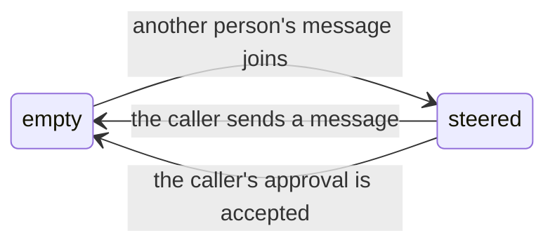

# Multiplayer steering

## Problem

In a shared session, such as a Slack thread, only a turn's caller can steer it. Everyone else's
message waits for the turn to end and then runs as a turn of its own. A long build or a slow query
locks the rest of the thread out.

The wait exists because a turn runs with its caller's access. Alice asks for churn numbers on her
twelve accounts. She can read every account, and Bob can't. If Bob's "actually include everyone"
joined her turn, the model would widen the query and run it as Alice. Waiting is safe because Bob's
message then runs as Bob.

This plan lets an author opt in to another person's message joining a running turn, without that
person's words spending the caller's access.

## Guarantee

A turn's principal never changes. With `"retain"`, after another person's message joins, eve hands
the caller's identity to no call the model makes. That lasts until the caller sends a message or
their approval is accepted.

eve enforces this wherever it hands out the identity itself. A tool or connection that authorizes
from `ctx.session.auth.current` in its own code is the author's to protect, with one policy:
[`steered()`](#4-steered).

## Changes

Four additive changes. Nothing changes for an agent that doesn't opt in.

| Change                                                        | Use case                                                         |
| ------------------------------------------------------------- | ---------------------------------------------------------------- |
| [`turnPolicy` with `principal`](#1-turnpolicy-with-principal) | Let a teammate's message join a running turn.                    |
| [`ctx.session.auth.steeredBy`](#2-ctxsessionauthsteeredby)    | Let code see that the turn has input its caller hasn't acted on. |
| [Caller identity hold](#3-caller-identity-hold)               | Stop that input from spending the caller's access.               |
| [`steered()`](#4-steered)                                     | Protect a tool that authorizes in its own code.                  |

### 1. `turnPolicy` with `principal`

`turnPolicy` decides when a message joins a running turn. Its steering form takes `principal`, which
decides what happens when that turn runs as someone else.

```ts
type TurnMode = "steer" | "queue";
type PrincipalPolicy = "match" | "retain";
type TurnPolicy =
  | TurnMode
  | { readonly mode: "queue" }
  | { readonly mode: "steer"; readonly principal?: PrincipalPolicy };
```

`"steer"` is `{ mode: "steer" }`, `"queue"` is `{ mode: "queue" }`, and `principal` defaults to
`"match"`. Only a steering policy has `principal`, so a queued message can't carry one.

| `principal`         | The running turn's caller sent it | Someone else sent it                                        |
| ------------------- | --------------------------------- | ----------------------------------------------------------- |
| `"match"` (default) | Joins the turn                    | Waits for the turn to end, then starts a turn as its sender |
| `"retain"`          | Joins the turn                    | Joins as input. The turn retains its caller and principal   |

`"match"` is today's behavior.

```ts title="agent/channels/slack.ts"
export default slackChannel({
  credentials,
  turnPolicy: "steer", // the channel's default, with principal "match"
  async onMessage(ctx, message) {
    const auth = defaultSlackAuth(message, ctx);
    // A mention may join a teammate's running turn. Other messages wait for it to end.
    return ctx.isBotMentioned()
      ? { auth, turnPolicy: { mode: "steer", principal: "retain" } }
      : { auth };
  },
});
```

- **Where it is set.** On a channel definition, in server-side `send()` options, and in the result
  of any built-in channel's message hook (including `eveChannel({ onMessage })`, which also sees
  the request's mode on `ctx.eve.turnPolicy`). A message's `turnPolicy` replaces its channel's as a
  whole.
- **Never from a client.** Request bodies and the client SDK take only `"steer"` or `"queue"`. They
  choose the mode. `principal` comes from the server, because it decides whose access a message can
  reach.
- **No turn running.** The message behaves as it does today and runs as its sender.
- **Needs a sender.** A message sent with `auth: null`, or as an anonymous principal, follows
  `"match"`.
- **Waits behind the caller.** While any approval, question, or sign-in is open in the session,
  another person's message waits. It joins when the turn continues, or starts its own turn if the
  turn ends first.
- **Channel `deliver()` hook.** `channel.session.auth.current` stays the running turn's caller;
  `payload.auth` carries the delivery's authenticated sender.

### 2. `ctx.session.auth.steeredBy`

```ts
readonly steeredBy?: readonly SessionAuthContext[];
```

The people other than the caller whose messages joined this turn since the caller last acted. eve
sets it only while it has at least one person; it is absent in every session with one person, so
nothing changes for a session that never opts in.



- It is readable wherever `ctx.session` is: tools, approval policies, dynamic functions, and hooks.
- It is stored with the turn, so a replayed step reads the same value.
- A session's own turn starts without it.
- A local subagent's turn starts with the list its parent turn had when it made the call or sent the message. A workflow tool call reads the same list.
- A denial, a rejected approval, or an approval from anyone but the caller does not clear it.

Clearing on the caller's message matches how turns work today: a caller's message already runs
against everything others wrote before it.

### 3. Caller identity hold

While `steeredBy` is set, a call the model makes can't obtain the caller's identity from eve.
The call fails before anything is sent, no sign-in starts, and the turn doesn't pause.

| What the call asks eve for                                                                      | Held |
| ----------------------------------------------------------------------------------------------- | ---- |
| The caller's token: a user-scoped connection's tools, `ctx.getToken()`, or `ctx.requireAuth()`  | Yes  |
| The caller forwarded to an MCP server or a remote agent (`forwardPrincipal`)                    | Yes  |
| The caller bound to work that outlives the turn: event subscriptions and dynamic schedule tools | Yes  |
| Tools of a memory slot scoped with `byPrincipal`                                                | Yes  |
| An app-scoped credential or shared-scope memory tool                                            | No   |

The caller's token fails with `ConnectionAuthorizationFailedError` and `reason: "turn_steered"`. So
do MCP tool calls with `forwardPrincipal` and connection event subscriptions. Dynamic schedule
tools, remote agent calls with `forwardPrincipal`, and `byPrincipal`-scoped memory tools fail with
an error that carries the same message. `byPrincipal`-scoped memory also skips automatic capture
while `steeredBy` is set. The message names nobody and tells the model what unblocks it:

```text
Another person's message joined this turn after its caller last spoke, so connection "github" can't use the caller's identity. Ask the caller to confirm in this conversation, then try again.
```

- A call that was already running when the message joined keeps the identity. The model chose it
  before reading the message.
- eve's own work for the caller, such as listing a connection's tools, isn't a call the model made
  and isn't held.
- App-scoped credentials and shared-scope memory aren't held. Everyone in the conversation already
  shares them.
- An approver's token (`ctx.approval.responder.getToken()`) isn't held.

### 4. `steered()`

```ts title="agent/tools/run_sql.ts"
import { defineTool } from "eve/tools";
import { steered } from "eve/tools/approval";

// Runs on a service account and checks the caller's role itself, so eve sees no identity use.
export default defineTool({
  description: "Run a read-only SQL query.",
  inputSchema,
  approval: steered(),
  execute: (input, ctx) => runAs(ctx.session.auth.current, input.query),
});
```

`steered()` is an approval policy. While `steeredBy` is set it asks the turn's caller before
the call starts. Otherwise it returns `undefined` and leaves the decision to other policies.

- **On a tool or connection:** for tools or connections that decide from the caller's role, tenant,
  or attributes while using a shared credential. eve can't detect these.
- **On the agent:** `approval: steered()` in `agent.ts` asks before every call. Use it to give the
  caller an approval card instead of a failed call.
- **Caller-only enforcement:** when `steered()` is the agent's `approval` or a tool's
  `approval.request`, only the turn's caller can approve while `steeredBy` is set, even if the tool
  has a custom `approval.response` policy.
- **One ask per steer.** An accepted caller approval clears `steeredBy`, so the approved call gets
  their identity and later calls don't ask again until someone else's message joins.
- **No one to ask.** When the turn has no signed-in caller, `steered()` denies the call. An approval
  whose requester is anonymous would otherwise take anyone's answer.
- **First-party extensions.** The git extension's `gh` tool (in app-installation mode) and the
  custom skills extension's personal-scope tools use `steered()` automatically while steered.

An approval pauses the turn on the caller, so other people's messages wait until they answer. The
identity hold alone never pauses a turn.

## The example, by configuration

Bob writes "actually include everyone" during Alice's turn.

| Configuration                                                     | Result                                                                            |
| ----------------------------------------------------------------- | --------------------------------------------------------------------------------- |
| `"match"`                                                         | Bob waits. His turn runs as Bob, and the warehouse refuses the wider query.       |
| `"retain"`, and the SQL tool uses Alice's token                   | The query fails with `turn_steered`. The agent asks Alice, and her reply decides. |
| `"retain"`, a service-account SQL tool, and `approval: steered()` | Alice gets one approval showing the wider query.                                  |
| `"retain"`, a service-account SQL tool, and no `steered()`        | The wider query runs under Alice's role. This is the gap the author must close.   |

## What the author owns

Opting in to `"retain"` comes with a short audit. The `turnPolicy` documentation must list it.

- **Tools and connections that authorize in their own code.** Add `approval: steered()` to every
  tool or connection (including `headers` and `providedArguments` callbacks) that decides from
  `auth.current` without taking the caller's token from eve.
- **Dynamic functions.** They run before every model call as the caller and aren't calls, so
  neither the hold nor `steered()` covers them. Read `steeredBy` there.
- **Ambient listening and `no_reply`.** Return `principal: "retain"` only on addressed messages,
  not on unmentioned thread replies paired with `no_reply`, or side-chat interrupts the active turn
  and can end it early.
- **Attribution.** The channel must show the model who sent each message. Slack already does. eve
  adds none.
- **Shared context.** A steering message can ask the model to repeat anything already in the
  conversation, as a later turn can today.
- **Custom memory scopes.** Slots using `byPrincipal` are protected automatically; custom `scope()`
  functions reading `auth.current` directly should check `steeredBy` or use `byPrincipal`.

## Where a model fits

Everything above is deterministic: who sent a message, which policy it carries, whose identity a
call can use, and who can release it.

A model belongs where either answer is safe. A channel hook can call a decision model to choose a
`principal` value for each message, as the ambient listening pattern already filters
messages. A wrong choice makes a message wait or join; it never widens access.

## Boundaries

- **Admission.** One check decides whether a message steers, and one function refuses a message
  from another principal. `"retain"` passes both and leaves the turn's auth untouched.
- **`steeredBy`.** It travels beside the turn's auth, so it crosses step boundaries and reaches
  child sessions the same way.
- **One sender per step.** One model step reads one sender's messages, so a step always knows whose
  input it is. When several people's messages wait, the earliest sender's are read first. The others
  wait for the next step, and start their own turn if the turn ends first.
- **Unchanged.** A turn's principal never changes, and how turns pause, how tasks run, and what
  history holds stay the same.

## Out of scope

- Handing a turn over to another principal (such as a task-preserving turn handover that starts a
  new turn as the sender without cancelling running tasks).
- Letting a turn continue while one of its calls waits on the caller.
- Acting with the steering person's own access inside the caller's turn.
- Whether an unaddressed message that starts a turn should run as its sender. The joining value
  covers only the running-turn case.

## Compatibility

Additive. `"steer"` and `"queue"` keep their meaning, and `principal` defaults to `"match"`. A
stored message keeps `turnPolicy` as `"steer"` or `"queue"` with `principal` beside it, so a
deployment that predates `principal` reads the mode correctly, and a stored message without
`principal` reads as `"match"`. `steeredBy` is absent when a session's own turn starts. The
changeset is `minor`.

## Testing

- Unit: the input queue's admission rule, grouping, and merged `steeredBy`; the stored form of a
  policy; that a request chooses only the mode while `eveChannel({ onMessage })` can override it;
  `steered()` response-policy composition; `byPrincipal` memory tool holds; and `SteeredByKey`
  preservation on cancellation.
- Integration: `principal-policy.integration.test.ts` proves the join, the hold and its release
  mid-turn, `steered()`, rejected response policies, channel `deliver()` auth/`steeredBy`,
  `byPrincipal` capture skip, the sign-in wait, and the default wait. `@eve/git` and
  `@eve/custom-skills` test their steered tool guards.
- One deterministic e2e eval in the `agent-tools-hitl` fixture.
