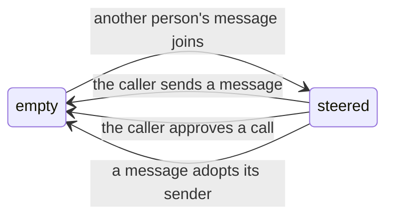

# Multiplayer steering

## Problem

In a shared session, such as a Slack thread, only a turn's caller can steer it. Everyone else's
message waits for the turn to end and then runs as a turn of its own. A long build or a slow query
locks the rest of the thread out.

The wait exists because a turn runs with its caller's access. Alice asks for churn numbers on her
twelve accounts. She can read every account, and Bob can't. If Bob's "actually include everyone"
joined her turn, the model would widen the query and run it as Alice. Waiting is safe because Bob's
message then runs as Bob.

This plan lets an author opt in to another person's message joining a running turn, without that
person's words spending the caller's access.

## Guarantee

With `"match-caller"` and `"retain-caller"`, a turn's principal never changes. `"adopt-sender"`
changes it deliberately. With `"retain-caller"`, after another person's message joins, eve hands the
caller's identity to no call the model makes. That lasts until the caller sends a message or approves
a call.

eve enforces this wherever it hands out the identity itself. A tool that authorizes from
`ctx.session.auth.current` in its own code is the author's to protect, with one policy:
[`steered()`](#4-steered).

## Changes

Four additive changes. Nothing changes for an agent that doesn't opt in.

| Change                                                     | Use case                                                         |
| ---------------------------------------------------------- | ---------------------------------------------------------------- |
| [`principalPolicy`](#1-principalpolicy)                    | Let a teammate's message reach or take over a running turn.      |
| [`ctx.session.auth.steeredBy`](#2-ctxsessionauthsteeredby) | Let code see that the turn has input its caller hasn't acted on. |
| [Caller identity hold](#3-caller-identity-hold)            | Stop that input from spending the caller's access.               |
| [`steered()`](#4-steered)                                  | Protect a tool that authorizes in its own code.                  |

### 1. `principalPolicy`

`turnPolicy` decides when a message joins a running turn. `principalPolicy` decides what happens
when that turn runs as someone else.

| `principalPolicy`          | The running turn's caller sent it | Someone else sent it                                                     |
| -------------------------- | --------------------------------- | ------------------------------------------------------------------------ |
| `"match-caller"` (default) | Joins the turn                    | Waits for the turn to end, then starts a turn as its sender              |
| `"retain-caller"`          | Joins the turn                    | Joins as input. The turn retains its caller and principal                |
| `"adopt-sender"`           | Joins the turn                    | Joins. The turn adopts the sender as its caller from the next model call |

`"match-caller"` is today's behavior.

```ts title="agent/channels/slack.ts"
export default slackChannel({
  credentials,
  principalPolicy: "match-caller", // the channel's default
  async onMessage(ctx, message) {
    const auth = defaultSlackAuth(message, ctx);
    // A mention may join a teammate's running turn. Other messages wait for it to end.
    return ctx.isBotMentioned() ? { auth, principalPolicy: "retain-caller" } : { auth };
  },
});
```

- **Where it is set.** On a channel definition, in server-side `send()` options, and in the result
  of a Slack message hook. A message's value wins over its channel's.
- **Never from a client.** Request bodies and the client SDK can set `turnPolicy`. They can't set
  `principalPolicy`, because it decides whose access a message can reach.
- **Only for steering.** With `turnPolicy: "queue"`, or with no turn running, the message behaves as
  it does today and runs as its sender.
- **Needs a sender.** A message sent with `auth: null`, or as an anonymous principal, follows
  `"match-caller"`.
- **Waits behind the caller.** While any approval, question, or sign-in is open in the session,
  another person's message waits. It joins when the turn continues, or starts its own turn if the
  turn ends first.
- **`"adopt-sender"` admission.** It joins under the same conditions as `"retain-caller"`.
- **Adopt from the next model call.** `ctx.session.auth.current` becomes the sender. The turn ID and
  `auth.initiator` do not change. `steeredBy` is absent, so the caller identity hold does not apply.
- **Earlier work.** Calls that already started finish under the caller who started them. The
  conversation stays, and the previous caller's later messages follow their own policy.
- **Why it is safe.** From that point the turn can do only what the sender can do. A queued message
  is safe for the same reason.

### 2. `ctx.session.auth.steeredBy`

```ts
readonly steeredBy?: readonly SessionAuthContext[];
```

The people other than the caller whose messages joined this turn since the caller last acted. eve
sets it only while it has at least one person; it is absent whenever a turn starts and in every session
with one person, so nothing changes for a session that never opts in.



- It is readable wherever `ctx.session` is: tools, approval policies, dynamic functions, and hooks.
- It is stored with the turn, so a replayed step reads the same value.
- A workflow tool call or local subagent reads the list its parent turn had when it made the call or sent the message.
- It is absent whenever a turn starts.
- An `"adopt-sender"` message clears it.
- A denial doesn't clear it. Neither does an approval from anyone but the caller.

Clearing on the caller's message matches how turns work today: a caller's message already runs
against everything others wrote before it.

### 3. Caller identity hold

While `steeredBy` is set, a call the model makes can't obtain the caller's identity from eve.
The call fails before anything is sent, no sign-in starts, and the turn doesn't pause.

| What the call asks eve for                                                                      | Held |
| ----------------------------------------------------------------------------------------------- | ---- |
| The caller's token: a user-scoped connection's tools, `ctx.getToken()`, or `ctx.requireAuth()`  | Yes  |
| The caller forwarded to an MCP server or a remote agent (`forwardPrincipal`)                    | Yes  |
| The caller bound to work that outlives the turn: event subscriptions and dynamic schedule tools | Yes  |
| An app-scoped credential                                                                        | No   |

The caller's token fails with `ConnectionAuthorizationFailedError` and `reason: "turn_steered"`. So
do MCP tool calls with `forwardPrincipal` and connection event subscriptions. Dynamic schedule tools
and remote agent calls with `forwardPrincipal` fail with an error that carries the same message. The
message names nobody and tells the model what unblocks it:

```text
Another person's message joined this turn after its caller last spoke, so connection "github" can't use the caller's identity. Ask the caller to confirm in this conversation, then try again.
```

- A call that was already running when the message joined keeps the identity. The model chose it
  before reading the message.
- eve's own work for the caller, such as listing a connection's tools, isn't a call the model made
  and isn't held.
- App-scoped credentials aren't held. Everyone in the conversation already shares them.
- An approver's token (`ctx.approval.responder.getToken()`) isn't held.

### 4. `steered()`

```ts title="agent/tools/run_sql.ts"
import { defineTool } from "eve/tools";
import { steered } from "eve/tools/approval";

// Runs on a service account and checks the caller's role itself, so eve sees no identity use.
export default defineTool({
  description: "Run a read-only SQL query.",
  inputSchema,
  approval: steered(),
  execute: (input, ctx) => runAs(ctx.session.auth.current, input.query),
});
```

`steered()` is an approval policy. While `steeredBy` is set it asks the turn's caller before
the call starts. Otherwise it returns `undefined` and leaves the decision to other policies.

- **On a tool:** for tools that decide from the caller's role, tenant, or attributes while using a
  shared credential. eve can't detect these.
- **On the agent:** `approval: steered()` in `agent.ts` asks before every call. Use it to give the
  caller an approval card instead of a failed call.
- **One ask per steer.** The caller's approval clears `steeredBy`, so the approved call gets their
  identity and later calls don't ask again until someone else's message joins.
- **Among approvals, only the caller clears it.** If a tool's `response` policy lets someone else approve, the call
  is approved but the identity hold stays.
- **No one to ask.** When the turn has no signed-in caller, `steered()` denies the call. An approval
  whose requester is anonymous would otherwise take anyone's answer.

An approval pauses the turn on the caller, so other people's messages wait until they answer. The
identity hold alone never pauses a turn.

## The example, by configuration

Bob writes "actually include everyone" during Alice's turn.

| Configuration                                                            | Result                                                                                      |
| ------------------------------------------------------------------------ | ------------------------------------------------------------------------------------------- |
| `"match-caller"`                                                         | Bob waits. His turn runs as Bob, and the warehouse refuses the wider query.                 |
| `"adopt-sender"`                                                         | Bob's message joins, the next query runs as Bob, and the warehouse refuses the wider query. |
| `"retain-caller"`, and the SQL tool uses Alice's token                   | The query fails with `turn_steered`. The agent asks Alice, and her reply decides.           |
| `"retain-caller"`, a service-account SQL tool, and `approval: steered()` | Alice gets one approval showing the wider query.                                            |
| `"retain-caller"`, a service-account SQL tool, and no `steered()`        | The wider query runs under Alice's role. This is the gap the author must close.             |

## What the author owns

Opting in to `"retain-caller"` comes with a short audit. The `principalPolicy` documentation must list it.

- **Tools that authorize in their own code.** Add `approval: steered()` to every tool that decides
  from `auth.current` without taking the caller's token from eve.
- **Dynamic functions.** They run before every model call as the caller and aren't calls, so
  neither the hold nor `steered()` covers them. Read `steeredBy` there.
- **Attribution.** The channel must show the model who sent each message. Slack already does. eve
  adds none.
- **Shared context.** A steering message can ask the model to repeat anything already in the
  conversation, as a later turn can today.
- **Memory.** A turn is saved under the caller it has when it is saved. `"retain-caller"` uses the
  original caller; `"adopt-sender"` uses the sender. Messages other people sent are included.

## Where a model fits

Everything above is deterministic: who sent a message, which policy it carries, whose identity a
call can use, and who can release it.

A model belongs where either answer is safe. A channel hook can call a decision model to choose a
`principalPolicy` value for each message, as the ambient listening pattern already filters
messages. A wrong choice makes a message wait or join; it never widens access.

## Boundaries

- **Admission.** One check decides whether a message steers, and one function refuses a message
  from another principal. `"retain-caller"` and `"adopt-sender"` pass both. `"retain-caller"` leaves
  the turn's auth untouched; `"adopt-sender"` changes it after the step.
- **`steeredBy`.** It travels beside the turn's auth, so it crosses step boundaries and reaches
  child sessions the same way.
- **One sender per step.** One model step reads one sender's messages, so a step always knows whose
  input it is. When several people's messages wait, the earliest sender's are read first. The others
  wait for the next step, and start their own turn if the turn ends first.
- **Caller handover.** The running turn re-reads its caller after a step that read an
  `"adopt-sender"` message.
- **Unchanged.** How turns pause, how tasks run, and what history holds.

## Out of scope

- Letting a turn continue while one of its calls waits on the caller.
- Acting with the steering person's own access without adopting the turn.
- Whether an unaddressed message that starts a turn should run as its sender. The joining values
  cover only the running-turn case.

## Compatibility

Additive. `principalPolicy` defaults to `"match-caller"`, and stored deliveries without the field
read as `"match-caller"`. `steeredBy` is absent whenever a turn starts. The changeset is `minor`.

## Testing

- Unit: the input queue's admission rule, grouping, and merged `steeredBy`.
- Integration: `principal-policy.integration.test.ts` proves the join, the hold and its release mid-turn,
  `steered()`, `adopt-sender`, the sign-in wait, and the default wait.
- Two deterministic e2e evals in the `agent-tools-hitl` fixture.
