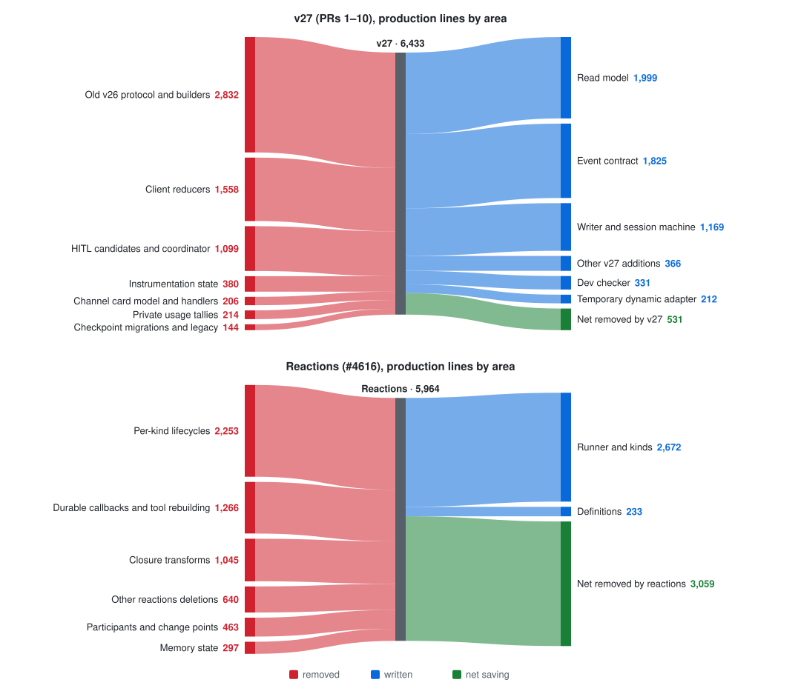
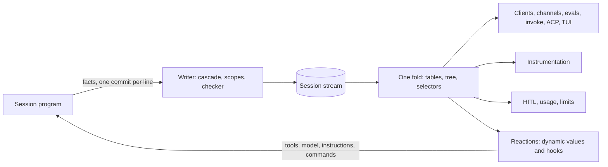
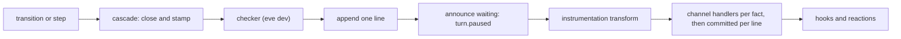
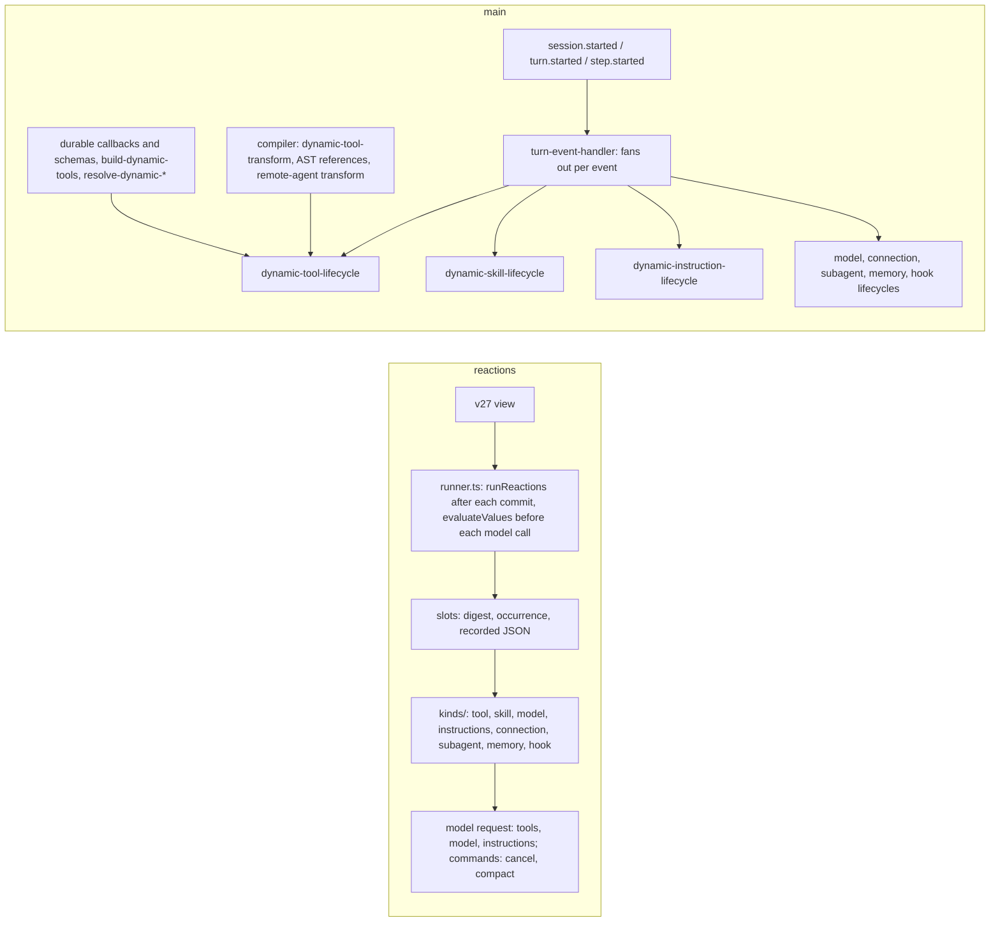
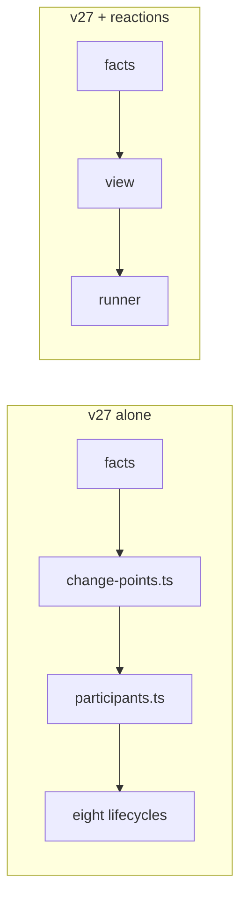
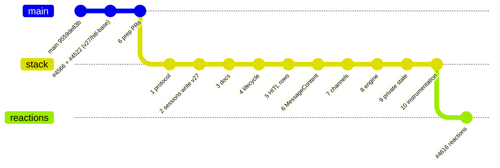

# Session stack overview

This is a map of the session work landing before 1.0. It contains the v27 event
model and the cleanup built on it (six prep PRs, then PRs 1–10, as GitHub stack #4696 from
[#4532](https://github.com/vercel/eve/pull/4532)), then reactions
([#4616](https://github.com/vercel/eve/pull/4616)), one commit on top of PR 10. The design docs
have more detail:

- [`session-event-lifecycle.md`](./session-event-lifecycle.md): the facts.
- [`session-event-tree.md`](./session-event-tree.md): ownership and closing.
- [`session-core-target.md`](./session-core-target.md): waiting, and what 1.0 locks.
- [`session-reactions.md`](./session-reactions.md): dynamic values and hooks.
- [`instrumentation-session-events.md`](./instrumentation-session-events.md): a reviewer's
  guide to the instrumentation changes.

## Summary

- **v27: one fold replaces a dozen private ones.** On main, the client reducers, HITL candidates,
  instrumentation, usage tallies, channel task cards, evals and the server projection each
  rebuilt lifecycles from loosely typed events. On the stack they read rows and selectors from
  one fold. On the write side, the writer closes and scopes facts in one place, so transitions no
  longer do it by hand. This works because every lifecycle is now recorded the same way. On main,
  many facts were missing and others were modeled inconsistently, so no simple fold over them was
  possible.
- **Reactions: one runner replaces eight lifecycles and a compiler pass.** Each dynamic kind had
  its own events, precedence rules, failure behavior and recovery. Tools survived cold starts
  through a pass that parsed authored source and snapshotted closures. With reactions, every kind
  is `select` / `record` / `render`: eve keeps the recorded JSON and renders the code again from
  it.
- **The two depend on each other.** The reactions runner reads the v27 view. Until reactions
  lands, v27 carries an adapter that maps facts back to the v26 event keys today's resolvers
  expect, so v27 can land without breaking `defineDynamic` and the other dynamic definitions.

## The numbers

|                                                          | Production lines |
| -------------------------------------------------------- | ---------------: |
| Rui's #4566 and #4522, under the stack (`v27/hitl-base`) |             +163 |
| Prep PRs #4532–#4588                                     |             −266 |
| v27 stack, PRs 1–10                                      |             −531 |
| … of which Rui's #4604, carried in PR 2                  |             +100 |
| **v27 against main**                                     |         **−634** |
| Reactions (#4616)                                        |           −3,059 |
| **Both against main**                                    |       **−3,693** |



<details>
<summary>v27 by area, against the stack's base</summary>

| Area                                                                                                      |      Net |
| --------------------------------------------------------------------------------------------------------- | -------: |
| Event contract: envelope, catalog, 13 families, guards                                                    |   +1,825 |
| Read model: fold, tables, tree, selectors, reader                                                         |   +1,999 |
| Writer and session machine: transitions, cascade, publisher, fact helpers (`harness/facts.ts`)            |   +1,169 |
| Event checker (dev only)                                                                                  |     +331 |
| Dynamic adapter, deleted by reactions                                                                     |     +212 |
| Compaction as a run, turn step, tool loop, `MessageContent`, tasks, evals, other                          |     +366 |
| Old v26 protocol: `message.ts`, 38 `create…Event` builders, `session-projection.ts`, `message-version.ts` |   −2,832 |
| Clients: message, conversation and transcript reducers, tool-part state                                   |   −1,558 |
| HITL: candidates, coordinator, relays, hitl-proxy                                                         |   −1,099 |
| Instrumentation's private maps, per-ending events and the OTel provider's stored terminal                 |     −380 |
| Channels: the task-card model, per-channel handlers, sign-in and failure copies                           |     −206 |
| Usage: `turn-tag-state.ts` tallies and a duplicate delta                                                  |     −214 |
| Compatibility: checkpoint migrations, legacy remote protocol                                              |     −144 |
| **Total**                                                                                                 | **−531** |

Channels come out net negative. Shared sign-in, failure notices and text limits cost +291. One
surface then took over the common handlers for five channels (about −124), and the task card
became the turn's call rows (−224), which removed the parallel card model.

</details>

<details>
<summary>Tests</summary>

Against main, v27 deletes 124 test files and adds 38. In lines, that's +7,874 / −94,829, net
−86,955. Regex-counted cases drop from about 9,850 to 7,890, about 20% fewer. Most of the deleted
lines are v26-shaped suites removed wholesale (`tool-loop.test.ts`, `slackChannel.test.ts`,
`terminal-renderer.test.ts`, …).

Coverage comes back in three forms:

- Units over the fold, cascade, checker, retention, task cards, selectors and conversation.
- Seventeen channel conformance suites.
- The mock eval matrix: 14 evals covering approval, budget, relay, cancel, compaction, remote
  approval, sign-in, images, billing and MCP.

Reactions deletes another +2,338 / −6,557 test lines, mostly for the lifecycles and transforms
it deletes. That brings cases to about 7,770, and its unit suite is 787 files, 7,404 passed.

</details>

## High-level idea



The session program commits facts. The writer completes them: it closes what an ending leaves
open and stamps each fact's scope. Everything downstream reads the same fold. Reactions are the
step that feeds decisions back into the program, and they read the same view as every other
consumer.

## Part 1: Session events (v27)

- **Every entity has a lifecycle on the stream.** A session, delivery, turn, model run, content
  part, call, task, interaction, response or context change is introduced by one fact and ends
  with one terminal fact and an outcome. Readers no longer infer endings from timing.
- **The entities form an ownership tree.** `tree.ts` states each family's owner once. When an
  owner ends, the writer closes everything still open under it in the same commit, leaves first,
  with `session.ended` last, and derives each fact's scope from the tree.
- **Client and server share a fold.** The fold produces typed tables (`turns`, `runs`,
  `calls`, `interactions`, `responses`, …), and selectors in `eve/events` answer questions over
  them. Each row records where it ended (`closedAt`).
- **Single taxonomy for interactions.** Approvals, questions, sign-ins and the budget prompt are all
  interactions, and a turn waits only on people. An answer is
  `{ interactionId, optionId?, text? }` everywhere: client, channel, MCP, `eve invoke`, engine.
- **Consumers read rows instead of keeping their own state:** client messages, channel task
  cards, HITL, usage, instrumentation and eval facts.
- **Instrumentation speaks the stream's vocabulary.** Providers hear `session.ended`,
  `turn.settled`, `call.requested`/`call.settled` and `interaction.opened`/`interaction.settled`,
  each ending carrying the fact's outcome. A reviewer's guide to these changes is
  [`instrumentation-session-events.md`](./instrumentation-session-events.md).

### Framework examples

**Readers derive from rows.** This is the biggest source of deletions. On main, the client
reducer folded events into AI SDK tool parts and had to know every way a call could end:

```ts
// packages/eve/src/client/message-reducer.ts (main, condensed)
case "action.result": {
  // A task call's result is only its start receipt, which can arrive after the task settled.
  if (conversationProjection(data).calls[event.data.result.callId]?.taskId !== undefined)
    return data;
  // A retried model-call attempt's calls never ran; the replacement attempt re-requests them.
  if (event.data.error?.code === "MODEL_CALL_ATTEMPT_RETRIED") return removeToolPart(…);
  const succeeded =
    event.data.status === undefined || event.data.status === "completed"
      ? event.data.result.isError !== true && event.data.error === undefined
      : false;
  return upsertToolPart(data, event.data.turnId, event.data.stepIndex, { …part, …outcome });
}
case "action.partial": { … }  // the same merge, marked partial
case "input.resolved": { … }  // find the part by approval id, attach the response
case "task.settled": { … }    // a task's outcome overwrites its call's receipt
```

On the stack, a tool part is the call's row as it stands:

```ts
// packages/eve/src/client/messages.ts (v27)
function toolPart(view, row: CallRow, preview, interaction): EveToolPart {
  const { kind, name } = row.capability; // kind: "tool" | "agent" | "skill" | "control"
  const running = row.status !== "settled";
  const part = {
    callId: row.callId,
    kind,
    name,
    status: row.status,
    type: "tool",
    label: callLabel(row, preview), // shared with channels and the TUI
  };
  if (row.outcome !== undefined) part.outcome = row.outcome;
  const output = running
    ? preview?.output
    : row.outcome === "completed"
      ? callOutputSource(view, row.callId)?.output
      : undefined;
  // …input, error, reason, taskId, interaction
  return part;
}
```

The special cases are gone because the facts settle them. A task's call settles when the task
does, an abandoned attempt's calls close `abandoned`, and an approval is an interaction whose
`subject` is the call. The same change deletes `message-reducer` with its types and primitives,
`tool-part-state`, `conversation-reducer`, `transcript-reducer`, `message-action-parts` and
`tool-call-state`. That's −1,558 lines net in clients.

<details>
<summary>The writer closes what an ending leaves open</summary>

On main, each transition that ended something also ended what it held, family by family. Some
open work got no ending at all, and readers inferred it (the dispatcher even published synthetic
failures for open actions):

```ts
// harness/session-machine/transitions.ts (main): cancel
const events = [
  ...openInputs(projection).filter(owned).map(inputWithdrawn),
  ...openSignIns(projection)
    .filter((attempt) => attempt.turnId === turnId)
    .map((attempt) => signInWithdrawn(attempt, "Cancelled.")),
];
if (turnId !== undefined) events.push(createTurnCancelledEvent({ sequence, turnId }));
events.push(createSessionWaitingEvent(view.usage));
// open calls, model steps and approvals: no closing event; readers decide
```

On the stack, a transition emits its own end, plus explicit withdrawals that mean something
different from "the owner was cut". The writer does the rest:

```ts
// harness/session-machine/transitions.ts (v27): cancel
const events = Object.values(tables.interactions)
  .filter(
    (row) =>
      row.status === "open" && (relayed(row) || stopped(row) || row.request.kind === "budget"),
  )
  .map((row) => withdrawInteraction(row.interactionId, "Cancelled.", "interrupted"));
events.push(...turnSettled(projection, { cause, outcome: "cancelled" }, turnId));
```

```ts
// harness/session-machine/cascade.ts (v27)
const ENDS_WITH = {
  call: { cut: "interrupted", superseded: "abandoned" },
  run: { cut: "interrupted", superseded: "abandoned" },
  interaction: { cut: "interrupted", superseded: "abandoned" },
  response: { cut: "withdrawn", superseded: "abandoned" },
  delivery: { cut: "handled", superseded: "handled" },
  task: { cut: "cancelled", superseded: "cancelled" },
  turn: { cut: "cancelled", superseded: "cancelled" },
  // …
};

/** An owner's end ends everything under it, in the same commit, leaves first. */
export function cascade(view: SessionView, events: readonly SessionEvent[]): SessionEvent[];
```

`cancel` is about the same length either way. The savings are everywhere else:

- `closure.ts` is gone, and `sessionEndedFacts` no longer closes turns.
- A settled interaction's other answers close through the cascade.
- About 120 lines that built scopes by hand are gone, because `stamped` derives them.
- The dispatcher's synthetic failures are gone.
- A failed session cancels its open turn and owns the error itself.

Building the cascade found a bug that hand-closing had hidden: a session that ended with a turn
open left its deliveries unsettled.

Every commit takes one path:



Facts have one builder each (`harness/facts.ts`). A `Transition` holds only what changes private
state or decides something.

</details>

<details>
<summary>The tool loop runs as named stages</summary>

A step takes what arrived, in order, and then acts. Each stage either hands its result to the
next or ends the step (`Ended`), so the order the old loop kept implicitly is now the code's
shape:

```ts
// harness/tool-loop.ts (v27)
const runtime = await runtimeResults(step, input); // task and workflow results
if ("ended" in runtime) return runtime.ended;
const answered = await answers(step, runtime); // admit and settle people's answers
if ("ended" in answered) return answered.ended;
const turn = await turnInput(step, input, answered); // the delivery's message, or a new turn
if ("ended" in turn) return turn.ended;
const stopped = await applyHumanDecisions(step, answered.decided); // approved calls run
if (stopped !== undefined) return stopped;
if (blocked(step.view(), step.session.state)) return park(step); // wait on people, once
return runModelStep(step, { onResponse, generation, turn });
```

This is clarity work, not a line count (+34). Reactions slots in at two named points: a hook's
turn failure is checked before `applyHumanDecisions`, and dynamic values are evaluated at the
start of the model stage.

</details>

<details>
<summary>HITL reads response rows instead of keeping candidates</summary>

On main, an answer to an approval became an _approval candidate_ in private state. It had seven
statuses (`pending`, `authorization-required`, `allowed`, `rejected`, `failed`, `timed-out`,
`stale`), an audit history, and a coordinator that looped over candidates until nothing changed.
The answer itself also travelled three ways through a step's input (`answers`,
`attributedAnswers`, `responseBindings`, matched back to each other by value).

On the stack, an answer is a `response` row from the moment it's admitted:

```ts
// protocol/session-projection/tables.ts (v27)
interface ResponseRow extends Introduced, Ended {
  readonly responseId: string;
  readonly interactionId: string;
  readonly deliveryId: string;
  readonly value?: ResponseValue;
  readonly status: "submitted" | "admitted" | "settled";
  readonly outcome?: ResponseOutcome; // refused, failed, expired, withdrawn, …
  readonly reason?: string;
}
```

`responders.ts` checks and weighs responders against the rows. Approved calls run as soon as
their batch settles. Deleted: `candidates.ts`, `coordinator.ts`, `response-bindings.ts`, the value
matching and the unbound-answer path. PR 5 is −1,061 lines. PR 2 also removes the engine's own
request type: suspended steps hold `ApprovalAsk`s directly, so there's no
`InputRequest` → fact → row → `InputRequest` round trip.

The private records that remain (responders, relays) retire from the rows too. After every
`Step.apply` and durable save, `dropClosedRecords` drops each record whose interaction has
settled. Sign-ins keep their own lifetime, because the callback consumes the sign-in record
before the interaction closes. An approved call still reads who approved it (#4604), and the
requester stays the turn's caller.

</details>

<details>
<summary>Channels read rows: one surface, task cards from call rows</summary>

On main, every built-in channel wrote its own handlers for the same events, its own failure
copy, and its own sign-in flow. Slack's task card was a parallel model: `TaskCardView` with its
own tasks, actions, blockers and statuses, rebuilt from events and kept in channel state.

On the stack:

- **Shared basics:** one failure notice (turn or session, with the next step to take), one text
  limit module, and one sign-in flow read from the interaction row.
- **One surface.** `channel/surface.ts` builds the common handlers for Telegram, Teams, Discord,
  Twilio and GitHub. Channels that stream natively, such as Slack, keep their own.
- **Task cards are rows.** A card is the turn's call rows plus the view, and the renderer owns
  presentation and privacy:

  ```ts
  // channel/task-card.ts (v27)
  interface TaskCard {
    readonly turnId: string;
    readonly since: number; // where the card begins on the stream
    readonly state: "working" | "blocked" | "finished";
    readonly calls: readonly CallRow[]; // a task's call has a taskId
    readonly view: SessionView;
    readonly audience: …;
  }
  ```

  A new card starts when a task is introduced after every earlier task has closed. Slack's
  stored state shrinks to `{ ts?, fingerprint?, since? }`.

- **Shared selectors** say where a call stands and how it reads: `callState`, `callLabel`,
  `waiting`, `heldBy`, `unanswered`, `ownApproval`. Channels, the TUI, ACP and the client use
  the same ones.
- **A capability kind marks eve's task controls** (`"tool" | "agent" | "skill" | "control"`), so
  ACP, the TUI, cards, Chat SDK, Linear and Slack filter controls the same way.
- **`committed`** is an optional channel handler that runs once per committed line, after that
  line's fact handlers, with `{ facts, position }`. A channel that renders state from the view
  needs one callback per line, not per fact.

PR 7 is −476 lines, including +45 for control kinds, +17 for `closedAt` and +84 for selectors.

</details>

<details>
<summary>Operational views stay small</summary>

The full history never changes, but the view a running session keeps is pruned:

- It keeps the latest turn and every turn with an unsettled call.
- An idle task doesn't pin the turn that started it, parts are pruned, and children go once their
  owner does.
- A settled, unpinned call's input or output longer than 16,384 characters is withheld as
  `{ size, mediaType: "application/json" }`.

Rows are replaced, never mutated, so a snapshot taken after a line stays true. Token estimates
round up (`Math.ceil` of UTF-8 bytes / 4), because they reach an integer field on
`context.started`.

</details>

<details>
<summary>Instrumentation, usage and evals read facts</summary>

- **Instrumentation** becomes a transform over each committed fact and the tables after it
  (`native-events.ts`). The private per-call and per-request scope maps (157 lines of
  `instrumentation/state.ts`), `setAttemptScope`/`getAttemptScope`, and HITL's
  `publishInputResolutions` are deleted. Model attempts are facts (`model.started` per attempt,
  `model.retried`), so instrumentation doesn't keep its own record of them.
- **One vocabulary (PR 10).** Providers used to hear endings under names of their own, one event
  per ending: `session.completed`/`failed`/`waiting`, `turn.completed`/`cancelled`/`failed`,
  `tool.call.started`/`completed`/`failed` and `input.requested`/`resolved`. Now they hear the
  stream's names, and each ending is one event with the fact's outcome:

  | Event                                       | Outcome                              |
  | ------------------------------------------- | ------------------------------------ |
  | `session.ended`                             | `completed` or `failed`              |
  | `turn.settled`                              | `completed`, `cancelled` or `failed` |
  | `call.requested`, `call.settled`            | `CallOutcome`                        |
  | `interaction.opened`, `interaction.settled` | the interaction's outcome            |

  `session.waiting` goes with no replacement, because waiting isn't an event in v27, so the OTel
  provider ends a turn's span at its `turn.settled` instead of the next session transition. A
  direct `invokeTool` emits the same call pair. Live model, attempt, memory and channel names stay.
  OTel trace schema 4 and its span names don't change, and span trees were diffed against the
  previous build for five evals. A call's capability marks a remote agent with `remote: true`, so
  instrumentation still reports `remote-agent-call`. A reviewer's guide, including the port onto
  main's new tracing adapter, is
  [`instrumentation-session-events.md`](./instrumentation-session-events.md).

- **Usage**: `turn-tag-state.ts` (342 lines) kept session and turn totals privately, beside the
  `usage.recorded` facts the fold already totals. `session-usage.ts` (173 lines) reads the view.
  If spend is missing from the facts, that's a bug in the facts: the only one found was an
  `execute` run's spend arriving after its call stopped being waited on, now `delegated-late`.
  Raised limits and a task's cumulative spend stay private.
- **Evals**: `deriveRunFacts` reads calls, skills, subagents and usage from the rows (284 → 173
  lines).

</details>

<details>
<summary>The temporary adapter reactions deletes</summary>

Today's dynamic resolvers are keyed on v26 events (`session.started`, `turn.started`,
`step.started`). v27 doesn't publish those, so `change-points.ts` builds them from facts, and
`participants.ts` dispatches them to each kind's lifecycle:

```ts
// harness/session-machine/change-points.ts (v27, until reactions)
// The change points today's participants name with their event keys. They are never published:
// v27 facts mark the points, and participants map each fact to the key their authors wrote.
export type ChangePointEvent =
  | SessionStartedPoint // from session.started
  | TurnStartedPoint // from turn.started
  | StepStartedPoint // from model.requested
  | TurnCompletedPoint
  | CompactionRequestedPoint
  | CompactionCompletedPoint;
```

This is about +212 lines in the stack (`change-points.ts` is 133 lines, plus `participants.ts`'
v27 changes), and about 40 more in `turn-step.ts`. It exists only so v27 can land before
reactions.

</details>

<details>
<summary>What changes for authors and frontends</summary>

**Rendering a tool call.** The AI SDK's seven states become the call's row:

```ts
// main
const labels = {
  "input-streaming": "Pending",
  "input-available": "Running",
  "approval-requested": "Awaiting Approval",
  "approval-responded": "Responded",
  "output-available": "Completed",
  "output-error": "Error",
  "output-denied": "Denied",
};
labels[part.state];
```

```ts
// v27
function toolStatus(part: EveToolPart) {
  if (part.status === "streaming") return "Pending";
  if (part.interaction?.request.kind === "approval" && part.interaction.status !== "settled")
    return "Awaiting Approval";
  if (part.status !== "settled") return "Running";
  switch (part.outcome) {
    case "completed":
      return undefined;
    case "rejected":
      return "Denied";
    case "interrupted":
      return "Cancelled";
    default:
      return "Error";
  }
}
```

**Answering.** `agent.respond(inputResponses)` with `{ requestId, … }` becomes
`agent.respond(answers)` with `{ interactionId, optionId?, text? }`. It's the same shape in
channels' `onAnswers`, MCP's `agent_*` tools and `eve invoke`.

**Custom client state.** The reducer hook is gone. Derive state from `events`:

```tsx
// main
const reducer = useMemo(() => traceReducer(), []);
const agent = useEveAgent({ reducer });
const turns = agent.data.turns;

// v27
const agent = useEveAgent();
const turns = useMemo(
  () => traceTurns(agent.events, agent.data.messages),
  [agent.events, agent.data.messages],
);
```

**Hooks.** Keys and payloads change, and `ctx.view` is the tables as of the event's commit:

```diff
 export default defineHook({
   events: {
-    "message.completed"(event) {
-      if (event.data.finishReason === "tool-calls") return;
-      log(event.data.message);
-    },
-    "action.result"(event) {
-      const weather = toolResultFrom(event.data.result, getWeather);
-    },
+    "content.completed"(event) {
+      if (event.data.phase !== "reply") return;
+      log(event.data.value);
+    },
+    "call.settled"(event, ctx) {
+      const weather = toolResultFrom(ctx.view.calls[event.data.callId], getWeather);
+    },
   },
 });
```

A hook keyed on a removed v26 event fails when eve loads it and names the replacement.
`turn.paused` now means only "waiting on a person", and `turn.resumed` is gone. The full mapping
is in `docs/concepts/upgrade-to-v27-events.md`.

**Inputs.** Sends, `deliver` results and schedules take eve's own `MessageContent`
(`string | MessagePart[]`: text and file parts, a file inline or by URL), not the AI SDK's
`UserContent`. Part literals pass unchanged; image parts go, and an image is a file part.

</details>

### Why it isn't more code

- **Deleting fold duplication.** The contract, fold and writer cost about +5,000. The old protocol
  (−2,832) and the readers' private reconstructions (about −3,400 across clients, HITL,
  instrumentation, usage and channels) are removed. Every later consumer gets the fold for free,
  reactions included.
- **Conversions in both directions become one vocabulary.** Interactions, calls and answers have
  a single shape. That removed the request converters, the three-way answer plumbing, the
  batch-scoped MCP hashes and the per-ending instrumentation events.
- **Closing and scoping happen once, in the writer,** not in each transition.
- **Private state holds only what the facts don't:** raised limits, responder records,
  sign-in secrets, relay routes, task records, payloads. Usage, lifecycle and attempts moved to
  facts, and records that rows can close retire with them.
- **Dead code removal.** An audit of 1,063 exports, which protected public, path,
  convention, workflow and synced entries, removed about 400 production lines (PR 9).
- **What grew:**
  - Entities that used to be invisible now have facts. Compaction is a control delivery, a
    context change and a summary run with its own spend and run facts (about +120 in
    `compaction/step.ts`). The task lifecycle is published beside the private task table (about
    +70 in `execution/tasks/`). Every message, answer and control is a delivery.
  - The dev checker (+331) turns a producer bug into a failure at the line that caused it. It's
    what lets 1.0 promise that readers can fold the stream.
  - Compatibility for sessions that span the upgrade, about +190: the v26 transcript reader
    (+97), errors that name a removed hook key's replacement (+50), and the pre-v27 answer shim
    (+47), which lets a deployment that still owns an old session receive answers. The shim and
    the reader are removable once old deployments retire.
  - Schema conformance (+12): every public type and its Zod schema are checked against each
    other in both directions at compile time, with five compile-negative cases.

## Part 2: Reactions

#4616 is the prototype; the authoring examples below show the target API for the initial land.

- **A dynamic value is `select`, `record`, `render`.** `select(ctx)` reads `ctx.view` and returns
  the JSON the value depends on. `record(selection, ctx)` fetches or decides, and eve keeps what
  it returns. `render(record)` turns that into a live tool, skill, model or connection. It's pure
  and has no context, so any process can render it again from the record.
- **A hook is `select` + `run`, or an `events` map, and can return commands** (`cancel()`,
  `compact()`). The two forms are mutually exclusive. A state hook runs initially and when its
  selection changes; an event handler runs for each matching fact. A throw during a turn fails
  that turn instead of being logged and ignored.
- **Only dynamic values read the assembled conversation:** `ctx.view.messages` in `select`,
  and `await ctx.messages()` in `record`, at the next model-call boundary. Hook selectors,
  `run`, and event handlers read committed session state and event payloads, not the assembled
  conversation. Their public types and runtime contexts enforce this; hooks need no
  conversation-dependent scheduling exceptions. Event payloads can still carry message content.
- **Each evaluation is an occurrence** with a stable identity, so a retry is distinguishable from
  doing the work again. `ctx.occurrence.id` is available in `record`, hook `run`, and event
  handlers as an idempotency key for services that honor it.
- **Persistence boundaries are validated.** `select` and `record` return JSON; `select` and
  `render` are synchronous. Errors name the file and callback, and non-JSON errors identify the
  offending path and type. Public types reject statically known violations, with runtime
  validation for external data.
- **One runner and a short adapter per kind.** The kind adapter says how a value contributes:
  validate, name, and store as JSON with live code beside it.
- **Values don't change under a waiting turn.** Nothing evaluates while a turn waits, and an
  approved call runs its tool as the session holds it, before the next evaluation. If a change
  must stop already-approved work, the check belongs in `execute`.

### Where the code moves



### Framework examples

**One loop instead of a fan-out per kind.** On main, every event a turn emitted went through each
lifecycle in turn. Each lifecycle decided whether the event was one it allowed, ran its handlers,
merged results by its own precedence rules, and stored them its own way:

```ts
// execution/session/turn-event-handler.ts (main, condensed)
return async (event, messages) => {
  const emitted = await publisher.emit(event);
  const lifecycleMessages = await dispatchMemoryLifecycleEvent({ ctx, event, messages, … });
  await publisher.dispatcher.runHooks(emitted, cancelTurn);
  if (emitted.type !== "step.started") await dispatchDynamicModelEvent({ ctx, event: emitted, … });
  await input.dynamicConnections.dispatch(emitted);
  await dispatchDynamicSubagentEvent({ ctx, event: emitted, … });
  await dispatchDynamicToolEvent({ ctx, event: emitted, … });
  await dispatchDynamicSkillEvent({ ctx, event: emitted, … });
  await dispatchDynamicInstructionEvent({ ctx, event: emitted, … });
};
```

With reactions, every surface desugars to one shape:

```ts
// reactions/reaction.ts (target shape, condensed)
export interface Reaction {
  readonly id: string;
  readonly kind: ReactionKind;
  readonly label: string; // where it was authored, for errors and logs
  readonly timing?: "commit"; // hooks: after every commit; values: before each model call
  readonly select?: (ctx: SelectContext) => unknown; // includes the kind's read-only view
  readonly record?: (selected: unknown, ctx: InternalRecordContext) => unknown;
  readonly render?: (input: JsonValue, ctx: InternalRecordContext) => unknown;
  /** Validates and names the value: its JSON form, and the live code it can't carry. */
  readonly contribute: (result: unknown, ctx) => Contribution | Promise<Contribution>;
}
```

The runner does what each lifecycle used to do, once:

```ts
// reactions/runner.ts (target shape, condensed)
for (const reaction of values) {
  const selection = selectionOf(reaction, {
    ...selectContextOf(ctx),
    view: reactionView(ctx, reaction.kind, conversation),
  });
  const digest = digestOf(selection);
  const slot = readSlot(ctx, reaction.id);
  const trigger =
    slot === undefined ? "first"
    : slot.digest !== digest ? "selection"
    : slot.invalid ? "mismatch"           // a fresh render didn't match what was offered
    : slot.revision !== revision ? "deployment"
    : undefined;
  if (trigger === undefined) continue;
  await evaluate(ctx, reaction, { selection, digest, occurrence, … }); // record → render → contribute → slot
}
```

<details>
<summary>One kind: skills</summary>

On main, `dynamic-skill-lifecycle.ts` (245 lines) checked the event against
`ALLOWED_DYNAMIC_SKILL_EVENTS`, filtered resolvers by event name, ran their handlers with
`Promise.allSettled`, logged and skipped a handler that threw, merged a manifest per resolver,
detected collisions, and synced sandbox files. Every other kind had its own version of the same
steps.

With reactions, the skill kind supplies only what's specific to skills:

```ts
// reactions/kinds/skill.ts (condensed)
export function skillReaction(resolver: ResolvedDynamicSkillResolver): Reaction {
  const framework = { framework: resolver.framework };
  const rendered = resolver.render !== undefined;
  return {
    id: `skill:${resolver.extensionNamespace ?? ""}:${resolver.slug}`,
    kind: "skill",
    label: resolver.logicalPath,
    select: resolver.select,
    record: authoredRecord(resolver.logicalPath, resolver.record, framework),
    render: authoredRender(resolver.logicalPath, resolver.render, framework),
    contribute: (result) => {
      const skills = namedSkills(resolver, result).map(({ entry, name }) =>
        normalizeSkillPackage({ ...entry, name }),
      );
      if (skills.length === 0) return { value: null };
      const value = skills.map((skill) => toDurableSkill(skill, { files: !rendered }));
      const withFiles = skills.filter((skill) => skill.files.length > 1);
      // A rendered skill's files are rendered again, not stored.
      return { value, ...(rendered && withFiles.length > 0 && { live: withFiles }) };
    },
  };
}
```

When to run, where to keep the result, replacement, recovery and failure all live in the runner.

</details>

<details>
<summary><code>auto()</code> becomes an ordinary definition</summary>

On main, `auto()` hand-writes the reactions pattern with internals authors can't use. It keeps a
`ContextKey` named by a SHA-256 fingerprint of its options, and its `step.started` handler checks
on every model call whether this turn already decided:

```ts
// models/auto.ts (main, condensed)
const selection = new ContextKey<{ turnId: string; model: string }>(
  `eve.experimental.decide.model.${fingerprint}`,
);
return defineDynamic({
  events: {
    "step.started": async (event, ctx) => {
      const state = loadContext();
      const previous = state.get(selection);
      if (previous?.turnId === turnId(event)) return models.get(previous.model)!;
      const result = await decide({ … });
      state.set(selection, { turnId: turnId(event), model: result.answers.route.choice });
      return models.get(result.answers.route.choice)!;
    },
  },
});
```

```ts
// models/auto.ts (reactions)
return defineDynamic({
  select: turnState, // the turn's ID and input
  record: (state, ctx) => choose(state, ctx), // decide once per turn; eve keeps the key
  render: (key) => (key === null ? null : optionOf(key)),
});
```

The context key, the fingerprint and the per-step cache check are gone. A deployment change
re-evaluates because the runner invalidates slots on a new revision.

</details>

<details>
<summary>The compiler pass goes away</summary>

On main, a dynamic tool's callbacks close over data its handler fetched, and closures can't be
stored. So at build time `dynamic-tool-transform.ts` parses authored source and finds each
`defineTool()` callback (`execute`, `label.*`, `approval.*`, `toModelOutput`, the schemas). It
hoists each body into a module-level function and stamps the live callback with that function and
its captured values, and on recovery `dynamic-tool-rebind.ts` puts them back together. Code the
compiler can't see, such as a package's tools, uses `defineDurableCallback` and
`defineDurableSchema` instead. Altogether that's about 2,300 lines: the transforms (−1,045),
their AST references, the remote-agent transform, durable callbacks and schemas, tool rebuilding
and metadata (−1,266 together with `resolve-dynamic-*`).

With reactions, a tool's data is in the record and its code is ordinary code rendered from it, so
nothing needs to be parsed or rebound. Builds stop parsing authored source for this, and
extensions don't need `eve extension build` for their tools to survive a cold start. Main's
callback-scope fixes to the transform (#4639) are moot: the transform is gone.

</details>

<details>
<summary>What changes for authors</summary>

**A playbook that follows the caller.** It's the same length, and now it follows whoever is
calling:

```ts
// main
export default defineDynamic({
  events: {
    "session.started": (_event, ctx) => {
      const team = ctx.session.auth.current?.attributes.team;
      return team && PLAYBOOKS[team] ? defineSkill({ markdown: PLAYBOOKS[team] }) : null;
    },
  },
});

// reactions
export default defineDynamic({
  select: ({ session }) => session.auth.current?.attributes.team ?? null,
  render: (team) => (team && PLAYBOOKS[team] ? defineSkill({ markdown: PLAYBOOKS[team] }) : null),
});
```

**A package's tool is plain code:**

```ts
// main
execute: defineDurableCallback({
  closure: { baseUrl },
  callback: async ({ baseUrl }, { query }) => (await fetch(`${baseUrl}/search?q=${query}`)).json(),
}),

// reactions
execute: async ({ query }) => (await fetch(`${baseUrl}/search?q=${query}`)).json(),
```

**Fetched data goes in `record`:**

```ts
export default defineDynamic({
  select: ({ session }) => session.auth.current?.attributes.tenantId ?? null,
  record: async (tenantId) => (tenantId === null ? [] : await db.crmTools(tenantId)),
  render: (rows) => Object.fromEntries(rows.map((row) => [row.slug, crmTool(row)])),
});
```

**A model can select from the conversation:**

```ts
model: defineDynamic({
  select: ({ view }) => view.messages.some(hasImage),
  render: (image) => (image ? "google/gemini-3.5-flash" : "zai/glm-5.2"),
});
```

**A recorded decision can use an idempotency key:**

```ts
model: defineDynamic({
  select: perTurn,
  record: async (_turn, ctx) =>
    chooseTier({
      messages: await ctx.messages(),
      idempotencyKey: `${ctx.occurrence.id}:route`,
    }),
  render: (tier) => models[tier],
});
```

The router must honor the key to deduplicate an interrupted evaluation's retry.

**A hook can act on committed state:**

```ts
export default defineHook({
  select: ({ view }) => ({ idle: idle(view), turnId: view.turn?.id ?? null }),
  run: ({ idle, turnId }) =>
    idle && turnId !== null ? compact({ reason: "The session went idle." }) : null,
});
```

Selectors take one context argument. `record`, hook `run`, and event handlers take their input
first and context second; only `render` receives no context.

**An event hook returns its decision:**

```ts
// main: ctx.cancel(), and a throw is logged while the turn continues
// reactions:
export default defineHook({
  events: {
    async "turn.started"(_event, ctx) {
      if (!(await hasWorkspaceCredentials(ctx.session.auth.current)))
        return cancel("Workspace credentials are unavailable.");
    },
  },
});
```

More pairs, and the behavior changes they come with, are in
[`session-reactions.md`](./session-reactions.md#before-and-after).

</details>

### Why it's less code

| Deleted                                                                                        |      Lines |
| ---------------------------------------------------------------------------------------------- | ---------: |
| Per-kind lifecycles: tools, memory, skills, subagents, connections, instructions, model, hooks |     −2,253 |
| Durable callbacks and schemas, tool rebuilding, tool metadata, `resolve-dynamic-*`             |     −1,266 |
| Closure transforms: dynamic tools, their AST references, remote agents                         |     −1,045 |
| Participants and change points, including v27's adapter                                        |       −463 |
| Memory state                                                                                   |       −297 |
| Other: context keys, memory tools, hook registry, history views, turn step, compaction recall  |       −640 |
| **Added:** runner, state, intents and eight kinds                                              |     +2,672 |
| **Added:** definitions (`select`, `record`, `render`, commands)                                |       +233 |
| **Net**                                                                                        | **−3,059** |

- **Eight lifecycles did one job eight times.** Each decided when to run, where to keep its
  result, how a later result replaced an earlier one, and how to recover. One runner does it
  once.
- **Recording data replaces a compiler.** Persisting closures needed source parsing, capture
  analysis, rewriting and rebinding, plus a parallel API for code the compiler couldn't see.
- **Precedence and replay rules disappear.** A turn's result shadowing the session's, steering
  skipping `turn.started`, re-running handlers to rebind callbacks: none of these exist when a
  value is whatever its selection says.
- **The view was already paid for.** The runner reads the v27 view clients use. On v26 events,
  that view would have had to be built too.
- **Some of it came back:**
  - About 340 lines for rendering remote credentials, failing turns for hooks and values, and
    occurrence identity.
  - About 220 for recall that keeps its place in the prompt cache. It lives outside the history,
    ahead of the turn's input.
  - About −90 from removing a check that held approved calls to the record they were offered
    with. An approved call runs its tool as the session holds it.
  - About 50 from review fixes: reactions run one commit at a time, slots of removed reactions
    are dropped, and skill files follow the manifest's owner.

## How the two fit



- v27 lands first and is self-contained. Today's `defineDynamic` resolvers keep working through
  the adapter, and the upgrade guide says so ("`defineDynamic` resolvers: Nothing in this
  release").
- Reactions is the last change of the break. It touches the authoring API and needs nothing else
  from the stack. It's one commit (43 squashed) on top of PR 10. A typecheck, the full unit
  suite, the reactions integration suites and the hooks scenario pass there.
- The rebase onto the stack had 38 conflicting paths. Most resolved toward one side; four
  needed design decisions:
  - The tool loop's named stages decide where reactions run. A hook's turn failure is checked
    before `applyHumanDecisions`, so nothing approved runs after a failed hook. Values are
    evaluated before the model prompt is built, which restores `previewPrompt` (PR 9 had
    deleted it as dead code).
  - Compaction keeps the stack's run facts and usage. Reactions drops compaction recall and the
    history projector, so main's recall-placement fix (#4613) is moot.
  - Reactions' replacements for removed participant fields read `activeTurnIdOf`,
    `latestTurnIdOf` and `turnCoordinatesOf`.
  - Extension epochs are renumbered above the stack's.
- One fix moved from reactions into PR 2: `estimateTokens` rounds up, since its value now reaches
  an integer field on `context.started`.

## What 1.0 locks

1.0 locks what readers depend on. It leaves free what only the running session uses.

<details>
<summary>Locked and free, with reasons</summary>

| Surface                                              | Locked?       | Why                                                                  |
| ---------------------------------------------------- | ------------- | -------------------------------------------------------------------- |
| Facts and their meaning                              | Yes           | Clients fold them, and stored streams are read forever               |
| `eve/events` tables and selectors                    | Yes           | Hooks, channels and clients read them through `ctx.view`             |
| Hook and channel keys, `committed`                   | Yes           | Authored code keys on them                                           |
| Instrumentation event names and outcomes             | Yes           | Providers key on them                                                |
| Client types: `eve/client`, `react`, `vue`, `svelte` | Yes           | Frontends render them                                                |
| `defineDynamic` / `defineHook` shapes, commands      | Yes           | Authored code                                                        |
| Inbox, remote agent protocol 3, relays               | Additive only | Deployments talk during skew; versioned                              |
| Session program, durable steps, private state        | No            | Only idle sessions cross deployments, through a versioned checkpoint |

Within stream version 27, a minor release may add facts that only add information, optional
fields, outcomes, kinds, displays and styles. Outcomes and kinds are closed in TypeScript and
open on the wire, so readers keep a default branch. That freedom is why the single scheduler can
come after 1.0.

</details>

## What breaks

<details>
<summary>For authors, frontends and integrations</summary>

- Hook and channel event keys and payloads (`ctx.view` and `ctx.position` added).
- Tool parts: `type: "tool"` with `status`/`outcome` and a capability `kind`, instead of
  `dynamic-tool` and the AI SDK states. Interactions that aren't about a call are
  `type: "interaction"` parts.
- Answers: `interactionId` everywhere; `inputResponses` → `answers`; sign-ins are interactions.
- The custom-reducer hook (`useEveAgent({ reducer })`, `EveAgentReducer`, `TData`).
- `turn.resumed` is gone, and `turn.paused` means waiting on a person.
- `eve invoke`: one `input-required` status; `authorization-required` is gone.
- MCP `agent_*` tools: `interactions` keyed by `interactionId`.
- Inputs take `MessageContent` (`string | MessagePart[]`) instead of the AI SDK's `UserContent`;
  image parts go, and an image is a file part.
- Channels: `TaskCardView` and its task, action, blocker and status types are gone; a card is
  `TaskCard` over call rows. `committed` is new and optional.
- Instrumentation providers: `session.ended`, `turn.settled`, `call.requested`/`call.settled`
  and `interaction.opened`/`interaction.settled` replace the per-ending names, and
  `session.waiting` is removed.
- Extensions: `channel`, `schedule` and `hook` drop their earlier epochs, so extensions that
  provide them are rebuilt. `tool`, `connection`, `subagent` and the dynamic capabilities keep
  theirs.
- With reactions: the `events` form of `defineDynamic` becomes `select`/`record`/`render`, with
  one context argument to `select`. Hooks use `select`/`run` or an `events` map; hooks that read
  the assembled conversation must migrate to event payloads and committed session state.
  `defineDurableCallback`/`defineDurableSchema` are gone; a throwing hook fails the owning turn.
  `dynamicTool`, `dynamicSkill`, `dynamicInstructions` and `hook` drop earlier epochs, and so do
  the `connection` and `subagent` epochs whose examples use `events`.

Pre-v27 sessions: channels keep working (deliveries carry both answer shapes, and a deployment
that still owns an old session receives answers through the pre-v27 shim), but a v27 frontend
shows an old session as empty. The upgrade guide documents this.

</details>

## PR map

<details>
<summary>The chain, with production lines per PR</summary>



| PR                                                    | Theme                                                                                                                                                                                                       | Production |
| ----------------------------------------------------- | ----------------------------------------------------------------------------------------------------------------------------------------------------------------------------------------------------------- | ---------: |
| —                                                     | Rui's #4566 and #4522, under the stack as `v27/hitl-base` until they land                                                                                                                                   |       +163 |
| #4532                                                 | Internal readers use the session projection consistently                                                                                                                                                    |        −42 |
| #4541                                                 | Session participants run through one pipeline                                                                                                                                                               |        −56 |
| #4543                                                 | Every run stops the same way                                                                                                                                                                                |        +38 |
| #4545                                                 | A turn pauses on one record with one waiter                                                                                                                                                                 |         −5 |
| #4549                                                 | Every local call runs through one executor                                                                                                                                                                  |       −286 |
| #4588                                                 | A session's running work is one record                                                                                                                                                                      |        +85 |
| 1 · [#4564](https://github.com/vercel/eve/pull/4564)  | v27 protocol: contract, fold, tree, selectors, checker. Additive                                                                                                                                            |     +4,124 |
| 2 · [#4567](https://github.com/vercel/eve/pull/4567)  | Sessions, clients, channels, evals and instrumentation write and read v27; old protocol deleted. Also: retention, schema conformance, terminal readers, the blocking-run fix, token estimates, #4604 (+100) |     −1,943 |
| 3 · [#4574](https://github.com/vercel/eve/pull/4574)  | Docs, upgrade guide and changesets                                                                                                                                                                          |          0 |
| 4 · [#4591](https://github.com/vercel/eve/pull/4591)  | Lifecycle only in the public view                                                                                                                                                                           |       −116 |
| 5 · [#4602](https://github.com/vercel/eve/pull/4602)  | HITL on response rows; answers carry their response; public `StepInput` split                                                                                                                               |     −1,061 |
| 6 · [#4691](https://github.com/vercel/eve/pull/4691)  | `MessageContent` inputs                                                                                                                                                                                     |        +38 |
| 7 · [#4692](https://github.com/vercel/eve/pull/4692)  | Channels: failure notices, text limits, one sign-in flow, one surface, task cards from rows, control kinds, `closedAt`, call selectors, `committed`                                                         |       −476 |
| 8 · [#4693](https://github.com/vercel/eve/pull/4693)  | Writer scopes and cascade, compaction's run facts, the tool loop's named stages                                                                                                                             |       −134 |
| 9 · [#4694](https://github.com/vercel/eve/pull/4694)  | Legacy readers gone, usage facts, facts built one way, dead code, guard fixes, HITL records retire with rows                                                                                                |       −825 |
| 10 · [#4695](https://github.com/vercel/eve/pull/4695) | Instrumentation vocabulary, inline file sizes (#4635), extension epochs                                                                                                                                     |       −138 |
|                                                       | **v27 against main**                                                                                                                                                                                        |   **−634** |
| [#4616](https://github.com/vercel/eve/pull/4616)      | Reactions, one commit                                                                                                                                                                                       |     −3,059 |

All 16 PRs form GitHub stack #4696 on `v27/hitl-base`. Rui's #4522 hasn't been rebased onto the
squashed #4566, so the base cherry-picks its two commits. When Rui's PRs land, #4532 moves to
`main`. Every commit is signed and signed off, and every PR's head typechecks.

PRs 1–3 replace the five earlier v27 PRs (contract, conversation, work, authoring, clients)
rather than follow them, and PR 2 is one commit. Work that sat at the old stack's tip moved into
the PRs it belongs to. Controls, `closedAt` and the call selectors are in PR 7 rather than PR 1 or
2, because the task cards depend on them. The guard fixes are in PR 9, because they edit code
that PR 9 introduces.

Each PR carries changesets only for what a user would notice, one change per file. Internal PRs
have none, and PR 3 holds the core v27 notes. Extension contracts are regenerated once, at PR 10,
so earlier PRs that change APIs can fail the epoch guard on their own.

</details>

<details>
<summary>How these were measured</summary>

- Production lines are `packages/*/src/**` without `*.test.*`, `/test/`, `internal/testing/` and
  generated files (`setup/scaffold/create/web-template.ts`, extension contracts), from
  `git diff --numstat -M` (`/tmp/buckets.py`).
- "Main" is `9559de83b`. The base is `v27/hitl-base` (`0606084ae`), the prep tip is
  `61ffbd129`, and PR 10's head is `9cd9eeff5`. Each PR's figure is its own head against the
  previous PR's head.
- Areas follow `~/harness-core-loc.md`'s classification (`/tmp/cats.py`), with `harness/facts.ts`
  counted under the writer.
- Reactions is `9cd9eeff5` → #4616's head `1f31eb64a`, bucketed file by file (`/tmp/rxcats.py`).
- Rui's #4604 (+100) is inside PR 2 and counted there. It's #4604's growth, not ours, and so
  is #4566 + #4522's +163.
- Outside production code, main → PR 10 is +530 docs, −659 apps, +229 e2e and +224 generated.
  Reactions adds +57 docs, +291 e2e and +210 generated.
- Test cases are regex counts of `it(`/`test(` in `packages/**/*.test.ts(x)`, not runtime
  accounting.

</details>
