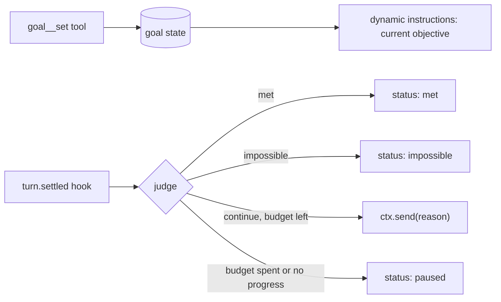

# Session goals

## Summary

Coding harnesses now ship `/goal`: a durable objective attached to a conversation. After each turn, a judge decides whether the objective is met. If not, the agent starts another turn on its own, guided by the judge's reason, until the goal is met, judged impossible, paused, or out of budget. Authors building long-running eve agents ask for the same loop.

eve already has most of the pieces: durable per-session state, per-call dynamic instructions, `turn.settled` hooks, turns that wait for their tasks, and durable sessions that park without compute. One piece is missing. Nothing that observes a settled turn can start the next one in the same session. Hooks can only observe and `cancel()`, task results never start a turn, and dynamic schedules start fresh sessions instead of steering an existing one.

This plan adds one core primitive, a same-session `ctx.send()` on `HookContext`, and builds goals on top of it as an extension. The core stays lean: goals are a policy, and sending the next message is the mechanism.

## Prior art

| System                                                                                    | Judge                                                                                            | Trigger                                                                     | Budget and safety                                                                                    |
| ----------------------------------------------------------------------------------------- | ------------------------------------------------------------------------------------------------ | --------------------------------------------------------------------------- | ---------------------------------------------------------------------------------------------------- |
| [Claude Code](https://code.claude.com/docs/en/goal)                                       | Separate small model reads condition plus transcript; verdict met, not met, or impossible, with a reason | Session-scoped prompt Stop hook after every turn                            | Stops after several turns without tool use; skips evaluation while subagents or shells run; clears on unrecoverable errors |
| [Codex](https://developers.openai.com/cookbook/examples/codex/using_goals_in_codex)        | The working model marks the goal complete through a tool, only on evidence                       | Continuation template injected at idle safe boundaries only                 | Thread-scoped budget; interruptions pause; a continuation turn with no tool call suppresses the next |
| [Mastra](https://mastra.ai/docs/harness/goals)                                             | LLM-as-judge scorer inside the agent loop, optionally with read-only verification tools          | In-loop step after `isTaskComplete`                                         | `maxRuns` (default 50); exhaustion pauses and is resumable                                           |
| [Hermes](https://hermes-agent.nousresearch.com/docs/user-guide/features/goals)             | Auxiliary model returns done, blocked, continue, or wait                                         | Continuation prompt fed back into the same session                          | Turn budget; judge errors fail open                                                                  |
| [Antigravity](https://antigravity.google/docs/commands/goal/)                              | None; the agent audits its own work against a deliverables checklist                             | Stop hook blocks premature turn end                                         | No iteration cap; waits for subagents and background tasks                                           |

The shared shape is: durable objective per thread, a trigger at turn end, a judge, a budget with a no-progress guard, pause, resume, and clear, and waiting for background work. eve already provides the last item: [turns wait for their tasks](../docs/tools/tasks.md#turns-wait-for-their-tasks).

## Core: `ctx.send()` from hooks

Today a hook acts on the session in exactly one way: `ctx.cancel(reason?)`. The handler pushes a command, `queueCommands` stores it in reactions state as an intent bound to the **active turn**, and `actOnCancels` stops that turn after the commit. Intents are turn-scoped by construction: a request made between turns is dropped. On `turn.settled` there is no active turn, so nothing a hook asks for there can take effect.

A goal continuation is a message into the current conversation, so it should look like one. eve already calls that `send`: Slack message hooks expose a thread-bound `ctx.send()` that starts a separate turn in the same conversation, and #5372 gives every server-side send (`Session.send`, `from().send`, `to().send`, Slack `ctx.send`) one `MessageSendOptions` type. Hooks get the same verb and a subset of the same options. It is the first hook command that targets the next turn instead of the running one.

```ts
type HookSendOptions = Pick<MessageSendOptions, "auth" | "context" | "idempotencyKey">;

interface HookContext {
  // existing: session, channel, conversation, view, turn, now, agent, position,
  // occurrence, memo, getSandbox(), cancel(reason?)
  send(message: string, options?: HookSendOptions): void;
}
```

Defaults fill what a hook should not have to know: `auth` is the principal of the delivery that started the settled turn, and `idempotencyKey` is the hook's `occurrence.idempotencyKey`. `turnPolicy` is not an option: a hook send always queues. `history`, `outputSchema`, and `title` are omitted because the session, its history, and its title already exist.

The smallest use needs no model judge. This hook keeps the agent working until the test suite passes, for at most ten continuations:

```ts title="agent/hooks/until-green.ts"
import { defineState } from "eve/context";
import { defineHook } from "eve/hooks";

const attempts = defineState("until-green.attempts", () => 0);

export default defineHook({
  events: {
    async "turn.settled"(event, ctx) {
      if (event.data.outcome !== "completed") return;
      const sandbox = await ctx.getSandbox();
      const test = await sandbox.run({ command: "pnpm test --reporter=dot" });
      if (test.exitCode === 0 || attempts.get() >= 10) {
        attempts.update(() => 0);
        return;
      }
      attempts.update((n) => n + 1);
      ctx.send(`Tests still fail. Fix them without editing test files.\n\n${test.stdout.slice(-2000)}`);
    },
  },
});
```

Semantics reuse the `ctx.cancel()` command path where they can, and differ where the target turn differs:

|                   | `cancel(reason?)`                                 | `send(message, options?)`                                             |
| ----------------- | ------------------------------------------------- | --------------------------------------------------------------------- |
| Targets           | The running turn                                  | The next turn                                                         |
| Eligible on       | Events while a turn runs                          | `turn.settled` with outcome `completed` only                          |
| Stored as         | An intent keyed by the active `turnId`            | A session-level intent with no turn, keyed by the settled `turnId`    |
| Consumed by       | `actOnCancels` after the commit                   | The idle wait in `nextTurnDelivery`, when nothing is queued           |
| Effect            | `turn.cancelled`, then `session.waiting`          | A message delivery that starts a normal turn                          |
| Competing input   | The first cancel wins                             | Dropped if any delivery is already queued or pending; people win      |

- **Recorded now, applied later.** Channel sends return a delivery receipt, but a hook send returns `void`: it is recorded during the handler and admitted after the event's hooks return, so retries and workflow replay stay deterministic. Like `cancel()`, calling it after the handler settled throws. If the handler throws, its commands are discarded with the rest of its requests.
- **Fails closed on events.** Eligibility is a total map over hook event types, so a new event does not compile until it is classified. A call on an ineligible event, or on a `failed` or `cancelled` settle, is ignored with a warning.
- **At most one per settled turn.** The intent is keyed by the settled `turnId`, and the hook's `occurrence.idempotencyKey` dedupes retried steps. A second request for the same turn, from the same or another hook, is ignored with a warning.
- **Queues, never steers.** `nextTurnDelivery` takes the intent only when the input queue and inbox are empty. Any person's message, answer, or control that arrives first drops it. A turn starting for any other reason also drops it, because the intent belongs to the turn that settled.
- **Arrives as an ordinary message delivery.** `delivery.admitted` records `source: { hook: "<slug>" }`, a new member of the open `DeliverySource` set, and the resolved principal. The delivery passes through the owning channel's `deliver` hook like any other send. The model receives the text as the next user message. Channels and UIs can render hook-origin turns distinctly.
- **Same session only.** A hook send never creates or reaches another session, so the delegated-session refusal on `ctx.to()` in #5096 does not apply: that refusal exists because a new session would outlive the delegation and act for the caller, and a message into the running session creates nothing new. Whether the caller waits for those extra turns is an open question below.
- **No new settlement path.** The continuation runs as a normal turn, so approvals, task waiting, and `limits.sessionUsage` apply unchanged. Unattended sessions keep failing with `SESSION_USAGE_LIMIT_REACHED` instead of prompting.
- **Failures between turns are logged.** A hook that throws during a turn fails that turn. On `turn.settled` there is no turn left to fail, so `reportReactionFailure` logs the error and nothing continues.

Adding `send()` bumps the hook extension contract epoch and retains the previous one.

## Extension: goals

Goals ship as an extension built only on public APIs plus hook `ctx.send()`.



- **State.** `defineState("goal")` holds `{ objective, status, runs, maxRuns, idleRuns, continued, lastReason, costAtStart }`. `status` is `active`, `paused`, `met`, or `impossible`. One goal per session; setting a new one replaces it.
- **Tools.** Names derive from paths and the mount adds the prefix. `goal__set` sets or replaces the objective (up to 4,000 characters, as in Claude Code and Codex) and is the only lifecycle action the model may take on its own. `goal__status` reports status, runs, spend, and the last reason. `goal__pause`, `goal__resume`, and `goal__clear` are for the person; channels can map them to a `/goal` command. The model can never mark a goal met.
- **Instructions.** A `defineDynamic` instruction shows the objective, the run count, and the judge's last reason before every model call while the goal is active.
- **Judge.** A structured-output model call returns `{ verdict: "met" | "continue" | "impossible", reason }`. It reads the objective, the turn's reply (`reply(ctx.view, turnId)`), and the turn's settled calls (`call(ctx.view, callId)`). Hooks do not receive assembled history, so the judge sees evidence the turn surfaced, not the whole transcript. `decide()` is not enough on its own because it returns no prose rationale, and the reason is what steers the next turn.
- **Budget and guards.** Default `maxRuns` is 50; an optional spend cap compares `usage(ctx.view).total.costUsd` with `costAtStart`. Reaching either pauses with a reason. Two consecutive continuation turns with no tool calls pause the goal. A `failed` or `cancelled` turn pauses it. A judge error pauses it: unattended sessions should not burn budget on a broken judge.

### Sketch

A consumer mounts it like any extension:

```ts title="agent/extensions/goal.ts"
import goal from "@eve/goal";

export default goal({ judge: "openai/gpt-6-luna", maxRuns: 30, maxCostUsd: 25 });
```

The judge hook carries the policy. State, tools, and instructions are ordinary contributions:

```ts title="extension/hooks/judge.ts"
import { calls, reply, usage } from "eve/events";
import { defineHook } from "eve/hooks";
import extension from "../extension";
import { judge } from "../lib/judge";
import { goal } from "../lib/state";

export default defineHook({
  events: {
    async "turn.settled"(event, ctx) {
      const current = goal.get();
      if (current?.status !== "active") return;
      const pause = (reason: string) => goal.update((g) => g && { ...g, status: "paused", lastReason: reason });

      if (event.data.outcome !== "completed") return pause(`Turn ${event.data.outcome}.`);
      const { turnId } = event.data;
      const turnCalls = calls(ctx.view, { turnId });
      const idle = current.continued && turnCalls.length === 0 ? current.idleRuns + 1 : 0;
      if (idle >= 2) return pause("Two continuation turns made no tool calls.");
      if (current.runs >= current.maxRuns) return pause(`Reached ${current.maxRuns} runs.`);
      const spent = (usage(ctx.view).total.costUsd ?? 0) - current.costAtStart;
      if (spent >= extension.config.maxCostUsd) return pause(`Spent $${spent.toFixed(2)}.`);

      const verdict = await judge(current.objective, reply(ctx.view, turnId), turnCalls).catch(() => undefined);
      if (verdict === undefined) return pause("The goal judge failed.");
      if (verdict.verdict !== "continue") {
        return goal.update((g) => g && { ...g, status: verdict.verdict, lastReason: verdict.reason });
      }
      goal.update((g) => g && { ...g, runs: g.runs + 1, idleRuns: idle, continued: true, lastReason: verdict.reason });
      ctx.send(`Continue toward the goal. ${verdict.reason}`);
    },
  },
});
```

```ts title="extension/instructions.ts"
import { defineDynamic, defineInstructions } from "eve/instructions";
import { goal } from "./lib/state";

export default defineDynamic(() => {
  const current = goal.get();
  if (current?.status !== "active") return null;
  return defineInstructions({
    role: "system",
    content: [
      `<goal runs="${current.runs}/${current.maxRuns}">${current.objective}</goal>`,
      current.lastReason && `<last_judgement>${current.lastReason}</last_judgement>`,
      "Work toward the goal. Prove progress with tool output; the judge only sees what this turn surfaces.",
    ].filter(Boolean).join("\n"),
  });
});
```

`extension/tools/set.ts` (mounted as `goal__set`) validates the objective and writes `{ status: "active", runs: 0, idleRuns: 0, continued: false, costAtStart }`, reading `costAtStart` from `usage` in the tool's session view. `extension/lib/judge.ts` makes one structured-output model call with the configured judge model and returns `{ verdict, reason }`.

## Alternatives considered

- **Loop inside a workflow tool.** Works today: a `goal_run` workflow tool loops `ctx.agent(...).send()` and judges each result in a step. But the work runs in a child session with fresh history, and the parent turn stays open for the whole goal. Useful as an interim recipe, not as the goal primitive.
- **Self-call through `eve/client`.** A `turn.settled` hook calls `attachSession(id).send(..., { turnPolicy: "queue" })` against its own deployment. It adds an auth and base-URL dependency and race risk for something the runtime can do directly.
- **`ctx.to()` back into the current conversation.** With #5096, tools get `ctx.to(channel, target).send()`. Slack's `receive()` with an existing `threadTs` sends through `from(<thread>)`, which reaches the session that owns the thread, so a tool in a Slack thread can queue its own next turn:

  ```ts
  await ctx.to(slack, { channelId, threadTs }).send("Continue toward the goal.", {
    auth: ctx.session.auth.current,
    turnPolicy: "queue",
    idempotencyKey: `${ctx.session.id}:${ctx.callId}`,
  });
  ```

  That is a usable interim recipe once the stack lands, but not the goal primitive. It is channel-specific: the extension would need the consumer's channel module and a per-channel target mapping, and sessions without an addressable channel cannot use it. Delegated sessions are refused by design. It is only on tools, so continuation depends on the model calling a checkpoint tool rather than on a judge that always runs. Giving hooks `ctx.to()` would fix the last point but not the first two.
- **`ctx.continue(message)`.** An earlier draft of this plan. Same semantics, but a new verb for what is a message send, with its own option shape instead of `MessageSendOptions`.
- **Schedules.** Dynamic schedules start fresh sessions and do not steer an existing conversation. A minute-granularity dispatcher adds latency and an external store.
- **Stop hook that blocks turn end, or a judge inside the harness loop.** Matches Antigravity and Mastra, but changes `harness/` turn settlement. Continuation after settlement gets the same behavior with a smaller core change.

## Open questions

- Confirm that `defineState` writes from a `turn.settled` handler persist into the next turn and that dynamic instructions can read the slot. The docs only show `turn.started` and task events. If not, the extension needs a memo or external store.
- Whether the hook should see that a turn was a continuation, for example from the turn's delivery `source`, instead of tracking it in state.
- Whether dropping a hook send when a person's input is already pending should be the fixed rule or an option. Dropping keeps shared threads safe; queuing behind the person's message matches `Session.send` but can start a stale turn that the extension must dedupe by `turnId`.
- In a delegated session, the caller receives the child's reply when its turn settles. A hook send there starts turns nobody waits for. Goals in subagents likely need the hook send to keep the delegated task open until the child stops sending.
- Whether a hook send should support a delay (`send(message, { after })`) for goals that wait on external events, using a durable sleep in the session workflow.
- How first-party channels (Slack, web chat) should present hook-origin turns.
- Which principal a hook send defaults to when the settled turn had none.
