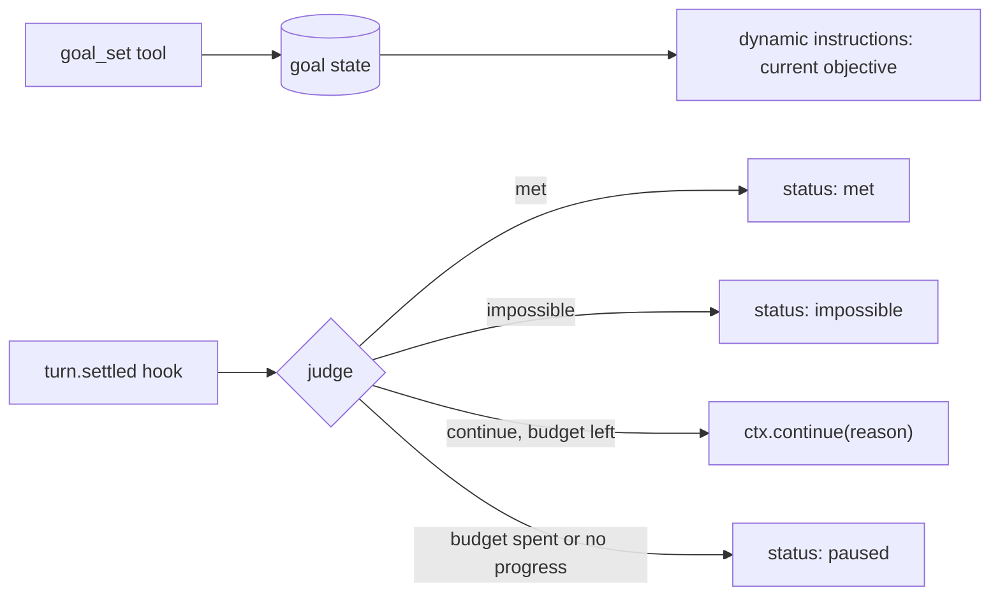

# Session goals

## Summary

Coding harnesses now ship `/goal`: a durable objective attached to a conversation. After each turn, a judge decides whether the objective is met. If not, the agent starts another turn on its own, guided by the judge's reason, until the goal is met, judged impossible, paused, or out of budget. Authors building long-running eve agents ask for the same loop.

eve already has most of the pieces: durable per-session state, per-call dynamic instructions, `turn.settled` hooks, turns that wait for their tasks, and durable sessions that park without compute. One piece is missing. Nothing that observes a settled turn can start the next one in the same session. Hooks can only observe and `cancel()`, task results never start a turn, and dynamic schedules start fresh sessions instead of steering an existing one.

This plan adds one core primitive, `ctx.continue()` on `HookContext`, and builds goals on top of it as an extension. The core stays lean: goals are a policy, and continuation is the mechanism.

## Prior art

| System                                                                                    | Judge                                                                                            | Trigger                                                                     | Budget and safety                                                                                    |
| ----------------------------------------------------------------------------------------- | ------------------------------------------------------------------------------------------------ | --------------------------------------------------------------------------- | ---------------------------------------------------------------------------------------------------- |
| [Claude Code](https://code.claude.com/docs/en/goal)                                       | Separate small model reads condition plus transcript; verdict met, not met, or impossible, with a reason | Session-scoped prompt Stop hook after every turn                            | Stops after several turns without tool use; skips evaluation while subagents or shells run; clears on unrecoverable errors |
| [Codex](https://developers.openai.com/cookbook/examples/codex/using_goals_in_codex)        | The working model marks the goal complete through a tool, only on evidence                       | Continuation template injected at idle safe boundaries only                 | Thread-scoped budget; interruptions pause; a continuation turn with no tool call suppresses the next |
| [Mastra](https://mastra.ai/docs/harness/goals)                                             | LLM-as-judge scorer inside the agent loop, optionally with read-only verification tools          | In-loop step after `isTaskComplete`                                         | `maxRuns` (default 50); exhaustion pauses and is resumable                                           |
| [Hermes](https://hermes-agent.nousresearch.com/docs/user-guide/features/goals)             | Auxiliary model returns done, blocked, continue, or wait                                         | Continuation prompt fed back into the same session                          | Turn budget; judge errors fail open                                                                  |
| [Antigravity](https://antigravity.google/docs/commands/goal/)                              | None; the agent audits its own work against a deliverables checklist                             | Stop hook blocks premature turn end                                         | No iteration cap; waits for subagents and background tasks                                           |

The shared shape is: durable objective per thread, a trigger at turn end, a judge, a budget with a no-progress guard, pause, resume, and clear, and waiting for background work. eve already provides the last item: [turns wait for their tasks](../docs/tools/tasks.md#turns-wait-for-their-tasks).

## Core: `ctx.continue()`

```ts
interface HookContext {
  // existing: session, agent, view, turn, memo, occurrence, cancel(reason?)
  continue(message: string): void;
}
```

```ts title="agent/hooks/keep-going.ts"
import { defineHook } from "eve/hooks";

export default defineHook({
  events: {
    async "turn.settled"(event, ctx) {
      if (event.data.outcome !== "completed") return;
      if (await shouldContinue(ctx)) ctx.continue("Keep going: two auth tests still fail.");
    },
  },
});
```

Semantics follow [`ctx.cancel()`](./hook-turn-cancellation.md):

- **Recorded now, applied after the event's hooks return.** `void`, never throws. The request is applied once every subscriber for the event has run, so an audit hook still sees the settled turn.
- **Only on `turn.settled` with outcome `completed`.** Eligibility is a total, fail-closed map over hook event types, like cancellation. A call anywhere else, or after dispatch, is ignored with a warning.
- **At most one per settled turn.** A second call in the same dispatch is ignored with a warning. Dedupe uses `occurrence.idempotencyKey`, so a retried hook step does not continue twice.
- **Queues, never steers.** If any delivery is already pending for the session (a person's message, an answer, a control), the continuation is dropped and logged. Human input always wins.
- **Arrives as an ordinary message delivery.** `delivery.admitted` records `source: { hook: "<slug>" }` and the principal of the turn that settled. Channels and UIs can render hook-origin turns distinctly; the model receives the text as the next message.
- **No new settlement path.** The continuation starts a normal turn, so limits, approvals, task waiting, and `limits.sessionUsage` apply unchanged. Unattended sessions keep failing with `SESSION_USAGE_LIMIT_REACHED` instead of prompting.

Adding `continue()` bumps the hook extension contract epoch and retains the previous one.

## Extension: goals

Goals ship as an extension built only on public APIs plus `ctx.continue()`.



- **State.** `defineState("goal")` holds `{ objective, status, runs, maxRuns, lastReason, usageAtStart }`. `status` is `active`, `paused`, `met`, or `impossible`. One goal per session; setting a new one replaces it.
- **Tools.** `goal_set` sets or replaces the objective (up to 4,000 characters, as in Claude Code and Codex) and is the only lifecycle action the model may take on its own. `goal_get` reports status, runs, spend, and the last reason. `goal_pause`, `goal_resume`, and `goal_clear` are for the person; channels can map them to a `/goal` command. The model can never mark a goal met.
- **Instructions.** A `defineDynamic` instruction shows the objective, the run count, and the judge's last reason before every model call while the goal is active.
- **Judge.** A structured-output model call returns `{ verdict: "met" | "continue" | "impossible", reason }`. It reads the objective, the turn's reply (`reply(ctx.view, turnId)`), and the turn's settled calls (`call(ctx.view, callId)`). Hooks do not receive assembled history, so the judge sees evidence the turn surfaced, not the whole transcript. `decide()` is not enough on its own because it returns no prose rationale, and the reason is what steers the next turn.
- **Budget and guards.** Default `maxRuns` is 50; an optional spend cap compares `usage(ctx.view).total` with `usageAtStart`. Reaching either pauses with a reason. Two consecutive continuation turns with no tool calls pause the goal. A `failed` or `cancelled` turn pauses it. A judge error pauses it: unattended sessions should not burn budget on a broken judge.

## Alternatives considered

- **Loop inside a workflow tool.** Works today: a `goal_run` workflow tool loops `ctx.agent(...).send()` and judges each result in a step. But the work runs in a child session with fresh history, and the parent turn stays open for the whole goal. Useful as an interim recipe, not as the goal primitive.
- **Self-call through `eve/client`.** A `turn.settled` hook calls `attachSession(id).send(..., { turnPolicy: "queue" })` against its own deployment. It adds an auth and base-URL dependency and race risk for something the runtime can do directly.
- **Schedules.** Dynamic schedules start fresh sessions and do not steer an existing conversation. A minute-granularity dispatcher adds latency and an external store.
- **Stop hook that blocks turn end, or a judge inside the harness loop.** Matches Antigravity and Mastra, but changes `harness/` turn settlement. Continuation after settlement gets the same behavior with a smaller core change.

## Open questions

- Confirm that `turn.settled` hooks can write `defineState` and that dynamic instructions can read it; otherwise the extension needs a memo or external store.
- Whether a continuation should support a delay (`continue(message, { after })`) for goals that wait on external events, using a durable sleep in the session workflow.
- How first-party channels (Slack, web chat) should present hook-origin turns.
- Which principal continuations run as when the settled turn had none.
