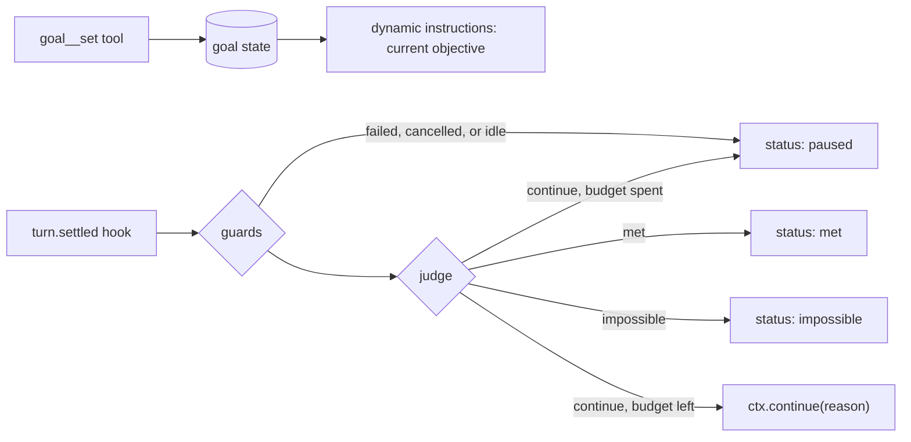

# Session goals

> **AI status:** Written entirely by AI; human review pending.

## Summary

Coding harnesses now ship `/goal`: a durable objective attached to a conversation. After each turn, a judge decides whether the objective is met. If not, the agent starts another turn on its own, guided by the judge's reason, until the goal is met, judged impossible, paused, or out of budget. Authors building long-running eve agents ask for the same loop.

eve already has most of the pieces: durable per-session state, per-call dynamic instructions, `turn.settled` hooks, turns that wait for their tasks, and durable sessions that park without compute. One piece is missing. Nothing that observes a settled turn can start the next one in the same session. Hooks can only observe and `cancel()`, task results never start a turn, and dynamic schedules start fresh sessions instead of steering an existing one.

This plan adds one core primitive, a same-session `ctx.continue()` on `turn.settled` hook handlers, and builds goals on top of it as an extension. The core stays lean: goals are a policy, and continuing a turn is the mechanism.

## Prior art

Several coding agents and agent frameworks ship goal loops. They differ mainly in who judges and what triggers the next turn:

| Pattern                    | Judge                                                                                                                      | Trigger                                       | Safety                                                                                |
| -------------------------- | -------------------------------------------------------------------------------------------------------------------------- | --------------------------------------------- | ------------------------------------------------------------------------------------- |
| Separate judge after turns | A small, fast model reads the condition and evidence; met, not met, or impossible, with a reason that steers the next turn | A stop hook after every turn                  | Stops after several turns without tool use; skips judging while background work runs  |
| Self-assessed completion   | The working model marks the goal complete through a tool, only on evidence                                                 | A continuation prompt at idle boundaries only | Thread-scoped budget; interruptions pause; no continuation while user input is queued |
| Judge inside the loop      | An LLM-as-judge scorer, optionally with read-only verification tools                                                       | A step in the agent loop before it returns    | Run budget (commonly 50); exhaustion pauses and is resumable                          |
| Blocked stop               | None; the agent audits its own work against a deliverables checklist                                                       | A stop hook refuses premature turn ends       | Often no iteration cap; waits for subagents and background tasks                      |

The shared shape is: durable objective per thread, a trigger at turn end, a judge, a budget with a no-progress guard, pause, resume, and clear, and waiting for background work. eve already provides the last item: [turns wait for their tasks](../docs/tools/tasks.md#turns-wait-for-their-tasks).

## Core: `ctx.continue()` from hooks

Today a hook acts on the session in exactly one way: `ctx.cancel(reason?)`. The handler pushes a command, `queueCommands` stores it in reactions state as an intent bound to the **active turn**, and `actOnCancels` stops that turn after the commit. Intents are turn-scoped by construction: a request made between turns is dropped. On `turn.settled` there is no active turn, so nothing a hook asks for there can take effect.

A goal continuation is a message into the current conversation, so it takes what every send takes: `MessageContent` and the shared send options. It isn't a send, though. Everywhere else in eve, `send` (`Session.send`, `from().send`, `to().send`, Slack's `ctx.send`) dispatches into the inbox now and returns a `Promise<Delivery>`. A hook runs inside a session step, its message can't be admitted until the handler returns, and it is dropped if other input starts a turn first. There is no receipt to return. So it gets its own verb, `continue`, with the shared types and a small synchronous result:

```ts
type HookContinueOptions = Pick<SessionSendOptions, "context"> &
  Partial<Pick<SessionSendOptions, "auth">>;

type HookContinueResult =
  | { readonly queued: true }
  | {
      readonly queued: false;
      readonly reason: "not-settled" | "not-completed" | "already-queued" | "auth-conflict";
    };

// Only `turn.settled` and `*` handlers receive it: HookContext<TKey> adds it from a total map
// over hook event keys, so a handler on any other key can't call it.
interface HookContinue {
  continue(message: MessageContent, options?: HookContinueOptions): HookContinueResult;
}
```

Defaults fill what a hook should not have to know. There's no `idempotencyKey`: the continuation is recorded with the step that settled the turn, which a retry never runs handlers for again, and its delivery's key derives from the settled turn. `auth` is omitted: the continuation names no sender, and the turn runs as the session's current identity, so a shared thread doesn't attribute the hook's words to whoever spoke last. `turnPolicy` is not an option: a continuation always queues. `history`, `outputSchema`, and `title` are omitted because the session, its history, and its title already exist.

The smallest use needs no model judge. This hook keeps the agent working until the test suite passes, for at most ten continuations:

```ts title="agent/hooks/until-green.ts"
import { defineState } from "eve/context";
import { defineHook } from "eve/hooks";

const attempts = defineState("until-green.attempts", () => 0);

export default defineHook({
  events: {
    async "turn.settled"(event, ctx) {
      if (event.data.outcome !== "completed") return;
      const sandbox = await ctx.getSandbox();
      const test = await sandbox.run({ command: "pnpm test --reporter=dot" });
      if (test.exitCode === 0 || attempts.get() >= 10) {
        attempts.update(() => 0);
        return;
      }
      attempts.update((n) => n + 1);
      ctx.continue(
        `Tests still fail. Fix them without editing test files.\n\n${test.stdout.slice(-2000)}`,
      );
    },
  },
});
```

Semantics reuse the `ctx.cancel()` command path where they can, and differ where the target turn differs:

|                 | `cancel(reason?)`                        | `continue(message, options?)`                                              |
| --------------- | ---------------------------------------- | -------------------------------------------------------------------------- |
| Targets         | The running turn                         | The next turn                                                              |
| Eligible on     | Events while a turn runs                 | `turn.settled` and `*` handlers; a completed turn, or one it cancelled     |
| Stored as       | An intent keyed by the active `turnId`   | The session's one continuation slot, keyed by the settled `turnId`         |
| Consumed by     | `actOnCancels` after the commit          | The idle wait in `nextTurnDelivery`, when nothing is queued or handed over |
| Effect          | `turn.cancelled`, then `session.waiting` | A message delivery that starts a normal turn                               |
| Competing input | The first cancel wins                    | Yields to any other turn, cancel, clear, or reset; survives compaction     |

- **Recorded now, applied later.** It returns `{ queued }` synchronously: it is recorded during the handler and admitted after the event's hooks return, so retries and workflow replay stay deterministic. Like `cancel()`, calling it after the handler settled throws. If the handler throws, its commands are discarded with the rest of its requests. Like other hook effects, a continuation is lost if the step that settled the turn is interrupted before it is saved.
- **Fails closed on events, in the types.** A total map over hook event keys decides which handlers receive `continue`, so a new event does not compile until it is classified, and a `turn.started` handler has no `continue` to call. A `*` handler receives it for every event and gets `{ queued: false, reason: "not-settled" }` off `turn.settled`; a `failed` turn, or one a person or another hook cancelled, returns `not-completed`.
- **Cancel, then redirect.** A hook that cancelled the turn can continue it, for example to cancel an agent that started editing test files and tell it not to. Only that hook can: a person's `session.cancel()` must still stop the session, and letting another hook continue it would let a guard and a goal loop against each other. Failed turns can't be continued yet: a failure that repeats, such as `SESSION_USAGE_LIMIT_REACHED`, would turn a retry hook into a loop of failing turns.
- **One next turn per settled turn, shared by hooks.** The intent is keyed by the settled `turnId`. Each hook that continues the turn adds a payload to its one delivery, in hook order, the way the input queue coalesces one principal's consecutive messages into a turn, so a goal hook and a lint hook both contribute and load order can't starve either. A hook asking twice returns `already-queued`. One delivery acts for one principal: a continuation that acts for a different principal than the queued one returns `auth-conflict`, where omitted `auth` means the session's current identity, since it couldn't run as a separate turn without yielding to the first.
- **Queues, never steers, and yields.** The intent belongs to the turn that settled. `nextTurnDelivery` admits it only when the input queue and inbox are empty. Behind an awaited handover, older input is queued but not yet readable, so the continuation waits for the handover and yields to that input as well. Any other turn that starts first discards it: a person's message, an answer, a schedule send, or another hook's continuation. A compaction leaves it queued, so it cannot stall a goal. `cancel`, `clear`, and `reset` discard it, so a person can always stop a loop from any channel, and a cleared session doesn't start on stale guidance. An expiry ends the session with the continuation unsent. `queued: true` means recorded; yielding happens later, and the hook sees the turn that won settle next.
- **Arrives as a marked message delivery.** `delivery.admitted` records `source: { channel, hook: "<slug>" }` and no principal unless the hook passes `auth`. The delivery passes through the owning channel's `deliver` hook like any other message. The model receives the message and `context` as the hook passed them. From `source.hook`, intake records a durable `context.instruction` ahead of the message saying it was sent automatically, not by a person, so the prompt the model reads matches history and measured prompt sizes stay exact. Channels and UIs can render hook-origin turns distinctly.
- **Same session only.** A continuation never creates or reaches another session, so the delegated-session refusal on `ctx.to()` in #5096 does not apply: that refusal exists because a new session would outlive the delegation and act for the caller, and a message into the running session creates nothing new. Whether the caller waits for those extra turns is an open question below.
- **No new settlement path.** The continuation runs as a normal turn, so approvals, task waiting, and `limits.sessionUsage` apply unchanged. Unattended sessions keep failing with `SESSION_USAGE_LIMIT_REACHED` instead of prompting.
- **Failures between turns are logged.** A hook that throws during a turn fails that turn. On `turn.settled` there is no turn left to fail, so `reportReactionFailure` logs the error and nothing continues.

Yielding is a fixed rule, not an option. For a goal it loses nothing: the hook runs after every `turn.settled`, including the person's turn, so their turn becomes the next goal iteration and is judged with their input in view. Queuing behind other input instead would deliver guidance written before the person spoke (after "stop" or "try the other approach"), add a turn per interjection that spends budget, and let channels that batch adjacent same-auth messages merge stale guidance into the person's message. Hooks that must always deliver a message, such as notifications, should use a channel send instead.

Extension compatibility is checked against the eve version an extension was built with, so `continue` needs no separate contract bump.

## Extension: goals

Goals ship as `eve/extensions/goal`, built only on public APIs plus hook `ctx.continue()`. Its source is the private `@eve/goal` workspace package, which eve's build copies into the `eve` package, as it does for `eve/extensions/code`.



- **Options.** `model` is the default judge's model, an AI Gateway model ID or a model instance, defaulting to `"openai/gpt-6-luna-fast"`. `judge` replaces the default judge with a function. `maxRuns` defaults to 50. `maxCostUsd` is unlimited unless set. `setApproval` puts `goal__set` behind an approval policy.
- **State.** `defineState("goal")` holds `{ objective, status, runs, maxRuns, idleRuns, continued, costAtStart, lastReason, notes }`. `status` is `active`, `paused`, `met`, or `impossible`. One goal per session; setting a new one replaces it. A turn is the goal's own when `continued` is set and every delivery it consumed has `source.hook`, so a person's message that joins or replaces the continuation isn't counted as one. The first `call.settled` after the goal is set records `costAtStart`.
- **Tools.** Names derive from paths and the mount adds the prefix. `goal__set` sets or replaces the objective (up to 4,000 characters) and is the only lifecycle action the model may take on its own. `goal__status` reports the objective, status, runs, and the last reason. `goal__pause`, `goal__resume`, and `goal__clear` always require the person's approval. Resume grants a fresh run and spend budget. The model can never mark a goal met.
- **Instructions.** A `defineDynamic` instruction shows the objective, the run count, and the judge's last reason before every model call while the goal is active.
- **Judge.** A structured-output model call returns `{ verdict: "met" | "continue" | "impossible", reason, notes }`. It reads the objective, the input the turn consumed (the text parts of its deliveries), the turn's reply text (`reply(ctx.view, turnId)`), and its settled calls (`calls(ctx.view, { turnId })`). Reading the input lets a person's "stop" or change of direction reach the verdict. Hooks do not receive assembled history, and the hook view keeps only the latest turn, so the judge sees evidence the turn surfaced, not the whole transcript. To carry proof across turns, each verdict also returns `notes` on what the evidence has proved so far, stored in goal state and read back on the next verdict. Every field is bounded and JSON-encoded with `<` escaped, so session text can't close a tag or forge evidence, and calls are trimmed from the oldest to fit. `decide()` is not enough on its own because it returns no prose rationale, and the reason is what steers the next turn.
- **Guards and budget.** Before the judge, a `failed` or `cancelled` turn pauses the goal, and so do two of the goal's own continuation turns in a row without tool calls. A judge error pauses it: unattended sessions should not burn budget on a broken judge. Every other completed turn is judged, so a turn that finishes the work at a limit is still met. The limits only stop the next continuation: on `continue`, the goal pauses if it reached `maxRuns` or its spend since `costAtStart` reached `maxCostUsd`. The judge's own calls aren't counted.
- **Shared continuations.** When another hook already continued the turn for a different principal, `ctx.continue()` returns `auth-conflict`. The goal stays active without `continued`, and goes on from the next turn that settles.

### Sketch

A consumer mounts it like any extension:

```ts title="agent/extensions/goal.ts"
import goal from "eve/extensions/goal";
import { always } from "eve/tools/approval";

export default goal({ maxRuns: 30, maxCostUsd: 25, setApproval: always() });
```

The judge hook reads the turn and applies the policy. `check()` and `settle()` in `lib/policy.ts` hold the guards and verdict handling without eve runtime imports, so unit tests cover them directly:

```ts title="extension/hooks/judge.ts"
import { calls, deliveries, reply, usage } from "eve/events";
import { defineHook } from "eve/hooks";
import extension from "../extension.ts";
import { modelJudge, type GoalVerdict } from "../lib/judge.ts";
import { check, pause, settle } from "../lib/policy.ts";
import { goal } from "../lib/state.ts";

export default defineHook({
  events: {
    async "turn.settled"(event, ctx) {
      const current = goal.get();
      if (current?.status !== "active") return;
      const { turnId } = event.data;
      const turnCalls = calls(ctx.view, { turnId });
      const input = deliveries(ctx.view, { turnId });
      const costUsd = usage(ctx.view).total.costUsd;
      const continued =
        current.continued === true && input.every(({ source }) => source?.hook !== undefined);
      const checked = check(current, {
        costUsd,
        continued,
        outcome: event.data.outcome,
        toolCalls: turnCalls.length,
      });
      if (checked.kind === "pause") return goal.update((g) => g && pause(g, checked.reason));

      let verdict: GoalVerdict | undefined;
      try {
        const judge = extension.config.judge ?? modelJudge(extension.config.model);
        verdict = await judge({
          objective: current.objective,
          notes: current.notes,
          input: textOf(input),
          reply: replyText(ctx.view, turnId),
          calls: turnCalls,
          abortSignal: ctx.occurrence.abortSignal,
        });
      } catch {}
      const next = settle(
        current,
        verdict,
        { costUsd, idleRuns: checked.idleRuns },
        extension.config,
      );
      const queued = next.message !== undefined && ctx.continue(next.message).queued;
      goal.update(() => (queued ? next.goal : { ...next.goal, continued: false }));
    },
  },
});
```

On `continue` with budget left, `settle()` counts a run and returns `Continue working toward the goal. <reason>` as the message.

## Alternatives considered

- **Loop inside a workflow tool.** Works today: a `goal_run` workflow tool loops `ctx.agent(...).send()` and judges each result in a step. But the work runs in a child session with fresh history, and the parent turn stays open for the whole goal. Useful as an interim recipe, not as the goal primitive.
- **Self-call through `eve/client`.** A `turn.settled` hook calls `attachSession(id).send(..., { turnPolicy: "queue" })` against its own deployment. It adds an auth and base-URL dependency and race risk for something the runtime can do directly.
- **`ctx.to()` back into the current conversation.** With #5096, tools get `ctx.to(channel, target).send()`. Slack's `receive()` with an existing `threadTs` sends through `from(<thread>)`, which reaches the session that owns the thread, so a tool in a Slack thread can queue its own next turn:

  ```ts
  await ctx.to(slack, { channelId, threadTs }).send("Continue toward the goal.", {
    auth: ctx.session.auth.current,
    turnPolicy: "queue",
    idempotencyKey: `${ctx.session.id}:${ctx.callId}`,
  });
  ```

  That is a usable interim recipe once the stack lands, but not the goal primitive. It is channel-specific: the extension would need the consumer's channel module and a per-channel target mapping, and sessions without an addressable channel cannot use it. Delegated sessions are refused by design. It is only on tools, so continuation depends on the model calling a checkpoint tool rather than on a judge that always runs. Giving hooks `ctx.to()` would fix the last point but not the first two.

- **`ctx.send(message)`.** An earlier draft of this plan. Familiar, and it matches Slack's thread-bound `ctx.send()`, but every other `send` dispatches now and returns a `Promise<Delivery>`. A hook's message can't be admitted until the handler returns and can be dropped, so the shared name would promise a receipt it can't give. `continue` keeps the shared message and option types under a verb that says what it does. It's a reserved word, but property names may be reserved words, so `ctx.continue()` works; only destructuring it doesn't. `followUp` was the other candidate, and an earlier name for it.
- **Schedules.** Dynamic schedules start fresh sessions and do not steer an existing conversation. A minute-granularity dispatcher adds latency and an external store.
- **Stop hook that blocks turn end, or a judge inside the harness loop.** Matches the blocked-stop and in-loop patterns above, but changes `harness/` turn settlement. Continuation after settlement gets the same behavior with a smaller core change.

## Open questions

- In a delegated session, the caller receives the child's reply when its turn settles. A continuation there starts turns nobody waits for. Goals in subagents likely need continuations to keep the delegated task open until the child stops continuing.
- Whether a continuation should support a delay (`continue(message, { after })`) for goals that wait on external events, using a durable sleep in the session workflow.
- How first-party channels (Slack, web chat) should present hook-origin turns.
