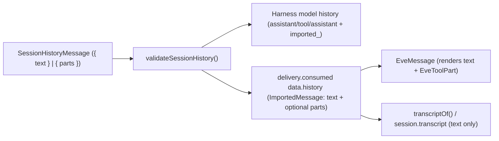

# Structured parts and completed tool exchanges in session history

## Problem

Session `history` (`#4477`, and local eval seeding in `#6891`) accepts only `{ id?, role, text }`. Real agent conversations use tools—and often execute multiple tool steps with optional narration before replying. Flattening prior tool results into assistant prose loses structure, causes real models to re-run tools they already called, and blocks conversation branching (`#5340`) and realistic multi-turn evals (`AX-5299`).

Bolting a flat `toolCalls` array onto `{ role, text }` with required non-empty `text` boxes `SessionHistoryMessage` into a dead end: multi-step turns require fake intermediate text, narration before a tool call cannot be represented, and future file attachments (`#5340`) would force a second competing parallel field (`files?`) or a competing `parts` model.

This plan introduces ordered `parts` on `SessionHistoryMessage` (starting with `text` and completed `tool` exchanges) while keeping `{ id?, role, text }` shorthand 100% compatible.

## Authoring API

Callers supply either `text` (unchanged shorthand) or non-empty ordered `parts`—never both:

```ts
import type { SessionHistoryMessage } from "eve/channels";

const history: SessionHistoryMessage[] = [
  { role: "user", text: "Is ticket T-1 still open?" },
  {
    role: "assistant",
    parts: [
      {
        type: "tool",
        name: "lookup_ticket",
        input: { id: "T-1" },
        output: { owner: "Bob", status: "open" },
      },
      {
        type: "tool",
        name: "list_notes",
        input: { id: "T-1" },
        error: "The notes service timed out.",
      },
      { type: "text", text: "T-1 is open and Bob owns it, but its notes didn't load." },
    ],
  },
];
```

```ts
export interface SessionHistoryTextPart {
  readonly type: "text";
  readonly text: string;
}

export type SessionHistoryToolPart = {
  readonly type: "tool";
  readonly name: string;
  readonly input?: JsonObject;
} & (
  | { readonly output: JsonValue; readonly error?: never }
  | { readonly output?: never; readonly error: string }
);

export type SessionHistoryUserPart = SessionHistoryTextPart;
export type SessionHistoryAssistantPart = SessionHistoryTextPart | SessionHistoryToolPart;
```

- **Discriminated unions enforce invariants at compile time:** `role: "user"` accepts only `SessionHistoryUserPart` (`tool` parts are compile-time errors on user messages), each entry takes either `text` or `parts` (never both), and each `tool` part takes either `output` or `error` (never neither or both, so pending/incomplete calls are unrepresentable).
- **Ordered multi-step turns without fake text:** Consecutive `tool` parts batch into one parallel assistant step (`assistant [tool-call…]` → `tool [tool-result…]`). Any `text` part immediately preceding a `tool` part joins that step as narration. A `text` part after a `tool` part follows its result. Tool-only steps need no placeholder text.
- **Provider-safe inputs and names:** `input` is a `JsonObject` (defaulting to `{}`), avoiding cross-provider divergence on non-object inputs (`null`, arrays, primitives). `name` matches `/^[a-zA-Z0-9_-]{1,64}$/` so Anthropic, OpenAI, and Gemini accept it.
- **Additive path for files (`#5340`):** Adding `{ type: "file", ... }` to `SessionHistoryUserPart` and/or tool results later extends the same `parts` union with zero breaking changes.
- **Works everywhere `history` applies:** channel `create()` and `send()`, channel `onMessage` hooks, and local eval `t.session({ history })`. `eve/channels` and `eve/evals` export the `SessionHistory*` types.

## Event stream and display semantics



- **Backward-compatible `delivery.consumed`:** `ImportedMessage` keeps `readonly text: string` required and adds `readonly parts?: readonly ImportedPart[]` (`ImportedTextPart | ImportedToolPart`, exported from `eve/events`). Shorthand `{ role, text }` imports emit `{ id?, role, text }` unchanged. Structured `{ role, parts }` imports emit `{ id?, role, text, parts }` where `text` joins the entry's text parts with `"\n"` (or `""` for tool-only entries), so existing readers accessing `message.text` keep working without modification.
- **Data, not execution:** eve runs no tool, approval, hook, or `toModelOutput` for imported calls, and emits no `call.*` facts or usage. Selectors, `view.calls`, `t.calledTool()`, and `turn.toolCalls` count only calls eve executed.
- **Call IDs and turn boundaries:** Imported tool calls receive deterministic IDs `imported_<n>` numbered past any existing `imported_*` IDs in `session.history`. When an imported `tool` result immediately precedes an imported or live user message, eve inserts `TOOL_RESULT_BOUNDARY` so providers such as Anthropic do not fold the user message into the tool-result turn.
- **Display and compaction:** Frontend `EveMessage` (`importedMessages()`) renders imported `parts` as `text` and completed/failed `EveToolPart` entries (`kind: "tool"`, `state: "completed" | "failed"`, `metadata.imported: true`). `transcriptOf()` and `session.transcript` continue to show only non-empty text. Compaction renders `{ type: "error-text" | "error-json" }` tool results as `errored`.
- **Dev route bounds:** `POST /eve/v1/dev/session` bounds structured history to 500 messages, 20,000 nodes, depth 32, and 512 KiB serialized UTF-8, and rejects `__proto__` keys before parsing.

## Non-goals

- File attachments in `parts` (tracked as the next additive extension to `SessionHistoryUserPart` under `#5340`).
- Pending, approval-waiting, or provider-executed tool calls.
- Checking `tool` names against the agent's current tool catalog (tools can be dynamic or removed after a stored conversation was recorded). Note: Anthropic's Messages API requires at least one tool definition on requests whose history contains `tool_use`/`tool_result` blocks.

## Validation

- **Unit:** `session-history.test.ts` (all valid and invalid `parts` shapes, discriminated rules, tool-name grammar, `JsonObject` inputs, `toImportedHistoryMessages`), `dev-session-create.test.ts` (structured history accepted; depth/node/byte/`__proto__` limits enforced), `compaction/prompt.test.ts` (`error-text` renders as `errored`), `conversation.test.ts` (frontend `EveMessage` renders imported tool parts without populating `view.calls`).
- **Integration:** `imported-history.integration.test.ts` (narration + parallel calls + error result + reply, tool-only multi-step + `TOOL_RESULT_BOUNDARY`, call ID numbering across two imports, zero `call.*` events, `delivery.consumed` `parts`), `interrupted-step.integration.test.ts` (recovery with structured history).
- **E2E:** Mock-model coverage in `e2e/fixtures/agent-channels/evals/seeded-history/eval-history-tools.eval.ts` and real-model coverage across `openai-sol` and `anthropic-opus` in `e2e/fixtures/agent-tool-stubs/evals/seeded-history.eval.ts` starting from a completed `list_tasks` tool exchange.
