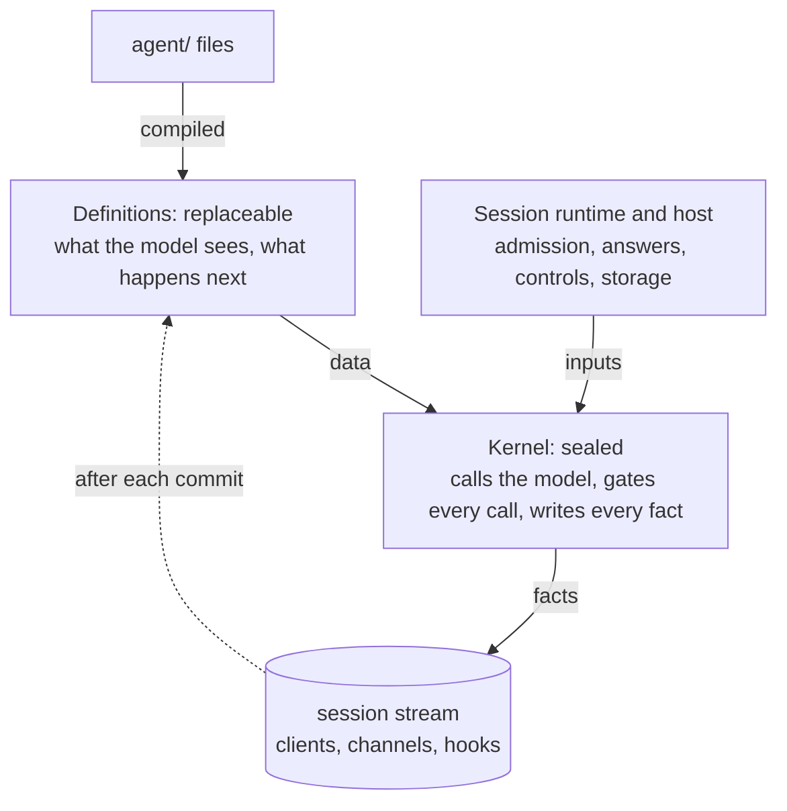
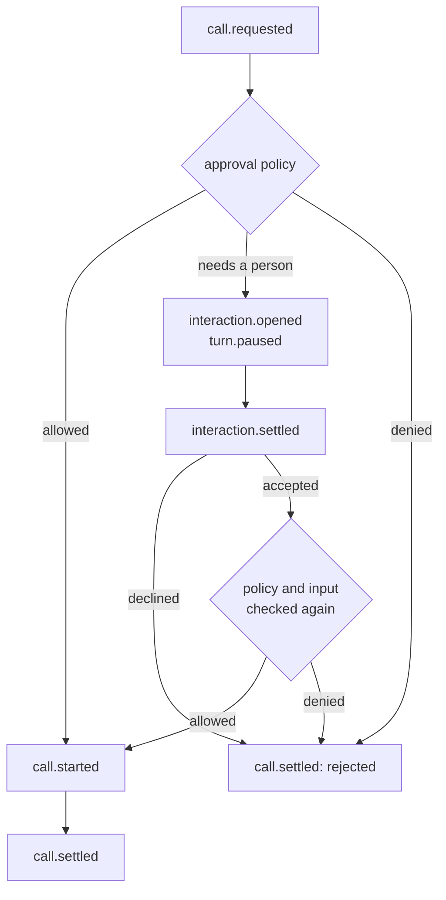
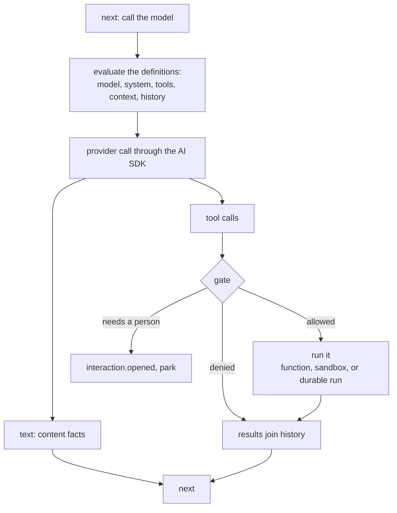
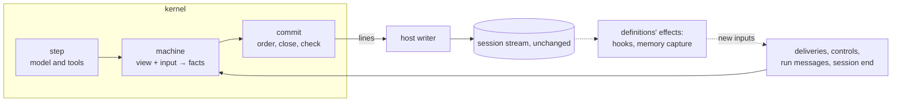

# eve from first principles: a kernel, definitions, and a harness

## Motivation

We like adding new ways for a user to customize how eve works.

Today, we have a default compaction behavior, and a few levers that you can pull to customize it, but it'd be nice if users could customize this further.

How do we enable this? We first need to define the scope of what customization can control and when user code should be invoked. For compaction, this gets tricky. We can think of it as two functions: one that says "when" you should compact ("you've hit x% of the model's context threshold") and one that says "how" you should compact ("strip out large tool results, then summarize the transcript using a model call").

This is sensible, but it brings up further questions. What if you want to strip large tool results before they get back to the model? Would the "when" be "all the time" in that case? If so, how would that interact with "normal" compaction? How would the four total functions compose with each other? etc. etc.

`defineMemory` also illustrates the challenge. It adds tools, hooks, and model-facing context. Tools and hooks already could be added directly, but prior to `defineMemory`, there was no way to directly interact with context in that way. Combining all of this into a coherent interface is necessary for comprehensibility, but what if users have other reasons they might want to interact with model-facing context that are not directly related to memory? Today, they have no way of doing so.

This leads to the first question: could we get to a point where even a feature as complex as memory could have been implemented as a user-space integration? What about other complex features like our deferred tools and skill search?

That leads to the secondary question: if we got to that point, what would be "left" of eve? If we go too far on decomposing all of eve's behaviors into arbitrary plugins, what differentiates an eve program from a durable `while` loop with arbitrary code inside of it? Can we make guarantees about any program written in eve, regardless of what customization a user puts on top?

## Summary

This doc will give a lot more reasoning on these conclusions, but in short:

- Can we expose user-facing abstractions that capture all of the complexity of things like `defineMemory` or a hypothetical `defineCompaction`?
  - Yes, in a pretty clean way. All of `defineTool`, `defineMemory`, `defineHook`, etc. (regardless of if they're static or dynamic) compile down into a single `Definition` type with uniform precedence rules.
- What is "left" of eve after we do this?
  - eve can be factored in such a way that no matter what "program" you write over it, many guarantees will still hold. The user will not be able to customize the harness to allow tools to be called without approval, or to modify the principal of the turn, or to emit events that violate the lifecycle policies that we set with the v27 event work. Clients that work for "base eve" will work for even heavily-modified instances, and safety guarantees will hold.
- What do we actually expose to users?
  - If we expose this highly-generic base to users in a legible way, there's no need for us to add a new `defineCompaction` concept at the top level. Definitions become the internal "theory of everything" for all features, and we can expose a singular `defineHarness` (a `Definition` itself) that serves as the total escape hatch for any type of modification a user might want to make to "core eve". While we may choose to add more named slots in the future for convenience, there would no longer be any behavior that a sufficiently-determined user couldn't construct for themselves out of this core primitive. Custom compaction of any sort would be simple to implement using a custom `defineHarness`, but so would new system prompt layouts, custom slash commands, direct tool invocation, custom tool search behavior, and so on.

## Part 1: Layers

The first step is to break out what eve does into different "layers".

### The loop

At its simplest, a harness is basically just a while loop:

```ts
while (true) {
  const response = await callModel({ model, system, tools, history });
  history.push(...response.messages);
  if (response.toolCalls.length === 0) return response.text;
  for (const call of response.toolCalls) history.push(await runTool(call));
}
```

There are really only two types of things that an agent could conceivably customize here:

1. **What do we pass to the model when we invoke it?** This would be what model we're using, the system prompt, the available tools, and the conversation history.
2. **What do we do in the next iteration?** Typically, this would be calling the model again, settling the turn with a reply, or failing.

If we can allow the user to have complete control over these things, then there is nothing stopping a user from implementing any of our existing features (e.g. memory) from scratch.

However, we can't just cede control over the inner while loop to the user. eve is designed for multiplayer, long-running sessions. We need to have durability, and we need to make sure that there is some uniformity in how any eve session plays out. This is critical for avoiding mistakes with things like auth and approvals, and also important for allowing people to write clients that will always encounter a session stream of the same shape.

If the user could simply inject arbitrary code here, there would be no way to maintain any guarantees.

### The layers



- **Definitions** handle the two types of customization outlined above. All the familiar faces, e.g. `defineTool`, `defineSkill`, `defineMemory`, `defineHook` etc. are wrappers over a `Definition`. They return data and react to commits, but never directly create or emit facts into the session stream.
- **The kernel** is the loop itself. It is responsible for invoking the composed `Definitions` to determine what model-facing objects should be passed in at a given iteration, then invoking the model with those inputs. It manages the lifecycle from there, emitting facts and progress events as the model goes, then capturing tool calls and handling invoking them or requesting approval, and parking the turn as it waits for user input. It cannot be customized by the user.
- **The session runtime and the host** are the compute layer, basically where the stream gets stored, where callbacks arrive, how messages are sent out, you get the point. This is just Workflows at the moment.

This doc focuses mostly on the first two layers.

## Part 2: Definitions

When you keep boiling down our authored abstractions enough, you basically just end up with:

- We need some way to describe the inner body of the while loop for a single iteration:
  - What tools, system prompt, and history are available
  - What effects run when we create events
  - What the next iteration of the while loop should do
- Then our abstractions are all just functions from the current session state (essentially the exact context we pass into `defineDynamic`) to parts of that "inner body of the while loop"

The following sections progressively build up all the pieces that fit into those categories, but at a very high level, the inner body of the while loop is a composition of `Contributions`, and a `Definition` is just a labeled function `(ctx) -> Contribution`.

### Static tools

Starting with the simplest example, we have a static tool. All authored static tools in the project get compiled into a single Definition (they could also conceptually all be compiled individually into N Definitions but this makes other codepaths larger).

```ts
interface Definition {
  readonly id: string; // stable across deployments: what it keeps lives under this id
  contribute(ctx): Contribution; // asked before each model call
}

// What the agent's static agent/tools/*.ts files become: one definition over their tool map.
const tools: Definition = {
  id: "eve.tools",
  contribute: () => ({ tools: { weather, search_orders } }),
};
```

In this case, the `contribute` function only returns `tools`. Different fields have different semantics for how their contributions compose, but the most common one is **collection**. When we invoke the full composition of all of our Definition objects, we concatenate the sets of all of our tools together (as opposed to replacing their contributions).

If multiple tools share a name, the first definition that provides a tool of that name keeps it, and we log that there was a collision.

### Instructions

User-defined instructions work very similarly, and return a list of sections underneath the `system` key.

```ts
const instructions: Definition = {
  id: "eve.instructions",
  contribute: () => ({ system: [section(agentInstructions, { order: 10 })] }),
};
```

Order matters here! Every section carries an `order`, which is a fixed slot in eve's default prompt rather than whatever order the files happened to load in:

```ts
const SECTION_ORDER = {
  instructions: 10, // agent/instructions/*.md
  workspace: 20,
  tools: 30, // e.g. eve's note on parallel tool calls
  skills: 40, // the list of skills the agent has
  dynamicInstructions: 100,
  tasks: 200, // eve's note on background tasks
  approvals: 300, // eve's note on calls waiting for approval
};
```

Before each model call, eve sorts every definition's sections by `order` (ties keep the order the definitions added them) and joins them into the system prompt. So static instructions always land ahead of dynamic ones, and eve's notes on tasks and approvals land after both, no matter how the agent's files are laid out.

User-role instructions (`role: "user"`) don't go in `system` at all. They reach the model as a message in the conversation instead, which we'll get to in [All model text](#all-model-text).

### defineDynamic

In this world, `defineDynamic` is not much of a special case at all. All fields within a `Contribution` are optionally `Lazy`:

```ts
type Lazy<T> = T | (() => T | Promise<T>);
```

`contribute` is already a function, and takes in a context argument, which can be used when deciding what to return on a given turn. When doing this, we wrap our return values in functions so that the kernel only has to evaluate the parts of the `Contribution` it needs for a given operation. If there's some part that nothing asks for, nothing runs.

There are some tricky technical bits here with making sure things are durable and resumable, but this is fairly in the weeds. For completeness:

<details>
<summary>Keeping dynamic values across steps and processes</summary>

The trickier part is what happens after a dynamic value is evaluated. Say the model gets offered a dynamic `open_project` tool, calls it, and the call parks waiting for approval. Later on, a bunch of things need to know what that tool was: the step that runs it once Alice approves, the version check on her approval, maybe a step in a completely different process. The obvious answer is to just run the dynamic function again. If the author is disciplined about putting everything nondeterministic behind `ctx.memo`, you'd think that this would solve the issue, but it doesn't quite.

`ctx.memo` makes the function's outside calls repeatable, but the function's other inputs keep moving. By the time Alice approves, the history is longer, the turn might be different, and `ctx.now` has moved. Memos also get thrown out on every deploy, since new code might reuse a memo key to mean something different. And some steps (like the ones that settle background work between turns) don't even have the conversation, so they couldn't run the function if they wanted to.

So instead of re-deriving the answer, the kernel just records it using `ctx.keep`:

```ts
// What a defineDynamic() tool file becomes.
const projects: Definition = {
  id: "tool::projects",
  contribute: (ctx) => ({
    tools: async () => {
      const kept = await ctx.keep(async (evaluation) => {
        const list = await evaluation.memo("projects", () => api.listProjects(user));
        const tool = openProjectTool(list); // a defineTool(), with an execute function
        return {
          value: [declarationOf(tool)], // JSON: recorded in the session's checkpoint
          live: [tool], // code: cached in this process
        };
      });
      return { entries: toolEntries(kept) };
    },
  }),
};
```

Before we call the model, we execute this function and the kernel records the result associated with the definition's id using `ctx.keep`. For serializable data, things are simple: the value is tossed into durable state, and all future readers are guaranteed to get the exact same output.

However, some return values include code, like a tool's `execute` function, and this can't be serialized. Within the same process, this isn't an issue, as we can store a map outside of durable state for these "live" values. But in some cases, we do need to get the same function across separate processes: e.g. a dynamic tool that requires approval is presented in one process, then parks waiting for approval, and later is intended to be executed in a new process once approval is granted.

`ctx.memo`, when used properly, will make it so that the output comes out the same in that new process, and `ctx.keep` lets the kernel catch it if something did change about the output. The rebuilt value is checked against what was recorded, and the parked call carries the version of the tool the model was offered, so if the rebuilt tool's version differs, the kernel refuses the call instead of running something Alice never approved.

</details>

### Model

Some things don't make sense to collect / concatenate like tools and instructions. For example, there can of course only be a single model per call. These fields are **decided**, meaning the latest contribution that provides a value wins.

```ts
// What a dynamic `model` in agent.ts becomes.
const model: Definition = {
  id: "model:agent",
  contribute: ({ session }) => ({
    model: () => (planOf(session) === "enterprise" ? "anthropic/claude-opus-5.5" : undefined),
  }),
};
```

Returning `undefined` means "no opinion", so the decision falls through to whatever came before it. Here, every session that isn't on the enterprise plan falls through to the agent's static model.

### History & Next

The history that's presented to the model, as well as the decision of what to do next on each iteration, is not currently exposed to the user in any way, and so is functionally **decided** by the default values that eve provides.

For history, the default is just to return the set of messages unchanged, until the session passes some compaction threshold or when someone calls `session.compact()`, at which point we make a summarization pass.

For determining what's next, eve's default is also quite simple:

```ts
type Next =
  | { model: { note?: string } } // call the model, after showing it the note
  | { settle: { output: JsonValue | null } } // end the turn with this reply
  | { fail: { message: string } }; // end the turn as failed

// eve's own next.
next: () => {
  const last = ctx.lastStep;
  // the turn just started: call the model
  if (last === undefined) return { model: {} };
  // the model returned the turn's structured output: settle with it
  if (last.output !== undefined) return { settle: { output: last.output } };
  // the model called tools and hasn't read their results yet: call it again
  if (ctx.unread && !last.endsTurn) return { model: {} };
  // otherwise the model is done. settle with its last text, or with nothing if it
  // called a tool that ends the turn
  return { settle: { output: last.endsTurn ? null : last.text } };
},
```

The "loop" comes from the `ctx.unread` line, as calling the model sends us back into another iteration.

### All model text

In the above examples, we've only sent model text through `system` and `history`. There are actually four total ways for text to reach the model:

- **`system`**: is passed in on every call. This includes things like the set of available skills, or information about how to use `eve__task_wait`, or user instructions.
- **`history`**: is the conversation history, and can be modified as discussed above
- **`context`**: is for just the current call, and is placed right before the input of the turn it's associated with, e.g. memory's recall.
- **`announcements`**: are emitted as messages in the conversation, and are re-announced when their values change. The tool search's list of available tools is an announcement.

Put together, a request looks something like this (in the order Anthropic reads its cache prefix):

```text
tools
system                                 instructions and eve's notes, sorted by order
messages
  [compaction summary]                 history
  ── an earlier turn ──
  announcements made at the time       history: written once, then it stays put
  context for that turn                this call only
  the turn's input                     history
  assistant messages, tool results     history
  ── the current turn ──
  new or changed announcements         history
  context for this turn                this call only
  the current input                    history
  ...
```

The goal here is to have a cache-stable layout. When we announce something and it changes, we don't go back and update the old announcement, as that would break the cache, and context stays locked to the same spot.

A small additional rule is that when history is rewritten (e.g. compaction), announcements are made again because the model might no longer have access to that information.

### Effects

Hooks are different from things like tools or instructions, as they don't impact the model call itself in any way. Instead, they contribute effects that the kernel runs after each commit.

```ts
// What a defineHook file becomes.
const hook: Definition = {
  id: "hook:notify",
  contribute: (ctx) => ({
    effects: () => committed(ctx, "turn.completed").map((fact) => effectOf(handler, fact)),
  }),
};
```

As with all user-space functions, they cannot write explicit events in any way. They can request things of the session (e.g. `ctx.cancel`), but those requests get routed through the kernel, which is responsible for actually carrying out those requests, and for the facts that produces within the session.

### Memory

Memory is the most complicated of the examples so far, as it contributes multiple different things at once. It has some say over the `context` that's provided to the model, as messages retrieved from memory need to get into the prompt. It can contribute tools for memory management. It also has some hooks: right before history is rewritten, or after a turn is completed, memory providers have the option to operate over that history to pull out information.

In practice, a `defineMemory()` slot becomes two definitions:

```ts
// Recall and capture...
const recall: Definition = {
  id: "memory:notes:recall",
  contribute: (ctx) => ({
    // recall once per turn and keep every turn's results, then place each turn's recall
    // just before that turn's input, so the prompt ahead of it stays cached
    context: async () => {
      const kept = await ctx.keep(async (evaluation, previous) => {
        const recalled = await evaluation.memo({ turn, principal }, () => provider.recall(turn));
        return { value: [...(previous ?? []), { turnId: turn.id, messages: recalled }] };
      });
      return kept.value.flatMap(({ turnId, messages }) =>
        messages.map((message) => ({ turnId, message })),
      );
    },
    effects: () => [
      // save from history before it's rewritten and no longer accessible. this one blocks:
      // if it fails, the rewrite doesn't happen
      ...beforeHistoryRewrite(ctx, captureRewritten),
      // save after each completed turn
      ...afterTurnCompleted(ctx, captureTurn),
    ],
  }),
};

// ...and the provider's tools, built exactly the way a dynamic tools/notes.ts file would be.
const tools = toolsDefinition({ logicalPath: "tools/notes.ts", slug: "notes" }, memoryTools);
```

The `context` value is a set of messages keyed to the turn they belong to. As discussed above, the kernel is responsible for placing that ahead of the turn's input when it comes time to call the model.

The tools are in a separate definition primarily to make it simpler to support the rule we have that users can override memory tools by defining their own tools in a given filesystem slot. Without a separate `Definition` object, that's much harder to represent.

Despite being a complex feature, memory still decomposes to a combination of existing primitives. Someone could build something that works similarly to memory, but only recalls every N turns, or captures at a different cadence, and it would fit just as well.

### eve-n more power

**Collecting** and **deciding** are easy to understand intuitively, and serve well for a variety of cases. However, we have some very powerful features in base eve. In particular, we have a whole tool catalog, and some of eve's built-in features can't add their contribution without understanding the full set of other contributions across the stack.

This is what **arranging** is for. After everything is collected / decided, each arrangement gets the set of contributions as drafted so far, and can replace parts of it:

```ts
const builtins: Definition = {
  id: "eve.builtins",
  contribute: ({ step }) => ({
    arrange: (draft) => ({
      system: async () => [...(await draft.system()), ...notesFor(await draft.tools(), step)],
      tools: async () => withTaskTools(await draft.tools(), step),
    }),
  }),
};
```

The draft's parts (`system`, `tools`, `context`, and `announcements`) are all still lazy. An arrangement can wrap what it got, which is how the builtins add to everything before them, or ignore it and return something else entirely. Either way, if nothing ever reads a part, nothing under it runs.

As a quick aside, arrangement can actually handle all use cases that collecting/deciding handle: it's strictly more powerful. However, programming against that model is not ergonomic or easily-understandable, and so we sacrifice a bit of purity to make our lives a lot simpler.

### Tool search

Tool search is the most complex arrangement. The agent can have a huge number of tools, and we want to control which of them are available to the model on a given call.

In order to do this, it needs to have access to the full set of tools, and then be able to modify which actually make it to the call.

<details>
<summary>Tool search as a <code>Definition</code></summary>

Implementing tool search looks roughly like the following:

```ts
// eve's tool search: eve__search, eve__tool, and eve__skill, derived from the finished tool table.
const toolSearch: Definition = {
  id: "eve.catalog",
  label: "eve's catalog tools",
  contribute: (ctx) => ({
    // an arrangement: it runs after everything else is collected (and after the builtins and
    // any harness), so it sees the tool table the call actually ends up with
    arrange: (draft) => ({
      tools: async () => {
        const table = await draft.tools();

        // everything the call can reach: listed tools, deferred tools, connections, skills
        const callable = indexOf(table);

        // which of eve__search / eve__tool / eve__skill this call needs. kept, so once one has
        // been offered in a session it stays offered, and earlier history that calls it stays valid
        const kept = await ctx.keep((_evaluation, previous) => ({
          value: union(needed(callable), previous),
        }));
        const offered = kept.value;

        const added = new Map<string, ToolEntry>();

        if (offered.search) {
          added.set("eve__search", {
            definition: searchTool(callable), // a normal tool: it runs and returns matches
            // rides along with the tool: the model is told what it can search for,
            // and the announcement goes away if the tool does
            announcements: { "eve.catalog": listingOf(callable) },
          });
        }

        if (offered.tools) {
          added.set("eve__tool", {
            definition: {
              name: "eve__tool",
              description:
                "Call a tool that isn't in your tool list by its exact name from eve__search.",
              inputSchema: { name: "string", input: "object" },
            },
            // a route: eve__tool never runs itself. the kernel calls `target`, and the call becomes
            // a call to the tool it names, so approval, auth, and the version check see that tool
            route: {
              target: (input) => {
                const entry = callable.get(input.name);
                if (entry === undefined)
                  return { issue: `No tool named "${input.name}".`, path: "name" };
                if (isListed(entry))
                  return {
                    issue: `"${input.name}" is in your tool list; call it directly.`,
                    path: "name",
                  };
                return { name: input.name, input: input.input ?? {}, at: "input" };
              },
            },
          });
        }

        if (offered.skills) {
          added.set("eve__skill", {
            definition: skillTool(offered),
            route: { target: (input) => ({ name: "eve.skill_loader", input }) }, // routes to the loader
            announcements: dynamicSkillsOf(callable), // the dynamic skills the prompt doesn't list
          });
        }

        // the table goes on with eve's tools added. deferred entries stay in it, so their calls can
        // still run, but the model's tool list leaves them out: it reaches them through eve__tool
        return { ...table, entries: new Map([...table.entries, ...added]) };
      },
    }),
  }),
};
```

</details>

### Your files are definitions

Pretty much every `defineX` either is a definition, or plays some other role around one:

| Part              | Authored as                                                                                                                                                                                                                                      | What it is                                                       |
| ----------------- | ------------------------------------------------------------------------------------------------------------------------------------------------------------------------------------------------------------------------------------------------ | ---------------------------------------------------------------- |
| Definitions       | `defineTool`, `defineWorkflowTool`, `defineDynamic`, `defineInstructions`, `defineSkill`, `defineMcpClientConnection`, `defineOpenAPIConnection`, `defineMemory`, `defineHook`, `model` in `defineAgent`, [`defineHarness`](#part-4-the-harness) | Contributions to the model call, or effects after commits        |
| Subagents         | `defineWorkspaceAgent`, `defineRemoteAgent`                                                                                                                                                                                                      | A tool, to the parent. Inside, an agent with its own definitions |
| Sources and sinks | `defineChannel`, `defineSchedule`, `defineDynamicSchedules`                                                                                                                                                                                      | Where input comes from, and where facts go                       |
| Resources         | `defineSandbox`, `defineParentSandbox`, `defineState`                                                                                                                                                                                            | What tools act on                                                |
| Packaging         | `defineExtension`, `defineMemoryProvider`                                                                                                                                                                                                        | Bundles of the above                                             |

The rest of `agent.ts` (`limits`, `reasoning`, `compaction`) either configures the kernel or is a parameter to one of eve's own definitions. The compaction threshold, for example, is just a parameter of eve's default `history`.

### What this simplifies

Even without exposing anything to the user, we get a lot of benefits from adopting this model:

- There's a single composition model across all definitions
- There's no longer a stark difference internally between static and dynamic definitions
- Implementing a new feature becomes much more straightforward
- The way that text reaches the model becomes a set of four rules instead of a bunch of separate mechanisms

## Part 3: The kernel

`Definitions` make so much surface area customizable, which leads us back to the introduction's second question. What _can't_ we customize? What does eve actually enforce?

### Why multiplayer needs a sealed part

A multiplayer session necessarily needs a first-class model of whoever is interacting with it at a given point. Turns need owners, and approvals and other interactions need to be associated with a specific person. Every step of the process is modeled explicitly in 1.0's event lifecycle so that clients can track all of this complexity cleanly.

If we follow the lifecycle of a single approval, we can see this complexity in action:



For a client to be able to render a card that asks the user for approval, it needs to be able to follow this flowchart natively. It's very hard to get this lifecycle right from scratch, hence our shiny new unified state model that we use across the entire system and heavily test.

If our framework was flexible enough to allow users to sidestep this flow and (e.g.) just start a call even if it was still waiting for approval, then it would be much harder to write general-purpose UIs around these sorts of important and complex flows.

### Kernel invariants

No matter what the definitions return:

- All tool calls must pass through the required process. If it requires approval, the tool will not start executing until it gets that approval.
- The call will always run with the principal of whoever requested it.
- The approval only applies to the tool that requested it. Dynamic tools that change mid-session refuse approvals that applied to an older version.
- A turn will not settle while it has in-flight tasks.
- Usage limits are applied before every model call, and all model calls get their usage tracked.
- History must conform to certain rules. Tool results must be associated with their call, the turn's input must remain available, unread task results must remain visible.
- A settled output must match the turn's output schema.
- Effects run after commits containing events that they track.

### A step

Here's what one iteration of the loop looks like from the kernel's side:



The AI SDK executes the model call as we've configured it, and gives us text, tool calls, and usage information. For tool calls, the kernel figures out what tool is being referenced, validates the input, handles approval, and then runs it if it's ready or parks it. Definitions have no say in any of this process.

The actual mechanics of the call are flexible. It could be a plain function in the step, something in the sandbox, or some sort of durable run (workflow tool / task / child session). Regardless of the specifics, the result will come back as input later on, at which point the call gets settled.

### One author for facts

The kernel is the only part of the system that produces facts (session events). It creates commits (batches of events), checks that they are valid, then passes them to the host to actually emit them out into the world. Afterwards, effects run:



On main, we have a session machine that's responsible for building most of the facts, but some facts are still emitted by hand. The contract is upheld everywhere as far as I'm aware, but having a single owner makes this much easier to enforce.

### When history changes

`history` requires a bit of extra care compared to other cases, and the kernel has special handling for it. Before each model call, we compare the return value of `history` with what the model has read so far.

- If there's been no change, nothing is recorded.
- If we've only changed things that the model hasn't seen yet, this is also fine. An example would be trimming a big tool result before the model sees it.
- If we've changed things that the model _has_ read, then we count this as a "rewrite". In these cases, we record this as a context change event, and check the new history against a set of invariants (e.g. "tool calls and their results are kept together", "rewrite fits within the model's window", "input of a running turn is unchanged")

Marking these rewrites explicitly enables things like memory's capture to run before we lose messages.

`session.compact()` asks for history to be processed immediately, outside of the context of the turn. Because it's a standard delivery, it gets admitted in the same way as any other input and visible within the stream. The only special behavior it has is forcing the `history` function to run with a `ctx.compact: true` flag set. The default history function that ships with eve listens to this flag and uses it to execute summarization regardless of threshold, but other harnesses could do whatever they chose with the flag (including ignoring it!).

### Between steps

Outside of `Definitions` and the kernel, we still do need extra machinery to handle admission, identity binding, routing calls etc. This runtime runs on a "host", so it holds the inbox, timers, storage, etc. Today, this is handled by Workflow, but in principle we could have other providers here if we wanted.

## Part 4: The harness

So far: everything eve does is definitions, and the kernel makes sure that no definition can break a session. Which brings us back to the question from the introduction: what do we actually let users customize, and through what?

### Why a harness, and not `defineCompaction`

The simplest approach (and what we've done historically) is to create a new `defineX` for each new thing that people want to change. But each of these things is really just a curated entry point into a more unified abstraction, and so every time we do this we need to make a set of somewhat arbitrary decisions into exactly what set of changes a user is allowed to make. This is a useful exercise: users need language to refer to well-defined concepts, and we don't want people having to build up things from first principles constantly. However, we also shouldn't limit users by the set of things that we currently have labels for.

The other simple move is to just make `Definition` public and have users program directly on top of that. This is maximally flexible, but it's a challenging set of concepts to toss straight at a user. We might actually expose this anyway for extremely advanced users, but I think we'd want a middle ground that gives us pleasant interfaces for sensible-but-not-first-class use cases. i.e. we want to have docs examples that are actually understandable for things like fancy compaction methods.

Note that I haven't fully gamed out this potential API, and there's definitely room for iteration on this, but as a first pass:

A `defineHarness` creates a `Definition` just like everything else, but the public surface is geared towards what a model sees, and what happens after the model is invoked. Each field gets a `below` argument, which is the set of things that the layers below answered (this is sugar over an "arrange" call).

```ts title="agent/harness.ts"
import { defineHarness } from "eve/experimental/harness";

export default defineHarness((ctx) => ({
  system: async (below) => [...(await below()), "Answer in one paragraph."],
  tools: async (below) => withoutTools(await below(), ["delete_repo"]),
  history: (below) => below(ctx.history.map(trimLargeResults)),
  next: async (below) => {
    const answer = await below();
    if (!("settle" in answer)) return answer; // only check what would end the turn
    return (await cites(ctx)) ? answer : { model: { note: "Cite a source for each claim." } };
  },
}));
```

All fields behave the same:

- `below` is lazy. If it's not called (i.e. you want to replace everything underneath), then nothing underneath needs to run.
- If you call `below`, you can wrap it, filter it, or just pass it unchanged. If you omit a field or return `undefined`, that's the same as just passing it directly down.

Harnesses are applied after eve's builtins, and before tool search. Extensions can ship harnesses as well. They compose in order, with `agent/harness.ts` going last.

### Sample implementations

Some examples of what this can be used for in practice:

<details>
<summary>Compaction is just a history decision</summary>

This is where the compaction problem from the introduction ends up. There's no "when" function and "how" function anymore. Before each model call, the kernel asks one question ("given this history and this call's size, what should the model remember?"), and the answer is ordinary code. Keeping large tool results out of the history, then compacting however the layers below compact, is one line:

```ts title="agent/harness.ts"
import { defineHarness } from "eve/experimental/harness";

export default defineHarness((ctx) => ({
  history: (below) => below(ctx.history.map(trimLargeResults)),
}));
```

And every other combination is about the same size:

| Want                                      | `history`                                                                                                                      |
| ----------------------------------------- | ------------------------------------------------------------------------------------------------------------------------------ |
| eve's behavior                            | Leave it out                                                                                                                   |
| Trim large results, then eve's compaction | `(below) => below(ctx.history.map(trim))`                                                                                      |
| Your trigger, eve's summary               | `() => ctx.size.tokens > 0.8 * ctx.size.window ? ctx.summarize(ctx.history) : ctx.history`                                     |
| eve's trigger, your summary               | `() => ctx.compact \|\| ctx.size.tokens > ctx.size.threshold ? mySummary(ctx.history) : ctx.history` (`threshold` is proposed) |

eve's threshold is just a number in `agent.ts`, so rather than adding a `shouldCompact` function, we'd hand it over as data in `ctx.size`. A couple of things to keep in mind:

- `ctx.size` is measured before the harness trims, so trimming compacts a little early.
- Trimming results the model has already read counts as a rewrite (see [When history changes](#when-history-changes)).
- `history` has to give the same answer when it's asked about its own output. Trimming does, since trimmed results stay trimmed.

</details>

<details>
<summary>Slash commands</summary>

`next` runs at the start of a turn, before the model sees anything, so a slash command can answer on its own, or run a tool through the gate:

```ts title="agent/harness.ts"
import { defineHarness } from "eve/experimental/harness";

export default defineHarness((ctx) => ({
  next: (below) => {
    const input = textOf(ctx.turn?.input);
    if (input === "/help" && ctx.steps === 0) {
      return { settle: { output: "Ask about plans or deploys. /deploy <target> deploys." } };
    }

    const target = /^\/deploy (\w+)$/.exec(input)?.[1];
    if (target === undefined) return below(); // anything else is the layers below

    const deploy = ctx.calls.find((call) => call.tool === "deploy");
    if (deploy === undefined) return { calls: [{ tool: "deploy", input: { target } }] };
    if (deploy.outcome !== "completed") {
      return { fail: { message: `The ${target} deploy was ${deploy.outcome}.` } };
    }
    return { settle: { output: `Deployed ${target}: ${deploy.output.url}` } };
  },
}));
```

`/help` never touches the model. `/deploy` still goes through the gate: if `deploy` needs approval, the turn waits for it, and a denial settles the call as `rejected`, the same as it would for the model.

</details>

<details>
<summary><code>/goal</code>: keep working until it's met</summary>

A goal outlives the turn that set it, and it has to survive compaction. Here, `/goal <text>` records the goal as a tool call, and whenever the turn is about to end with the goal still open, the harness sends the model back to keep working:

```ts title="agent/tools/set_goal.ts"
import { defineTool } from "eve/tools";
import { z } from "zod";

export default defineTool({
  description: "Set the goal this session works toward. Set it to null once it's met.",
  inputSchema: z.object({ goal: z.string().nullable() }),
  execute: async ({ goal }) => ({ goal }),
});
```

```ts title="agent/harness.ts"
import { defineHarness } from "eve/experimental/harness";

export default defineHarness((ctx) => ({
  next: async (below) => {
    // `/goal <text>` records the goal with a call, before the model runs
    const asked = /^\/goal\s+(.+)$/s.exec(textOf(ctx.turn?.input))?.[1];
    if (asked !== undefined && !ctx.calls.some((call) => call.tool === "set_goal")) {
      return { calls: [{ tool: "set_goal", input: { goal: asked } }] };
    }

    // only an answer that would end the turn can end it too early
    const answer = await below();
    // the latest set_goal call in the session's stream, whatever compaction kept
    const goal = latestGoal(ctx.view);
    if (!("settle" in answer) || goal === null || ctx.continuations >= 10) return answer;

    return {
      model: {
        note: `The goal is still open: ${goal}. Keep working, or call set_goal with null if it's met.`,
      },
    };
  },
}));
```

The goal is set by a regular tool call, so it goes through the gate like any other. It survives compaction because it's read out of `ctx.view` (the session's tables, folded from the stream) rather than out of the history. It could just as well live in `ctx.keep`, but reading it from the stream means there's nothing extra to keep. Each time the model tries to stop early, the person sees what it's said so far, and the harness sends it back. The model ends it by calling `set_goal` with `null`, and the session's usage limits cap it either way.

</details>

<details>
<summary>A critic</summary>

`next` can look at an answer before the turn settles, and send the model back with a note if it's not good enough:

```ts title="agent/harness.ts"
import { decide } from "eve/ai";
import { defineHarness } from "eve/experimental/harness";

export default defineHarness((ctx) => ({
  model: (below) => (ctx.continuations > 0 ? "anthropic/claude-opus-5.5" : below()),
  next: async (below) => {
    const answer = await below();
    const draft = ctx.lastStep?.text;
    if (!("settle" in answer) || !draft || ctx.continuations >= 2) return answer;

    const { answers } = await decide({
      state: { request: textOf(ctx.turn?.input), draft },
      questions: {
        cited: {
          type: "boolean",
          instructions: "Does every factual claim in the answer cite a source?",
        },
      },
      signal: ctx.signal,
    });

    return answers.cited.probability >= 0.5
      ? answer
      : { model: { note: "Some claims have no source. Cite one for each, or remove the claim." } };
  },
}));
```

The rejected answer stays in history right before the note, so the model revises with both in view. And since `ctx.continuations > 0` at that point, the revision runs on a bigger model.

</details>

<details>
<summary>Read-only for viewers</summary>

`tools` and `system` can also filter what eve would offer, instead of replacing it:

```ts title="agent/harness.ts"
import { defineHarness } from "eve/experimental/harness";

export default defineHarness((ctx) => {
  const viewer = roleOf(ctx.session) === "viewer";
  return {
    tools: async (below) => (viewer ? onlyReadOnly(await below()) : below()),
    system: async (below) =>
      viewer ? [...(await below()), "You can read but not change anything."] : below(),
  };
});
```

Since harnesses run before tool search, a write tool removed here isn't listed by `eve__search`, and can't be reached through `eve__tool` either. And since they run after the builtins, the harness sees eve's task tools too.

</details>

<details>
<summary>A narrow agent</summary>

A harness that never calls `below` for its prompt and tools gets a completely different agent:

```ts title="agent/harness.ts"
import { defineHarness } from "eve/experimental/harness";
import { defineTool } from "eve/tools";
import { z } from "zod";

export default defineHarness((ctx) => {
  const plan = String(ctx.session.auth.current?.attributes.plan ?? "pro");
  return {
    model: (below) => (plan === "enterprise" ? "anthropic/claude-opus-5.5" : below()),
    system: () => [`You answer billing questions. The customer is on the ${plan} plan.`],
    announcements: () => ({}), // none of the agent's user-role instructions either
    tools: () => ({
      tools: {
        plan_lookup: defineTool({
          description: "Look up what a plan includes.",
          inputSchema: z.object({ plan: z.enum(["free", "pro", "enterprise"]) }),
          execute: async ({ plan }) => ({ plan }),
        }),
      },
    }),
  };
});
```

None of the agent's own instructions are evaluated, and none of its tools or skills are offered. That leaves tool search with nothing to offer, so there are no `eve__` tools either. The model can't wait on tasks anymore, but the kernel still won't settle the turn while one is running.

</details>
