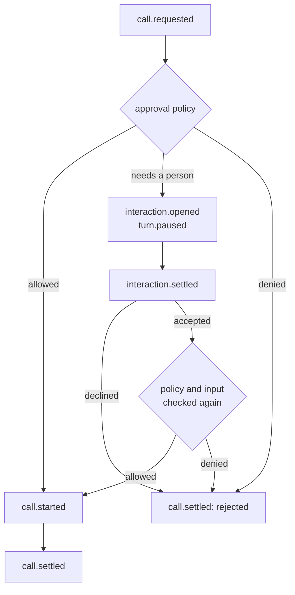
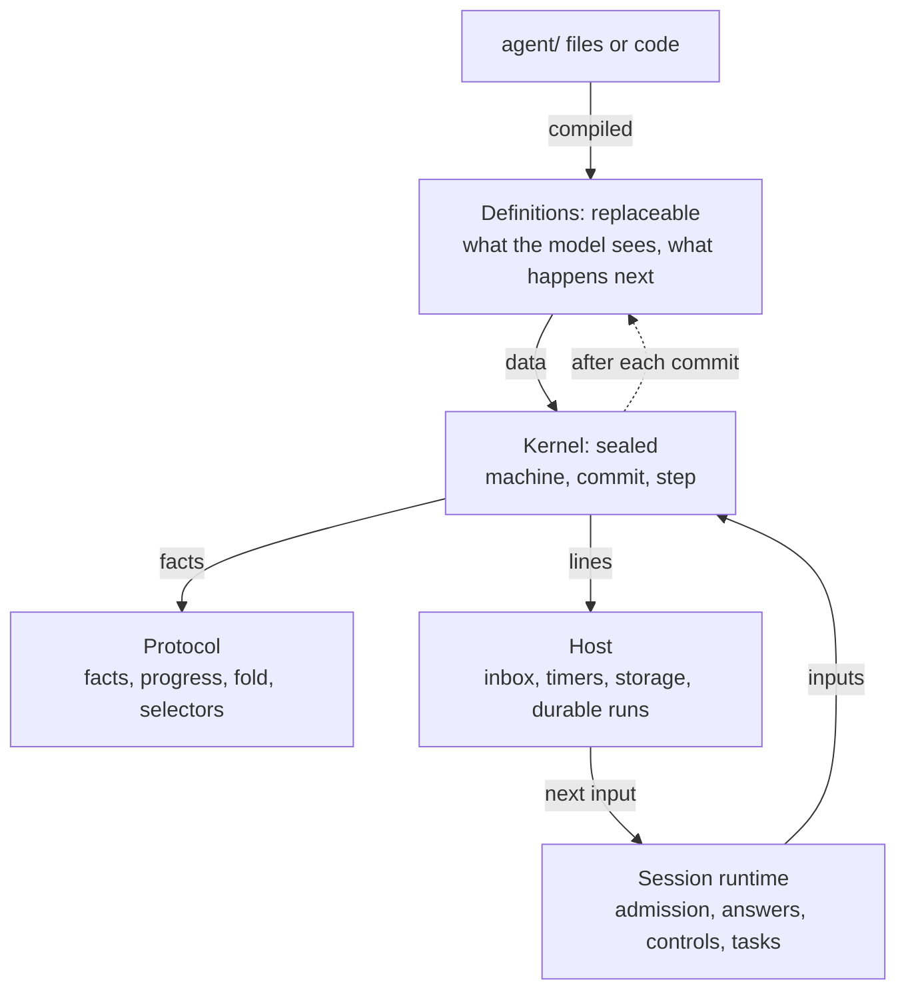
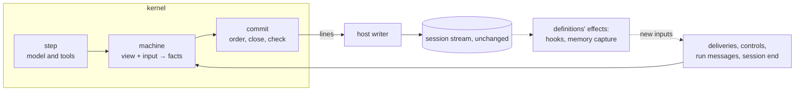
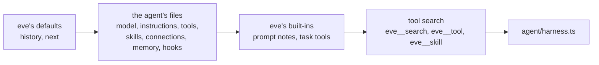
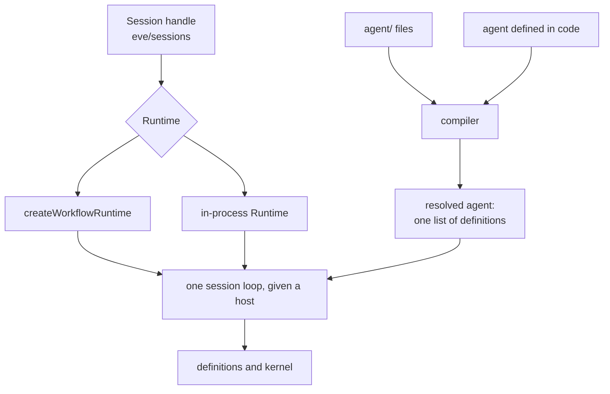

# eve from first principles: a kernel, definitions, and hosts

## Summary

eve is built for long-running sessions that involve more than one person. People share a conversation, approvals and sign-ins wait for days, and every channel and client reads the same event stream. The stream's facts carry guarantees. For example, a call that needs approval can't run until someone allowed to answer approves it.

This plan describes eve as three parts, and argues that most of eve is one of them:

- A sealed **kernel** owns time and facts. It admits input, gates every call, and writes every fact in a shape that clients, channels, and hooks can rely on, whatever else runs.
- **Definitions** answer the two questions that remain: what the model sees when the kernel calls it, and what the turn does next. Nearly every authored file is a definition: a tool, an instruction, a skill, a connection, a hook, memory, the model in `agent.ts`, and the harness. eve's own behavior is a list of them too.
- A **host** runs the session: Workflow when deployed, or one process for an agent embedded in a CLI, a worker, or a test.

The consequence is that eve's features are not special. Memory, tool search, and compaction are definitions built from the same few parts as a single tool. Anything they do, another definition can do differently.

None of this is part of 1.0. [Status](#status) says what is drafted and what is proposed. Code here is pseudocode unless a title names a file.

## What eve guarantees

A multi-party session has to track who said what, who may approve what, which requests wait on whom, and what happened to every call. eve records all of it as facts, which clients, channels, hooks, and the kernel fold into one view. An approval shows how much depends on them:



A client that shows "waiting for approval" relies on `call.started` never coming first. A channel that posts an approval card relies on one answer settling the whole batch. Whoever approves, the call runs as the person whose turn made it, so approving doesn't lend the approver's credentials.

A framework whose loop owns everything can't promise this: the code that decides what to send the model is the same code that runs tools and records what happened, so any customization can break the record. eve separates the two. The part that records is sealed, and everything else returns data to it.

The contract covers effects that go through eve. It isn't a defense against a malicious tool or host, which can reach a service directly. Provider-executed tools, such as a provider's web search, run inside the model call where eve can't gate them, so offering one is the decision to allow it. Sandboxes and scoped credentials limit what an approved call can reach. They complement the gate; they don't replace it.

## The parts



- **Kernel** owns the guarantees. Its machine turns the session's view and an input into facts, its commit orders and checks them, and its step calls the model and runs calls through the gate.
- **Definitions** are policy. They return data the kernel applies, and they react to commits with effects. They never write facts.
- **Session runtime** works between steps. It routes answers, admits messages mid-turn, binds identity, and applies controls such as cancel and compact. It submits inputs to the kernel and doesn't write facts either.
- **Host** is what the runtime waits on and writes to. Durable runs for workflow tools, tasks, and child sessions exist only where the host provides them.

## The kernel

### A step

A step runs from choosing the model to deciding what's next:


The AI SDK turns the provider's response into text, tool calls, and usage. The kernel turns each tool call into a governed call: it resolves the tool, validates the input, applies approval and authorization, and then runs or parks the call. No definition repeats that dispatch, and none can reach around it.

The kernel decides whether a call runs, and an execution adapter decides how. A call runs as a function in the step, as an operation in the session's sandbox, or as a durable run the host starts for a workflow tool, task, or child session. A durable run reports back as input, and the kernel settles the call.

### One author for facts

The kernel's machine builds every fact. Its commit orders and checks them, the host writes them, and effects run after:



Today the session machine builds most facts, but some are built by hand, and one cleanup path writes to the stream without the checker. Nothing is known to break the contract, but it holds because separate pieces of code agree. Sealing the kernel makes one owner enforce it.

The stream format doesn't change, so clients, channels, and existing sessions read it as before. The machine needs only the session's view, not a loaded agent, so it can also write the facts for a session's end, a failure, or a session stranded by an upgrade.

### What no definition can change

Definitions return data, and the kernel decides what that data becomes. Whatever the definitions return:

- Every call, the model's or one a definition asks for, passes the gate. Nothing can skip, answer, or forge an approval or a sign-in.
- A call runs as the person whose turn made it.
- An approval holds for the tool it was asked for. A dynamic tool that changed since it was offered is refused, not run under the old answer.
- A turn doesn't settle while its tasks work. The kernel waits for them and calls the model with their results.
- Input that arrives during a turn is read in that turn.
- Usage limits apply before every model call, and every model call is billed, including the summarizer's and `decide()`'s.
- History is checked. A rewrite can't separate a tool result from its call, drop the turn's input, or drop a task's result the model hasn't read. A model call with nothing new to read is refused.
- A settled output must match the turn's output schema.
- Effects run after the commit that caused them, at least once. They can submit input, such as a hook's `ctx.cancel`, but they can't write facts.
- A definition that throws or returns something invalid fails the turn. An authored harness fails it with "The agent's harness failed."; the reason goes only to the logs.

## What remains: two questions

Take the kernel away, and every agent is the same loop:

```ts
while (true) {
  const response = await callModel({ model, system, tools, history });
  history.push(...response.messages);
  if (response.toolCalls.length === 0) return response.text;
  for (const call of response.toolCalls) history.push(await runTool(call));
}
```

The loop itself, `runTool`, and recording what happened belong to the kernel, because approvals, identity, and parking live there. What's left is two questions:

1. **What does the model see when the kernel calls it?** The model, the system prompt, the tools, per-call context, and the history.
2. **What does the turn do next?** Call the model again, possibly with a note; run tools without the model; settle with a reply; or fail.

Skills, compaction, critics, memory, tool search, and model routing are all answers to these two questions. eve's answers to them are definitions.

## Definitions

### One shape

A definition has a stable id and contributes to a model call:

```ts
interface Definition {
  readonly id: string; // what it keeps across steps lives under this id
  readonly decides?: true; // it owns the turn's reply; see `next`
  contribute(ctx): Contribution;
}

interface Contribution {
  // Collected: every definition's are added, in list order.
  system?: Lazy<Section[]>;
  tools?: Lazy<Tools>; // tool entries, and the skills and connections calls can reach
  context?: Lazy<Anchored[]>; // messages for this call only, placed by turn
  announcements?: Lazy<Record<string, Announcement>>; // told once, again when they change
  effects?: () => Effect[]; // what to do after a commit

  // Decided: the latest definition with an answer wins.
  model?: Lazy<ModelId | undefined>;
  history?: Lazy<Message[] | undefined>;
  next?: Lazy<Next | undefined>;

  // Arranged: sees the whole call and replaces parts of it.
  arrange?(draft: Draft): Partial<Draft>;
}
```

The agent is an ordered list of definitions. Later ones have more authority:



The three ways a field combines are the whole composition model:

- **Collected.** A tool is just a tool. Every definition's tools, system sections, context, announcements, and effects are added together. Most features need nothing else. Names don't stack: the first definition to offer a tool name keeps it, and a collision is logged. A definition that means to replace a tool arranges instead.
- **Decided.** Some questions have one answer: which model, what the history is, what happens next. The latest definition that answers wins. Returning `undefined` means no opinion, so the question falls through to the definition before it, down to eve's defaults.
- **Arranged.** Some features need the whole call to decide what to do. An arrangement receives the draft, with lazy `system`, `tools`, `context`, and `announcements`, and returns replacements. A replacement can wrap what it received, so a later arrangement can add to everything before it, or ignore what it received and replace it outright.

Every field is lazy. The kernel asks for a value only when the call needs it, and each value is computed at most once per call. A part that nothing asks for never runs, so a harness that replaces the system prompt never runs the agent's dynamic instructions.

Text reaches the model in four places, which differ only in how long the model has it:

| Placement       | The model has it                                                | For example                                   |
| --------------- | --------------------------------------------------------------- | --------------------------------------------- |
| `system`        | On every call; its base sections form the cached prefix         | Instructions, the parallel-calls note         |
| `context`       | On this call only, just ahead of its turn's input               | Memory's recall, the pending-approvals note   |
| `announcements` | Once, as a message in history; again when its value changes     | User-role instructions, the catalog's listing |
| `history`       | What the model remembers about the past; decided, not collected | Compaction, a harness's summary               |

An announcement is said again after the history is rewritten, by compaction or `session.clear()`, since the model may no longer have it. That's one rule for every announcement, including user-role instructions, whose static text now also follows the deployment the way the system prompt does.

### Static and dynamic are the same kind

A static tool contributes a constant. A `defineDynamic` file contributes a function of the session that the kernel evaluates before each model call. Both are collected the same way. The only differences follow from that:

- A dynamic value needs `keep`. The kernel stores what it returned, as JSON in the checkpoint, and the code it built, such as a tool's `execute`, in the process. Another step reads the stored result instead of running the function again. A process that lacks the code runs the function again, with the results its `ctx.memo` calls stored, so a fetch doesn't repeat.
- A dynamic tool has a version: the digest of what was offered and of the memo results behind it. A parked approval carries the version, and the kernel refuses the call if the tool changed.
- A constant is known without a session. That's why only static tools can be called outside a turn, and why a workflow tool, whose durable workflow is compiled ahead of time, must be static.

`ctx.memo` is a cache, not a record of effects. A crash or a deployment can run its function again.

What a definition adds to the call is what it contributes. A dynamic skill file contributes its skills, and the agent's own skills join after it, so a dynamic skill can take an authored skill's name. Two things read kept values directly instead, by the kind of definition that kept them. The first is what applies a kind to the process or the sandbox: the connection registry, whose clients run a connection's calls, and the skill files a sandbox needs. Every definition of a kind names the same `install`, and the kernel runs it as a step starts and after what the definition keeps changes. The second is a reader outside a model call, such as the dispatch step that needs the subagent a session selected. Dynamic connections are reached through the registry, so the call's connections are the registry's.

### From one tool to tool search

Features differ in how many parts of the shape they use, not in kind.

**A tool** collects into `tools`. So do system instructions into `system`, a skill into the skills list, and a connection into the tools it offers.

**The model** is decided. `agent.ts`'s `model` answers it, a dynamic model answers later, and a harness's `model` later still, so it wins. A harness that returns `null` falls through to the agent's model. A caller's model, and a subagent's configured model, still take precedence over every definition. The kernel records the choice, so readers outside the call, such as memory and a subagent's parent, see the model the call ran.

**Instructions** collect too. System instructions are `system` sections. User-role instructions, static or dynamic, are announcements, so a change reaches existing sessions once, as a message, without invalidating the cached system prompt.

**A hook** contributes only effects: after each commit, it runs its handler for each matching fact.

**Memory** uses three parts at once:

```ts
// What a defineMemory() file becomes.
const memory: Definition = {
  id: "memory:notes:recall",
  contribute: (ctx) => ({
    // Recall once per turn and keep it, then show each turn's recall just ahead of that
    // turn's input on every call, so the prompt before it stays cached.
    context: async () => anchored(await ctx.keep(recallOncePerTurn)),
    // Offer the provider's tools, under the tool id an authored tools/<slot>.ts would have.
    tools: async () => entries(await ctx.keep(memoryTools)),
    effects: () => [
      // Save what history is about to lose. Blocking: if it fails, the rewrite doesn't happen.
      ...beforeHistoryRewrite(ctx, captureRewritten),
      // Save each completed turn.
      ...afterTurnCompleted(ctx, captureTurn),
    ],
  }),
};
```

Memory doesn't change the history. Recall reaches the model as per-call context, and capture is an effect. It's one of eve's most complex features, and it's still a definition that adds and reacts.

**eve's built-ins** need the whole call. eve's note on parallel tool calls belongs in the prompt only if the call has tools of the agent's own, and its task tools only if the session can run tasks. So the built-ins arrange:

```ts
const builtins: Definition = {
  id: "eve.builtins",
  contribute: ({ step }) => ({
    arrange: (draft) => ({
      system: async () => [...(await draft.system()), ...notesFor(await draft.tools(), step)],
      tools: async () => withTaskTools(await draft.tools(), step),
    }),
  }),
};
```

**Tool search** goes further. With deferred tools, connections, and loadable skills, eve decides from the whole table which tools reach the model directly, which are reached through `eve__search` and `eve__tool`, and which skills load through `eve__skill`. It's an arrangement placed after the built-ins, so it sees every tool the call would offer. Two properties of a tool entry are all it needs:

- A **route**: a tool whose calls become calls to the tool its input names. `eve__tool` and `eve__skill` are routes. The model's history names the route, but approval, authorization, and the version check see the target, and a route can't name another route.
- **Announcements** a tool carries while it's offered. `eve__search` carries the listing of what it can find, and `eve__skill` the dynamic skills. A definition that replaces the tools removes what they announce without computing it.

Tool search remembers which tools the model has found, so the reach it gave earlier holds when the table changes.

**The reply** is the caller's. When a turn has an output schema, eve offers `eve__reply` under any tools, a harness's included. A turn without one settles with the model's text, so an ordinary chat turn never needs a tool to finish.

**The harness** is eve's last say: its `model` is the latest answer, its `system` and `tools` replace the arranged draft, and its `history` and `next` are the latest decisions. It `decides`, so it owns the turn's reply.

### Your files are definitions

Every `defineX` an author uses either is a definition, or plays a different part in the system:

| Part                      | Authored as                                                                                                                                                                                                                   | What it is                                                                             |
| ------------------------- | ----------------------------------------------------------------------------------------------------------------------------------------------------------------------------------------------------------------------------- | -------------------------------------------------------------------------------------- |
| Definitions               | `defineTool`, `defineWorkflowTool`, `defineDynamic`, `defineInstructions`, `defineSkill`, `defineMcpClientConnection`, `defineOpenAPIConnection`, `defineMemory`, `defineHook`, `defineHarness`, the `model` in `defineAgent` | Contributions to the model call, or effects after commits                              |
| Subagents                 | `defineWorkspaceAgent`, `defineRemoteAgent`                                                                                                                                                                                   | To the parent, a tool contribution. Inside, an agent: a list of definitions of its own |
| Session sources and sinks | `defineChannel`, `defineSchedule`, `defineDynamicSchedules`, the Slack manifest and renderer                                                                                                                                  | Where deliveries come from and where facts go. They feed the kernel through the host   |
| Resources                 | `defineSandbox`, `defineParentSandbox`, `defineState`                                                                                                                                                                         | What tools act on: an environment, durable state                                       |
| Packaging                 | `defineExtension`, `defineMemoryProvider`                                                                                                                                                                                     | A directory of definitions and resources; a typed helper value                         |

The rest of `agent.ts`, such as `limits`, `reasoning`, and `compaction`, configures the kernel or parameterizes eve's own definitions. `compaction`'s threshold, for example, is a parameter of eve's default `history`.

So a feature like `defineMemory` isn't a privilege of the framework. It's a convenient way to write one definition. Someone writing a definition directly could build memory that recalls on a schedule instead of per turn, a retriever that keeps only the latest turn's results, or a store that captures only rewritten tool results. Two powers memory uses are internal today, and would have to be decided before definitions become public: blocking effects, and the full tool table that tool search reads.

### The whole model

Someone building an agent framework on eve's kernel, with its own `defineTool`, `defineSkill`, memory, tool search, and commands, needs to learn these concepts:

- A **definition**: an id, what it contributes, and whether it owns the reply.
- Three ways a field combines: **collected**, **decided**, **arranged**. Every field is lazy.
- A **tool**: an entry, listed or deferred, which may be a route and may carry announcements. Connections and skills are lookups beside the entries.
- Four **placements** for text: `system`, `context`, `announcements`, and `history`.
- **`keep`** for what a definition keeps between steps, as JSON plus code rebuilt from it, and **`memo`** for what it learned from outside.
- **Effects** after each commit, at least once.
- The kernel's rules, which no definition changes.

Everything else in this section is one of these. Some concepts eve has today aren't on the list and are proposed to go; [Status](#status) lists them.

### What you could build

These are definitions in the shape above. The definition API is internal; this shows what the shape expresses.

<details>
<summary><strong>A plan the model keeps:</strong> a tool, and an announcement of the plan.</summary>

```ts
const planning: Definition = {
  id: "eve.planning",
  contribute: (ctx) => ({
    tools: () => ({ update_plan }), // its execute returns "ok"
    announcements: async () => {
      // The latest update_plan call, or the plan kept before it.
      const kept = await ctx.keep((e, previous) => {
        const plan = latestInput(e.history, "update_plan") ?? previous;
        return plan === undefined ? null : { value: plan };
      });
      return kept === null ? {} : { plan: announcement(`Current plan:\n${render(kept.value)}`) };
    },
  }),
};
```

The model hears the plan when it changes, not on every call, so the cached prompt stays the same. If a compaction drops the call, the definition still has the plan, and announces it again after the rewrite. One gap remains: a plan updated and compacted away between two evaluations is missed. Folding the facts committed since the last evaluation, proposed in [Status](#status), closes it.

</details>

<details>
<summary><strong>Read-only for viewers:</strong> filter the final tools by role.</summary>

```ts
const readOnly: Definition = {
  id: "eve.read-only",
  contribute: ({ session }) => ({
    arrange: (draft) =>
      roleOf(session) !== "viewer"
        ? {}
        : {
            tools: async () => onlyReadOnly(await draft.tools()),
            system: async () => [
              ...(await draft.system()),
              section("You can read but not change anything."),
            ],
          },
  }),
};
```

Placed after eve's built-ins, it sees every tool the call would offer, including eve's.

</details>

<details>
<summary><strong>Retrieval per turn:</strong> context fetched once and shown with its turn.</summary>

```ts
const docs: Definition = {
  id: "eve.docs",
  contribute: (ctx) => ({
    context: async () => {
      const kept = await ctx.keep(async (e) => ({
        value: {
          turnId: e.turn.id,
          hits: await e.memo({ turn: e.turn.id }, () => search(e.turn.input)),
        },
      }));
      return kept.value.hits.map((hit) => ({ turnId: kept.value.turnId, message: hit }));
    },
  }),
};
```

The results never join the history. A restart reads them instead of searching again.

</details>

<details>
<summary><strong>An audit trail:</strong> effects after each settled call.</summary>

```ts
const audit: Definition = {
  id: "eve.audit",
  contribute: (ctx) => ({
    effects: () =>
      committed(ctx, "call.settled").map((settled) => ({
        id: "eve.audit",
        run: () => auditLog.write({ key: settled.data.callId, ...summarize(settled) }),
      })),
  }),
};
```

Effects run at least once, so the key makes a repeat harmless.

</details>

## The harness

### Why a harness

This design started with compaction. Earlier proposals let authors configure when history compacts separately from how. [History without compaction](#history-without-compaction) explains why that split didn't hold. Asking what the core primitives are led back to the loop, and to a file that answers its two questions directly.

```ts title="agent/harness.ts"
import { defineHarness } from "eve/experimental/harness";

export default defineHarness((ctx) => ({ model, system, tools, history, next }));
```

Each field is a value or a function the kernel calls only when it needs the value. A missing field, or one that returns `undefined`, falls through to the agent's definitions and eve's.

| Field     | What it returns                                              | When the kernel evaluates it                                               |
| --------- | ------------------------------------------------------------ | -------------------------------------------------------------------------- |
| `model`   | Which model, with its options. `null` leaves it to the agent | Before each model call                                                     |
| `system`  | The whole system prompt                                      | Before each model call                                                     |
| `tools`   | Every tool the model is offered; eve's aren't added          | Before each model call                                                     |
| `history` | What the model remembers, saved as the session's history     | Before each model call, and on `session.compact()`                         |
| `next`    | What the turn does next                                      | At turn start, after each model step, and after the harness's calls settle |

A harness is the last definition in the list. Its `system` and `tools` replace everything before them. It doesn't add to them, because a harness that adds is better written as a definition. Replacing `system` also replaces eve's user-role instructions, and replacing `tools` replaces eve's tool search and what it announces. `eve__reply` stays whenever the caller asked for an output schema, because the reply belongs to the caller's contract. Its `model`, `history`, and `next` are the latest answers, so returning `undefined` falls through.

### `next`

```ts
type Next =
  | { model: { note?: string } } // call the model, after showing it the note
  | { calls: { tool: string; input?: JsonValue }[] } // call tools, then decide again
  | { settle: { output: JsonValue | null } } // end the turn with this reply
  | { fail: { message: string } }; // end the turn as failed
```

A harness's `calls` pass the same gate as the model's. Approvals, sign-ins, and workflow and task tools park the same way, and history records the calls as the agent's.

A definition that `decides`, such as the harness, owns the reply: the model's text streams as a draft, and the reply is what `next` settles with. Channels such as Slack post only the reply, so a critic can reject a draft before any channel posts it. Without such a definition, eve's own `next` settles with the model's text, so there's no draft to hold back.

eve's own `next` is the default the harness falls through to:

```ts
next: () => {
  const last = ctx.lastStep;
  if (last === undefined) return { model: {} }; // turn start
  if (last.output !== undefined) return { settle: { output: last.output } };
  if (ctx.unread && !last.endsTurn) return { model: {} }; // results the model hasn't read
  return { settle: { output: last.endsTurn ? null : last.text } };
},
```

Parking for approvals, reading queued input, and waiting for tasks are kernel rules, so they don't appear here.

### What a harness reads

| Field                                      | Meaning                                                                                                   |
| ------------------------------------------ | --------------------------------------------------------------------------------------------------------- |
| `ctx.history`                              | The history eve is deciding about                                                                         |
| `ctx.turn`                                 | The running turn, with its `input`                                                                        |
| `ctx.calls`                                | The turn's calls: tool, input, status, outcome, and output when small enough                              |
| `ctx.lastStep`                             | The model step that just ended: `text`, `output`, and `endsTurn`                                          |
| `ctx.steps`, `ctx.continuations`           | Model calls this turn, and the notes the harness added                                                    |
| `ctx.unread`                               | The history ends with results the model hasn't read                                                       |
| `ctx.size`, `ctx.compact`, `ctx.summarize` | Where eve asks for the history: the next call's size, a `session.compact()` request, and eve's summarizer |
| `ctx.memo`                                 | A cache across evaluations. A crash or a deploy can rerun it, so it isn't an effect log                   |
| `ctx.signal`                               | The turn's abort signal                                                                                   |
| `ctx.session`                              | The session's id, identity, and metadata                                                                  |

### Examples

Each is a complete `agent/harness.ts`. Fields an example leaves out are eve's. Small helpers such as `textOf` aren't shown.

<details>
<summary><strong>Critic:</strong> check the draft before the turn settles, and send it back with a note.</summary>

```ts title="agent/harness.ts"
import { decide } from "eve/ai";
import { defineHarness } from "eve/experimental/harness";

export default defineHarness((ctx) => ({
  next: async () => {
    const draft = ctx.lastStep?.text;
    if (!draft || ctx.unread || ctx.continuations >= 2) return undefined;

    const { answers } = await decide({
      state: { request: textOf(ctx.turn?.input), draft },
      questions: {
        cited: {
          type: "boolean",
          instructions: "Does every factual claim in the draft cite a source?",
        },
      },
      signal: ctx.signal,
    });

    return answers.cited.probability >= 0.5
      ? undefined
      : { model: { note: "Some claims have no source. Cite one for each, or remove the claim." } };
  },
}));
```

The rejected draft stays in history before the note, so the model revises with both in view, and channels never post it. To escalate instead of revising, also return a stronger `model` once `ctx.continuations > 0`.

</details>

<details>
<summary><strong>Command turn:</strong> run <code>/deploy staging</code> without calling the model.</summary>

```ts title="agent/harness.ts"
import { defineHarness } from "eve/experimental/harness";

export default defineHarness((ctx) => ({
  next: () => {
    const target = /^\/deploy (\w+)$/.exec(textOf(ctx.turn?.input))?.[1];
    if (target === undefined) return undefined;

    const deploy = ctx.calls.find((call) => call.tool === "deploy");
    if (deploy === undefined) return { calls: [{ tool: "deploy", input: { target } }] };
    if (deploy.outcome !== "completed") {
      return { fail: { message: `The ${target} deploy was ${deploy.outcome}.` } };
    }
    return { settle: { output: `Deployed ${target}: ${deploy.output.url}` } };
  },
}));
```

The call still passes the gate. If `deploy` needs approval, the turn waits, and a denial settles the call as `rejected`. Other messages fall through to eve's loop.

</details>

<details>
<summary><strong>A narrow agent:</strong> its own prompt and tools, and a model chosen by plan.</summary>

```ts title="agent/harness.ts"
import { defineHarness } from "eve/experimental/harness";
import { defineTool } from "eve/tools";
import { z } from "zod";

export default defineHarness((ctx) => {
  const plan = String(ctx.session.auth.current?.attributes.plan ?? "pro");
  return {
    model: () => (plan === "enterprise" ? "anthropic/claude-opus-5.5" : null),
    system: `You answer billing questions. The customer is on the ${plan} plan.`,
    tools: {
      plan_lookup: defineTool({
        description: "Look up what a plan includes.",
        inputSchema: z.object({ plan: z.enum(["free", "pro", "enterprise"]) }),
        execute: async ({ plan }) => ({ plan }),
      }),
    },
  };
});
```

`null` leaves the model to `agent.ts` for every plan but enterprise. Because `system` and `tools` replace eve's, the agent's instructions aren't sent, its dynamic instructions and tools never run, skills don't load, and the model can't wait on tasks. The turn still waits for them.

</details>

## History without compaction

### Why compaction isn't a concept

Compaction is common: when the history nears the context window, summarize the older turns. A first-class `defineCompaction` has two problems.

The first is that it splits one decision into two. A policy is "compact at 80% of the window" plus "summarize this way". An author with a better summarizer wants to keep the 80% trigger, and an author with a better trigger wants to keep eve's summary. So `defineCompaction` grows two inputs, `shouldCompact` and `compact`, each falling back to eve's when absent. That's defensible, but every combination of the two becomes a case to define and test.

The second is that it isn't powerful enough. Authors manage history in many ways: they keep large tool results out of it, drop turns that no longer matter, keep some messages verbatim, or summarize with their own model. Keeping large results out could be written as a compaction that runs on every call, but then it has to compose with ordinary summarization, and the trigger-plus-summarizer shape has no place for that.

Both problems come from treating compaction as a moment. Without it, history is one decision the kernel asks for before each model call: given the history and the call's size, what should the model remember? When and how stop being separate fields and become ordinary code:

| Want                                      | `history`                                                                                               |
| ----------------------------------------- | ------------------------------------------------------------------------------------------------------- |
| eve's behavior                            | Leave it out                                                                                            |
| Your trigger, eve's summary               | `ctx.size.tokens > 0.8 * ctx.size.window ? ctx.summarize(ctx.history) : ctx.history`                    |
| eve's trigger, your summary               | `ctx.size.tokens > ctx.size.threshold ? mySummary(ctx.history) : ctx.history` (`threshold` is proposed) |
| Trim large results, then eve's compaction | `const trimmed = ctx.history.map(trim)`, then the same comparison with `ctx.summarize(trimmed)`         |

eve's threshold is a number from `agent.ts`, so the proposal reports it as data in `ctx.size` rather than adding a `shouldCompact` function. `ctx.size` measures the call before a harness trims, so the last row compacts slightly early.

### What the kernel records

`history` rewrites the durable history. The kernel compares what it returns with what the model has read:

- If nothing changed, nothing is recorded.
- A change to messages the model hasn't read yet, such as a tool result that just arrived, joins the history with no rewrite.
- A change to messages the model has read is a rewrite. The kernel checks it and records it as a context change, with any summary call announced and billed.

The kernel checks the new history's structure, not whether a summary is faithful. Clients still show every call's full output from the stream, because the stream records what happened and the history is only what the model remembers.

Trimming a result before the model reads it isn't a rewrite: the trimmed result joins the history, and the model never sees the full one. Trimming results the model has already read is a rewrite, after which every announcement is made again. Adding something for one call while leaving the history alone is per-call context, which is how memory's recall works. Showing one call a different view of the history itself, such as shorter tool outputs, is a separate field, to add when a strategy needs it. An earlier draft had an arrangeable call record for it that nothing used, and it was removed.

### Before history loses messages

The kernel knows exactly when history is about to lose messages: when it opens a rewrite. Memory's capture runs there, as a blocking effect, with the history being rewritten. If the capture fails, the rewrite doesn't happen. Because the moment is defined by the rewrite and not by a feature, it applies to any `history`, including one that never summarizes. The fact keeps its wire name, `context.started` with `kind: "compaction"`.

### `session.compact()`

The kernel owns when history may change, and the policy owns what it becomes. History is decided before each model call, where the kernel knows the call's size. `session.compact()` is the one other time: someone outside the turn asks the policy to reconsider the history now.

- It's a delivery. It's admitted, ordered, and settled like any other input, so it's safe when several people share a session and visible in the stream.
- It runs the same `history` decision with `ctx.compact: true`. eve's default summarizes whatever the threshold. A harness can summarize, trim, or keep the history as it is.
- It settles `applied` when the history changed, `failed` when the decision failed, and, proposed, `unchanged` when the policy kept the history. Today it settles `applied` either way.

Other times to compact need no new API. Compacting when a session goes idle, nightly, or on a `/compact` command is a schedule, a hook, or a channel calling `session.compact()`.

`session.clear()` is different. It isn't a request to the policy but a kernel guarantee: the history becomes empty, and no definition can refuse it.

## Hosts and embedded eve

### What a session needs

Channels, schedules, and routes need the compiler and the `agent/` layout. The kernel and the session's semantics don't. The compiler accepts programmatic sources, modules at logical paths, which framework defaults and the in-memory test compiler use. An agent defined in code goes through that path, so it gets the compiler's validation and errors, and names still come from paths.

The kernel alone can't run a session. Routing an answer to its call, admitting a message mid-turn, binding identity, applying cancel and compact, and recovering an interrupted step all live in the session runtime, so an embedded session uses the session runtime too.



`Session` from `eve/sessions` talks to a `Runtime` interface. An in-process `Runtime` is a second implementation of that interface, so a UI written against one works with the other. `createSession` wraps it in a smaller handle.

### What a host provides

The session loop and step wait on input, arm timers, and move between runs. A host provides those. Simplified, since the draft splits this between the step, the inbox, and the loop:

```ts
interface SessionHost {
  inbox: SessionInboxReader; // the next input; claims the session's addresses
  timers: { until(deadline: Date): Promise<void> };
  owns(runId: string): boolean; // ignores a timer or prewarm an earlier owner armed
  moves?: SessionMoves; // moving the session between runs
  runs?: DurableRuns; // workflow tools, tasks, child sessions
}
```

The loop's rules stay the same, which is what keeps an embedded session behaving like a deployed one. The host also writes the lines the kernel commits.

|                                      | Workflow host                     | In-process host                                     |
| ------------------------------------ | --------------------------------- | --------------------------------------------------- |
| Input                                | Workflow hooks                    | An in-memory queue                                  |
| Timers                               | Durable `sleep`                   | The process's timers                                |
| Storage                              | The run's stream and step results | Memory                                              |
| Workflow tools, tasks, and subagents | Workflow runs                     | Not provided; calls fail with an error that says so |
| Moving between deployments           | Handoff                           | Not needed                                          |
| Sessions that outlive the process    | Yes                               | Not yet                                             |

The in-process runtime can snapshot and restore a session internally, in the checkpoint format handoff already uses; a public store is proposed. A host could also store a deployed session as a checkpoint plus records instead of replaying a Workflow run, which would end version pinning. That's a separate proposal.

### A terminal agent in one file

This uses `createSession` to build a local terminal agent. It has eve's `bash`, `read_file`, and `write_file` tools in an in-process just-bash sandbox, and it asks for approvals inline:

```ts title="terminal.ts"
import { createInterface } from "node:readline/promises";

import { createSession } from "eve/experimental/embed";
import { JustBashSandbox } from "eve/sandbox/just-bash";
import { defineTool } from "eve/tools";
import { always } from "eve/tools/approval";
import { bash } from "eve/tools/bash";
import { readFile } from "eve/tools/read_file";
import { writeFile } from "eve/tools/write_file";

const session = createSession({
  model: "anthropic/claude-sonnet-5",
  instructions: "You are a concise coding assistant.",
  tools: {
    bash,
    read_file: readFile,
    write_file: defineTool({ ...writeFile, approval: always() }),
  },
  sandbox: JustBashSandbox.environment({}), // proposed: createSession takes no sandbox yet
});

const rl = createInterface({ input: process.stdin, output: process.stdout });
const lines = rl[Symbol.asyncIterator]();
const ask = async (prompt: string) => (process.stdout.write(prompt), (await lines.next()).value);
rl.on("SIGINT", () => void session.cancel());

for (let line; (line = await ask("> ")) !== undefined;) {
  let delivery = await session.send(line);
  while (delivery !== undefined) {
    for await (const event of delivery.stream()) {
      if (event.type === "content.delta") process.stdout.write(event.data.delta);
      if (event.type === "call.requested") console.log(`\n⚙ ${event.data.capability.name}`);
    }
    const open = (await delivery.result()).interactions.filter((i) => i.status === "open");
    if (open.length === 0) break;

    const answers = [];
    for (const interaction of open) {
      const yes = /^y/i.test((await ask(`approve ${interaction.call?.name}? [y/n] `)) ?? "");
      answers.push({
        interactionId: interaction.interactionId,
        optionId: yes ? "approve" : "deny",
      });
    }
    delivery = await session.respond(answers);
  }
  process.stdout.write("\n");
}
```

`createSession` compiles the agent as a programmatic agent and returns a session handle over an in-process `Runtime`, with the host's user as the default identity. `send`, `respond`, `cancel`, and `compact` work as they do on a deployed session. The tools, gate, facts, fold, and loop are the ones a deployed agent uses. So `bash` runs at once, `write_file` waits for approval, and `result().interactions` comes from the same selectors a deployed client reads.

The same handle could back a web chat in a small worker. The worker still needs routes for its client, server-side authentication for its users, and a callback URL for sign-ins.

## Status

None of this is merged. The harness's first form is drafted in stack #5638, #5566, #5604, #5609, #5621, and #5640, which nests the call's fields under `agent`. The rest is drafted on follow-up branches.

**Drafted:**

- The sealed kernel's fact ownership; hosts and the in-process runtime; `createSession` in `eve/experimental/embed`; the flat harness.
- Every runtime file compiled to one ordered list of definitions, replacing per-kind reactions and layer composition with collected, decided, and arranged fields.
- The model as one decision: `agent.ts`, a dynamic model, and the harness answer in order, and the kernel records the choice for readers outside the call. A session holds what it observed, not its agent's configuration.
- `eve__reply` offered for any output schema, under any harness.
- Tool search as an arrangement after eve's built-ins, with routes and announcements as properties of tool entries. This replaces a separate presentation step.
- Announcements replacing three mechanisms: the catalog's notes, dynamic user instructions' notices, and static user instructions seeded into a new session's history. User-role instructions now follow deployments and are announced again after a rewrite.
- `Definition.decides` replacing the check for a harness file.
- Memory's tools contributed by the memory definition, under the id an authored `agent/tools/<slot>.ts` would have, so an authored file or `disableTool()` still overrides them.
- The pending-approvals note as its own definition that reads session state.
- Dynamic skills contributing their skills to the call.

Stored sessions, checkpoints, and the stream's wire format read as before, and compiled manifests must be rebuilt. Approvals parked before the change run after it, and the reverse, for memory's tools and for `eve__tool`. Rolling back past tool search's arrangement is imperfect: the older deployment can't read where the newer one records which tools the model found, so a session that reached a tool only through that record loses `eve__search` and `eve__tool` on its next call.

**Not pursued:**

- Each static tool file as its own definition. eve's static tools stay one definition over the same tool map that calls outside a turn use.
- Client context as per-call context. It would need its usage accounting and position kept exact, and nothing needs it to move yet.
- Moving `install` to one definition per kind. Run after every change, it repeated a failed sandbox write within the step, and run once after evaluation, it would leave the registry stale for that evaluation's draft.

**Proposed, internal:**

- One context: the evaluation context `keep` receives extends the context `contribute` receives, so the rule is that `contribute` must be cheap and `keep` may use `memo`.
- Effects that return requests, such as cancel, continue, or fail, instead of hooks' commands reaching the kernel separately.
- One visibility field on tools, instead of three ways to hide a tool from delegated sessions.
- The turn's input in the context `history` and `next` read, as [What a harness reads](#what-a-harness-reads) shows. The draft doesn't pass it yet, and a command such as `/deploy staging` needs it to answer `next` at the turn's start.
- State folded from the facts committed since a definition's last evaluation, so features such as `/goal` and `/todo` don't depend on what compaction keeps.

**Proposed, public:** `ctx.size.threshold`; `session.compact()` settling `unchanged`.

**Later decisions:** a public way to write definitions, including whether blocking effects and the full tool table become public, and with which guardrails; a public host interface for other stores, queues, and timers once the Workflow and in-process hosts have proven it.

The kernel stays sealed: both its rules and its authorship of every fact. Before any of this becomes stable, it needs docs pages, e2e evals for each `next` value and its failure modes, and a changeset.
