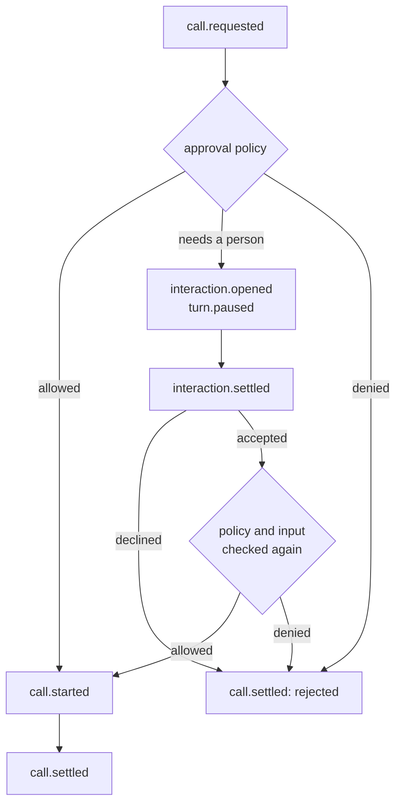
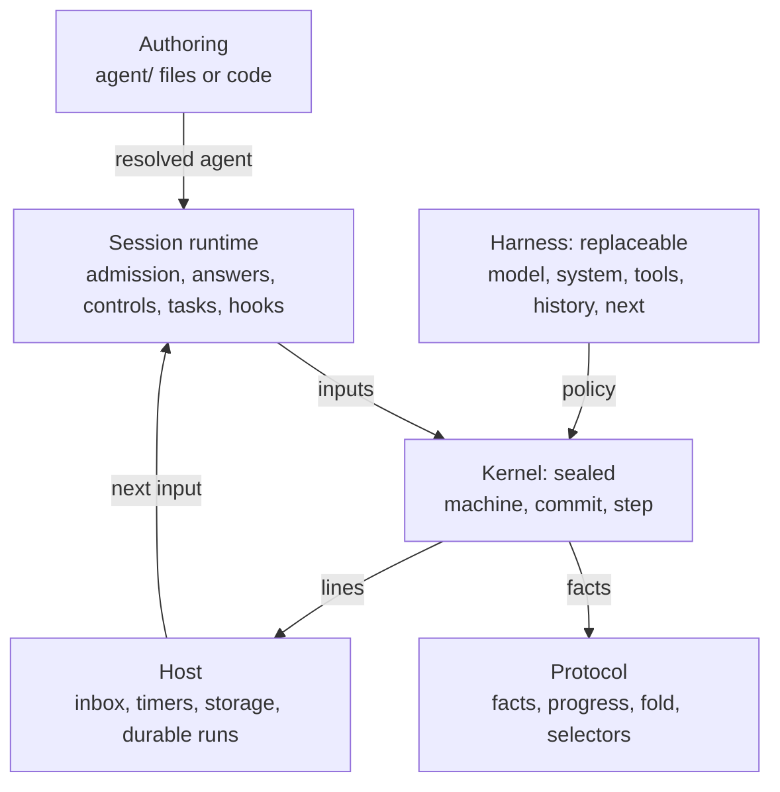
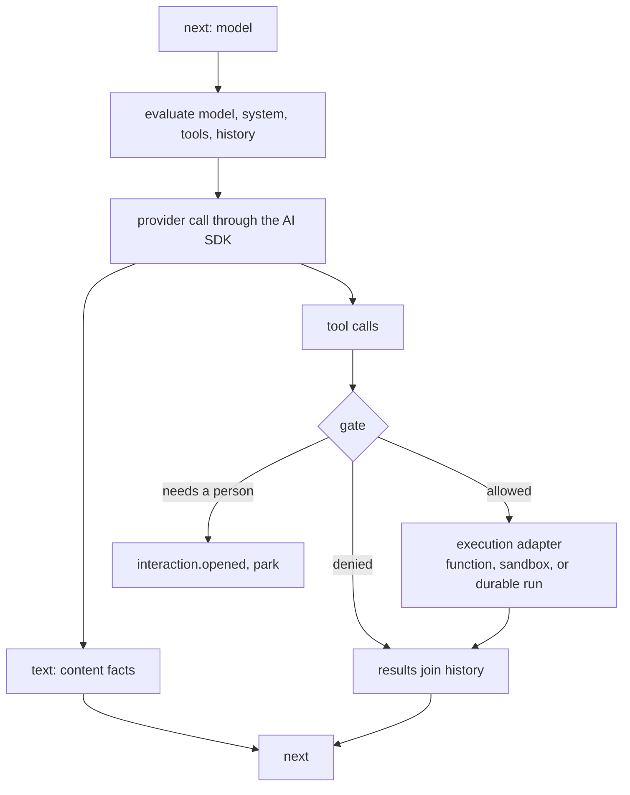
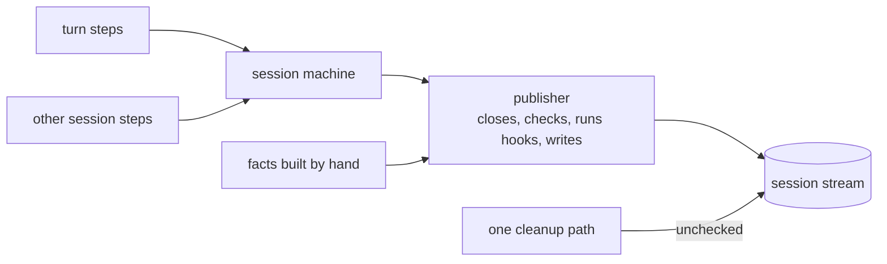
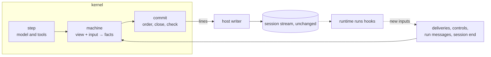
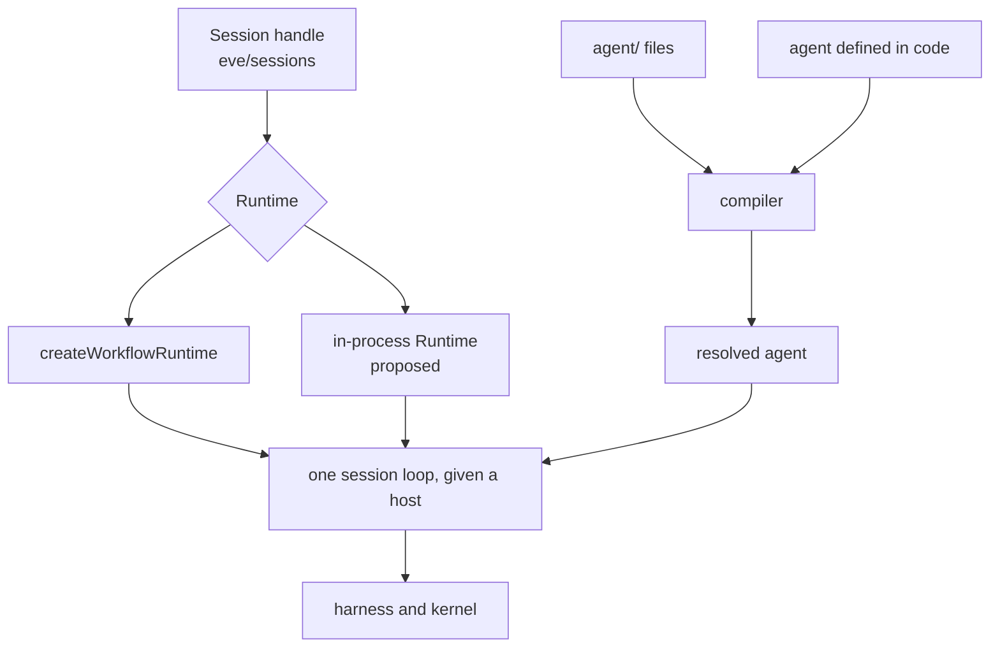

# eve in layers: a sealed kernel, harnesses, and hosts

## Summary

eve is built for long-running sessions that involve more than one person. People share a conversation, approvals and sign-ins wait for days, and every channel and client reads the same event stream. The stream's facts carry guarantees. For example, a call that needs approval can't run until someone allowed to answer approves it.

This plan splits eve into layers so those guarantees hold whatever loop runs and wherever the session runs:

- A sealed **kernel** becomes the only code that writes facts and the only path by which a call runs.
- A **harness** is the inside of the agent loop: what the next model call gets, and what the turn does next. eve's own loop becomes one harness.
- A **host** runs the session: Workflow when deployed, or one process for an agent embedded in a CLI, a worker, or a test.

None of this is part of 1.0. The kernel and harness split is drafted in stack #5638, #5566, #5604, #5609, #5621, and #5640, and this document uses its names. Anything the stack doesn't have is marked proposed, including the flat harness shape. The stack nests the call's fields under `agent` and names the system prompt `agent.instructions`. Code here is pseudocode.

## What eve guarantees

A multi-party session has to track who said what, who may approve what, which requests wait on whom, and what happened to every call. eve records all of it as facts, which clients, channels, hooks, and the kernel fold into one view. An approval shows how much depends on them:



A client that shows "waiting for approval" relies on `call.started` never coming first. A channel that posts an approval card relies on one answer settling the whole batch. Whoever approves, the call runs as the person whose turn made it, so approving doesn't lend the approver's credentials.

Much of this is enforced today. The gate decides every call the model makes, and a stream checker validates lifecycle rules in tests and under `eve dev`. But no single component owns the guarantee. Facts are built in several places, a few of them by hand, and one path writes to the stream without the checker. Nothing is known to break the contract, but it holds because separate pieces of code agree, not because one owner enforces it.

The contract covers effects that go through eve. It isn't a defense against a malicious tool or host, which can reach a service directly. Provider-executed tools, such as a provider's web search, run inside the model call where eve can't gate them, so offering one is the decision to allow it. Sandboxes and scoped credentials limit what an approved call can reach. They complement the gate; they don't replace it.

## The layers

This is the proposed layering. The kernel section covers where today's code differs.



- **Session runtime** works between steps. It submits inputs to the kernel and doesn't write facts.
- **Harness** is policy. It returns data the kernel applies.
- **Kernel** owns the guarantees. Its machine turns the session's view and an input into facts, its commit orders and checks them, and its step calls the model and runs calls through the gate.
- **Host** is what the runtime waits on and writes to. Durable runs for workflow tools, tasks, and child sessions exist only where the host provides them.

Hooks and `ctx.continue()` (#5555) belong to the runtime: a hook is an effect after a commit. `next` decides how a turn ends; `ctx.continue()` decides whether another begins.

## The kernel

### A step

A step runs from the harness choosing the model to the harness deciding what's next:



The AI SDK turns the provider's response into text, tool calls, and usage. The kernel turns each tool call into a governed call: it resolves the tool, validates the input, applies approval and authorization, and then runs or parks the call. Choosing `model` includes that dispatch, so a harness doesn't repeat it. Inspecting calls before they run would need a separate, explicit capability.

The kernel decides whether a call runs, and an execution adapter decides how. A call runs as a function in the step, as an operation in the session's sandbox, or as a durable run the host starts for a workflow tool, task, or child session. A durable run reports back as input, and the kernel settles the call. No adapter bypasses the gate.

Sandboxes and connections are execution environments that the host provides and tools use. An approval covers the operation a tool declares, not everything the operation can reach, so approving `bash` grants whatever the sandbox allows.

### What no harness can change

- Every call, the model's or the harness's, passes the gate. A harness can't skip, answer, or forge an approval or a sign-in.
- A call runs as the person whose turn made it.
- A turn doesn't settle while its tasks work. The kernel waits for them and calls the model with their results.
- Input that arrives during a turn is read in that turn.
- Usage limits apply before every model call, and every model call is billed, including the summarizer's and `decide()`'s (#5638).
- History is checked, so a harness can't send the model a request the provider would reject: a tool result without its call, or a history that ends in the model's own reply with nothing new to read.
- A settled output must match the turn's output schema.
- A harness that throws or returns something invalid fails the turn with "The agent's harness failed." The reason goes only to the logs.

### One author for facts

Today the session machine builds most facts, but not all of them, and not every fact reaches the stream the same way:



Proposed, the machine builds every fact, and the publisher splits by owner. The kernel commits and checks, the host writes, and the runtime runs hooks:



The stream format doesn't change, so clients, channels, and existing sessions read it as before. The machine needs only the session's view, not a loaded agent, so it can also write the facts for a session's end, a failure, or a session stranded by an upgrade.

## Harnesses

### Why a harness

This design started with compaction. Earlier proposals let authors configure when history compacts separately from how. That split was hard to make consistent, because authors manage history in many ways: they trim large tool results, drop turns that no longer matter, keep some messages verbatim, or summarize with their own model. Each mixes when and how differently, and many don't fit a trigger plus a summarizer at all. Every draft squeezed history into a box of the wrong shape.

The better question was what the core primitives are, and how they compose. The answer is the inside of the agent loop.

### The loop

At its core, every agent harness is a while loop:

```ts
while (true) {
  const response = await callModel({ model, system, tools, history });
  history.push(...response.messages);
  if (response.toolCalls.length === 0) return response.text;
  for (const call of response.toolCalls) history.push(await runTool(call));
}
```

Skills, compaction, critics, and model routing are all variations on what `callModel` gets and when the loop stops. An eve harness is the inside of that loop. `model`, `system`, `tools`, and `history` are what `callModel` gets, and `next` decides whether the loop goes around again. The loop itself and `runTool` belong to the kernel, because approvals, identity, and parking live there.

```ts title="agent/harness.ts"
import { defineHarness } from "eve/experimental/harness";

export default defineHarness((ctx) => ({ model, system, tools, history, next }));
```

Each field is a value or a function, and the kernel calls a function only when it needs the value. A missing field, or one that returns `undefined`, falls back to eve's. The flat shape is proposed.

| Field     | What it returns                                          | When the kernel evaluates it                                               |
| --------- | -------------------------------------------------------- | -------------------------------------------------------------------------- |
| `model`   | Which model, with its options                            | Before each model call                                                     |
| `system`  | The whole system prompt                                  | Before each model call                                                     |
| `tools`   | Every tool the model is offered                          | Before each model call                                                     |
| `history` | What the model remembers, saved as the session's history | Before each model call, and on `session.compact()`                         |
| `next`    | What the turn does next                                  | At turn start, after each model step, and after the harness's calls settle |

### Familiar from `defineDynamic`

A `defineDynamic` value in `agent.ts` is a function of the session that eve runs before each model call, with `ctx.memo` to keep a result. A harness field is the same kind of function, with the same context and memo rules:

```ts title="agent/agent.ts"
export default defineAgent({
  model: defineDynamic((ctx) =>
    ctx.session.auth.initiator?.attributes.plan === "enterprise"
      ? "anthropic/claude-opus-5.5"
      : "anthropic/claude-sonnet-5",
  ),
});
```

```ts title="agent/harness.ts"
export default defineHarness((ctx) => ({
  model: () =>
    ctx.session.auth.initiator?.attributes.plan === "enterprise"
      ? "anthropic/claude-opus-5.5"
      : "anthropic/claude-sonnet-5",
}));
```

The difference is scope. A dynamic value computes one thing the agent declares, such as a model, a tool, or an instruction. A harness field computes everything the call gets. The harness sits underneath `defineDynamic`: eve's own harness is the code that runs your dynamic values. A harness that sets a field without calling `declared(ctx)` skips the dynamic values behind it.

eve's harness keeps what you declared apart from what eve adds, and combines them with plain functions:

```ts
model: async () => (await declared(ctx)).model,
system: async () => builtins(ctx).prompt.system(await declared(ctx)),
tools: async () => ({ ...(await declared(ctx)).tools, ...builtins(ctx).tools }),
```

- **`declared(ctx)`** is what the agent's files declare, as data, with dynamic values resolved: instructions with their system or user role, skills (each with `load()`), tools, the workspace, and the model. Default tools such as `bash` count as declared, because a file can replace or turn off each one.
- **`builtins(ctx)`** is what eve adds: its `eve__` tools, and renderers for its prompt sections.

Your harness can recombine these however it likes. `system` is the whole system prompt; eve's builds it from the system-role instructions and its own sections. `tools` is exactly what the model is offered, so leaving out an `eve__` tool turns off its feature. Without `eve__skill`, for example, skills can't load. `model` accepts whatever `agent.ts`'s `model` does, including a selection with provider options.

### `history`

The stream records what happened, and history is what the model remembers. The simplest `history` remembers everything:

```ts
history: () => ctx.history,
```

Compaction is a special case: remember everything until the history nears the context window, then summarize the older turns. That's eve's default:

```ts
history: () =>
  ctx.compact || ctx.size.tokens > threshold(ctx.size) // `compaction.threshold` from agent.ts
    ? ctx.summarize(ctx.history)
    : ctx.history,
```

A proposed export, `nativeHistory(ctx, messages?)`, is this function, so a harness can prepare history its own way and still let eve compact the result. Trimming results, dropping old turns, and keeping messages verbatim are other cases of the same function, so nothing has to be split into when and how.

The kernel knows the model's context window, which is a physical limit, and reports the next call's size as `ctx.size`. The threshold is policy, so it lives in the harness. `ctx.summarize` is eve's summarizer, and its model call is announced and billed. A change to messages the model has already read is recorded as a rewrite. The kernel checks the new history's structure, not whether a summary is faithful.

### `next`

```ts
type Next =
  | { model: { note?: string } } // call the model, after showing it the note
  | { calls: { tool: string; input?: JsonValue }[] } // call tools, then decide again
  | { settle: { output: JsonValue | null } } // end the turn with this reply
  | { fail: { message: string } }; // end the turn as failed
```

A harness's `calls` pass the same gate as the model's. Approvals, sign-ins, and workflow and task tools park the same way, and history records the calls as the agent's.

When a harness decides the reply, the model's text streams as a draft until the turn settles. Channels such as Slack post only the reply, so a critic can reject a draft before any channel posts it.

### What a harness reads

| Field                                      | Meaning                                                                                 |
| ------------------------------------------ | --------------------------------------------------------------------------------------- |
| `ctx.history`                              | The model history as of this decision                                                   |
| `ctx.turn`                                 | The running turn, with its `input`                                                      |
| `ctx.calls`                                | The turn's calls: tool, input, status, outcome, and output when small enough            |
| `ctx.lastStep`                             | The latest model step: `text`, `output`, and `endsTurn`                                 |
| `ctx.steps`, `ctx.continuations`           | Model calls this turn, and the notes the harness added                                  |
| `ctx.size`, `ctx.compact`, `ctx.summarize` | The next call's tokens and the window; a `session.compact()` request; eve's summarizer  |
| `ctx.memo`                                 | A cache across evaluations. A crash or a deploy can rerun it, so it isn't an effect log |
| `ctx.session`                              | The session's id, identity, and metadata                                                |
| `ctx.unread`                               | Proposed: history ends with tool results the model hasn't read                          |
| `ctx.signal`                               | Proposed: the turn's abort signal                                                       |

### eve's harness

This is eve's entire default harness:

```ts
export const native = defineHarness((ctx) => ({
  model: async () => (await declared(ctx)).model,
  system: async () => builtins(ctx).prompt.system(await declared(ctx)),
  tools: async () => ({ ...(await declared(ctx)).tools, ...builtins(ctx).tools }),
  history: () => nativeHistory(ctx),

  next: () => {
    const last = ctx.lastStep;
    if (last === undefined) return { model: {} }; // turn start
    if (last.output !== undefined) return { settle: { output: last.output } };
    if (ctx.unread && !last.endsTurn) return { model: {} }; // results the model hasn't read
    return { settle: { output: last.endsTurn ? null : last.text } };
  },
}));
```

Parking for approvals, reading queued input, and waiting for tasks are kernel rules, so they don't appear here.

### What you can build

Each example is a complete `agent/harness.ts`, and some use the proposed `ctx` fields. Fields an example leaves out are eve's. Small helpers such as `textOf`, `size`, and `preview` aren't shown.

<details>
<summary><strong>Skills your way:</strong> keep one skill always loaded, and list the rest in your own words.</summary>

```ts title="agent/harness.ts"
import { declared, defineHarness } from "eve/experimental/harness";

export default defineHarness((ctx) => ({
  system: async () => {
    const files = await declared(ctx);
    const refunds = files.skills.find((skill) => skill.name === "refunds");
    const others = files.skills.filter((skill) => skill !== refunds && !skill.deferred);

    return [
      "You are Acme's billing assistant.",
      files.instructions.agent.content,
      await refunds?.load(),
      "Load these with eve__skill({ name }) when a request needs one:\n" +
        others.map((skill) => `- ${skill.name}: ${skill.description}`).join("\n"),
    ];
  },
}));
```

A dynamic instruction supplies one entry, and eve places it in a prompt that still has eve's own sections: the workspace, the note on tools, the skills list, and the note on tasks. A harness's `system` is the entire system prompt, so those sections appear only if you include them. Here, the harness writes its own skills list and loads `refunds` up front.

</details>

<details>
<summary><strong>Large tool results:</strong> keep a preview in history, then let eve compact as usual.</summary>

```ts title="agent/harness.ts"
import { defineHarness, nativeHistory } from "eve/experimental/harness";

const LIMIT = 20_000;

const trim = (message) =>
  message.role !== "tool"
    ? message
    : {
        ...message,
        content: message.content.map((part) =>
          size(part.output) > LIMIT ? { ...part, output: preview(part.output, LIMIT) } : part,
        ),
      };

export default defineHarness((ctx) => ({
  history: () => nativeHistory(ctx, ctx.history.map(trim)),
}));
```

Trimming runs first, and eve's compaction then applies to the trimmed history. A trimmed result is already under `LIMIT`, so only the newest result changes, and the kernel adds it as a plain append. Clients still show the full output from `call.settled`.

</details>

<details>
<summary><strong>Compaction on your terms:</strong> compact earlier, with your own summary instructions.</summary>

```ts title="agent/harness.ts"
import { defineHarness } from "eve/experimental/harness";

export default defineHarness((ctx) => ({
  history: () => {
    const { tokens, window = Infinity } = ctx.size ?? { tokens: 0 };
    if (!ctx.compact && tokens <= 0.5 * window) return ctx.history;

    // Proposed options; `ctx.summarize` takes only `tokens` today.
    return ctx.summarize(ctx.history, {
      keepTurns: 4,
      model: "openai/gpt-6-luna",
      instructions: "Keep ticket IDs, decisions with their reasons, and open questions.",
    });
  },
}));
```

The summarizer's call is announced as a compaction and billed to the session. If the result still doesn't fit, the turn fails; eve doesn't fall back to its own compaction.

</details>

<details>
<summary><strong>Critic:</strong> check the draft before the turn settles, and send it back with a note.</summary>

```ts title="agent/harness.ts"
import { decide } from "eve/ai";
import { defineHarness } from "eve/experimental/harness";

export default defineHarness((ctx) => ({
  next: async () => {
    const draft = ctx.lastStep?.text;
    if (!draft || ctx.unread || ctx.continuations >= 2) return undefined;

    const { answers } = await decide({
      state: { request: textOf(ctx.turn?.input), draft },
      questions: {
        cited: {
          type: "boolean",
          instructions: "Does every factual claim in the draft cite a source?",
        },
      },
      signal: ctx.signal,
    });

    return answers.cited.probability >= 0.5
      ? undefined
      : { model: { note: "Some claims have no source. Cite one for each, or remove the claim." } };
  },
}));
```

The rejected draft stays in history before the note, so the model revises with both in view, and channels never post it. The `decide()` call is billed to the turn. To escalate instead of revising, also return a stronger `model` once `ctx.continuations > 0`.

</details>

<details>
<summary><strong>Command turn:</strong> run <code>/deploy staging</code> without calling the model.</summary>

```ts title="agent/harness.ts"
import { defineHarness } from "eve/experimental/harness";

export default defineHarness((ctx) => ({
  next: () => {
    const target = /^\/deploy (\w+)$/.exec(textOf(ctx.turn?.input))?.[1];
    if (target === undefined) return undefined;

    const deploy = ctx.calls.find((call) => call.tool === "deploy");
    if (deploy === undefined) return { calls: [{ tool: "deploy", input: { target } }] };
    if (deploy.outcome !== "completed") {
      return { fail: { message: `The ${target} deploy was ${deploy.outcome}.` } };
    }
    return { settle: { output: `Deployed ${target}: ${deploy.output.url}` } };
  },
}));
```

The call still passes the gate. If `deploy` needs approval, the turn waits, and a denial settles the call as `rejected`. Other messages fall through to eve's loop.

</details>

<details>
<summary><strong>One agent, many customer accounts:</strong> fit the agent to each customer's account and plan.</summary>

A SaaS product runs one agent for all its customers. Each signed-in user's auth attributes carry their `accountId`, and the product's own `loadAccount` returns that account's plan and status.

```ts title="agent/harness.ts"
import { builtins, declared, defineHarness } from "eve/experimental/harness";
import { loadAccount } from "./lib/accounts";

export default defineHarness((ctx) => {
  const id = ctx.session.auth.current?.attributes.accountId ?? null;
  const account = () => ctx.memo(["account", id], () => loadAccount(id));

  return {
    next: async () => {
      if (ctx.lastStep !== undefined) return undefined;
      const { suspended } = await account();
      return suspended ? { fail: { message: "This account is suspended." } } : undefined;
    },

    tools: async () => {
      const { tools } = await declared(ctx);
      const { deploy, bash, ...rest } = tools;
      const { plan } = await account();
      return { ...(plan === "enterprise" ? tools : rest), ...builtins(ctx).tools };
    },

    system: async () =>
      [
        builtins(ctx).prompt.system(await declared(ctx)),
        `This customer is on the ${(await account()).plan} plan.`,
      ].flat(),
  };
});
```

The harness loads the account once and uses it three ways. A suspended account's turn fails before the model runs. Accounts below the enterprise plan never see `deploy` or `bash`. And the model is told the customer's plan. The harness adds eve's tools back, because a harness that sets `tools` offers exactly what it returns.

</details>

## Hosts and embedded eve

### What a session needs

Channels, schedules, and routes need the compiler and the `agent/` layout. The kernel and the session's semantics don't. The compiler already accepts programmatic sources, modules at logical paths, which framework defaults and the in-memory test compiler use. An agent defined in code goes through that path, so it gets the compiler's validation and errors, and names still come from paths.

The kernel alone can't run a session. Routing an answer to its call, admitting a message mid-turn, binding identity, applying cancel and compact, and recovering an interrupted step all live in the session runtime, so an embedded session uses the session runtime too.



`Session` from `eve/sessions` already talks to a `Runtime` interface, and `createWorkflowRuntime` is its only implementation. An in-process `Runtime` would be a second implementation behind the same handle, so a UI written against one works with the other.

### What a host provides

Today the session loop and step are written against Workflow: they wait on Workflow hooks, arm Workflow sleeps, and read step metadata. Proposed, the loop gets these from a host:

```ts
// Proposed.
interface SessionHost {
  inbox: SessionInboxReader; // the next input; claims the session's addresses
  timers: { until(deadline: Date): Promise<void> };
  owns(runId: string): boolean; // ignores a timer or prewarm an earlier owner armed
  moves?: SessionMoves; // moving the session between runs
  runs?: DurableRuns; // workflow tools, tasks, child sessions
}
```

The loop's rules stay the same, which is what keeps an embedded session behaving like a deployed one. The host also writes the lines the kernel commits.

|                                      | Workflow host                     | In-process host                                     |
| ------------------------------------ | --------------------------------- | --------------------------------------------------- |
| Input                                | Workflow hooks                    | An in-memory queue                                  |
| Timers                               | Durable `sleep`                   | The process's timers                                |
| Storage                              | The run's stream and step results | A store the embedder passes, or memory              |
| Workflow tools, tasks, and subagents | Workflow runs                     | Not provided; calls fail with an error that says so |
| Moving between deployments           | Handoff                           | Not needed                                          |
| Sessions that outlive the process    | Yes                               | Only with a store                                   |

The in-process store would use the format handoff already uses, so either host can read a session the other saved. A host could also store a deployed session as a checkpoint plus records instead of replaying a Workflow run, which would end version pinning. That's a separate proposal.

### A terminal agent in one file

This sketch uses the proposed `createSession` to build a local terminal agent. It has eve's `bash`, `read_file`, and `write_file` tools in an in-process just-bash sandbox, and it asks for approvals inline:

```ts title="terminal.ts"
import { createInterface } from "node:readline/promises";

import { createSession } from "eve/experimental/embed"; // proposed
import { JustBashSandbox } from "eve/sandbox/just-bash";
import { defineTool } from "eve/tools";
import { always } from "eve/tools/approval";
import { bash } from "eve/tools/bash";
import { readFile } from "eve/tools/read_file";
import { writeFile } from "eve/tools/write_file";

const session = createSession({
  model: "anthropic/claude-sonnet-5",
  instructions: "You are a concise coding assistant.",
  tools: {
    bash,
    read_file: readFile,
    write_file: defineTool({ ...writeFile, approval: always() }),
  },
  sandbox: JustBashSandbox.environment({}),
});

const rl = createInterface({ input: process.stdin, output: process.stdout });
const lines = rl[Symbol.asyncIterator]();
const ask = async (prompt: string) => (process.stdout.write(prompt), (await lines.next()).value);
rl.on("SIGINT", () => void session.cancel());

for (let line; (line = await ask("> ")) !== undefined;) {
  let delivery = await session.send(line);
  while (delivery !== undefined) {
    for await (const event of delivery.stream()) {
      if (event.type === "content.delta") process.stdout.write(event.data.delta);
      if (event.type === "call.requested") console.log(`\n⚙ ${event.data.capability.name}`);
    }
    const open = (await delivery.result()).interactions.filter((i) => i.status === "open");
    if (open.length === 0) break;

    const answers = [];
    for (const interaction of open) {
      const yes = /^y/i.test((await ask(`approve ${interaction.call?.name}? [y/n] `)) ?? "");
      answers.push({
        interactionId: interaction.interactionId,
        optionId: yes ? "approve" : "deny",
      });
    }
    delivery = await session.respond(answers);
  }
  process.stdout.write("\n");
}
```

`createSession` compiles the definition as a programmatic agent and returns a `Session` over an in-process `Runtime`, with the host's user as the default identity. `send`, `respond`, `cancel`, and `compact` work as they do on a deployed session. The tools, gate, facts, fold, and loop are the ones a deployed agent uses. So `bash` runs at once, `write_file` waits for approval, and `result().interactions` comes from the same selectors a deployed client reads.

The same handle could back a web chat in a small worker. The worker still needs routes for its client, server-side authentication for its users, and a callback URL for sign-ins. Approvals wait as long as the process lives, or across restarts with a store.

## Later: exposing it

The draft stack already exports `defineHarness`, `declared(ctx)`, and `builtins(ctx)` from `eve/experimental/harness`. The rest could become public in steps after 1.0, each one experimental first:

- **`agent/harness.ts`** default-exports `defineHarness((ctx) => ({ model, system, tools, history, next }))`. Authors can adopt one field at a time.
- **Composition is a function call.** To combine eve's compaction with its own trimming, a harness calls `nativeHistory` inside its own `history`. There's no processor pipeline.
- **`compaction` options in `agent.ts`** keep configuring eve's harness. A harness that defines `history` owns compaction.
- **`eve/experimental/embed`** exports `createSession`. It takes an agent defined in code, plus an optional store, identity, and sandbox, and returns a `Session`.
- **A host interface** for other stores, queues, and timers could follow once the Workflow and in-process hosts have proven it.
- **The kernel stays sealed:** both its rules and its authorship of every fact.

Before any of it becomes stable, it needs an updated research doc, docs pages, e2e evals for each `next` value and its failure modes, and a changeset.
