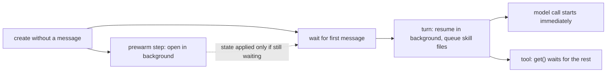

# Session prewarmers

Nothing session-scoped may delay the model call. A turn that needs the sandbox still pays to
start it, and to write files that dynamic resolvers return at `turn.started`. Session
prewarmers start that work in the background as early as possible. Whatever uses the result
waits only for the rest of the race.

## Semantics (implemented)

Prewarmers run at two points:

- `"session"`: a session created without a message runs a prewarm step beside its wait for that
  message.
- `"turn"`: the first model call of each durable turn step starts them before `turn.started`.

A prewarmer starts work and returns. Framework providers own the work: consumers wait for it,
and the provider settles it before its scope commits. The model call never waits for it, so a
model-only turn pays nothing until its step commits.

The sandbox access has an ordered background queue:

```ts
access.prepare(); // open in the background
access.prepare(async (open) => {
  /* work; call open() only if needed */
});
await access.get(); // waits for the open and all queued work: the last mile
```

- Dynamic skill files go through the queue instead of waiting for `get()`. Unchanged packages
  never open the sandbox.
- `get()` retries failed queued work before it returns. The step commit drains the queue,
  retries failed work once, and fails the step if that fails again, as a failed write did
  before. A failed background open with no queued work is logged and left to the next `get()`.
- In the `"session"` phase the sandbox prewarmer always opens the sandbox. In the `"turn"`
  phase it resumes only a sandbox the session already recorded. Every agent has a sandbox, so a
  turn never starts one speculatively; queued work starts one when it needs it.

A first message never waits for the prewarm step. The step runs beside the wait. Its recorded
state is applied only while the owner still waits for its first input and no other session step
has run. Otherwise it is dropped. Provider `start()` is a documented cross-process upsert, so a
turn that opens the sandbox meanwhile reaches the same one; the selector may run twice, which
its existing idempotency rule covers. Session end, and a prewarm handoff, wait for the step, so
cleanup finds whatever it started.



## Internal contract

```ts
type SessionPrewarmPhase = "session" | "turn";

interface SessionPrewarmer {
  readonly name: string;
  start(ctx: ContextContainer, phase: SessionPrewarmPhase): void;
}
```

The registry sits next to the framework provider list. Adding a prewarmer needs no workflow,
checkpoint, or protocol change: it hands work to a provider, as the sandbox prewarmer hands it
to the access queue.

## Next steps (not implemented)

- Other turn-start sandbox work, such as staging inbound attachments, can use the same queue.
- An authored API: a callback that starts work in the same scope and hands consumers a value
  to wait on, rather than a side effect nobody can join.
- Turns of sessions created with a message do not start the sandbox unless work needs it. Any
  eager start for those turns needs an agent-level policy, because it costs a sandbox for every
  chat-only agent.
