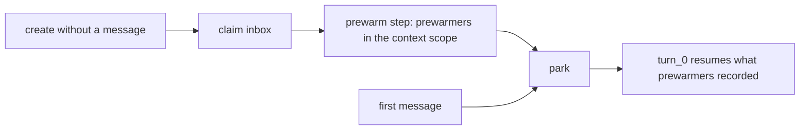

# Session prewarmers

Prewarming a session used to only boot its workflow. A first turn still paid for everything
session-scoped after Send: sandbox start, connection discovery, and dynamic definitions. Session
prewarmers move that work into the gap between `prewarm()` and Send. They share one contract that
framework resources use now and that authored code can join later.

## Semantics (implemented)

A session created without a message runs one durable prewarm step after it claims its inbox and
before it parks. The step runs every prewarmer concurrently inside the framework context scope a
turn's steps get. Durable effects go through framework providers and commit with the step.

- No turn starts, and no session event or session hook runs. `session.auth` is the creator's; the
  first message's `onMessage` can return a different identity. Title, initiator, and
  `session.started` still come from the first message.
- Best effort. A failed prewarmer is logged and skipped, and the step never fails the session.
  The lazy path redoes the work on first use. A prewarmer must therefore leave nothing that the
  lazy path cannot reuse or session end cannot clean up.
- Runs before the wait. The state cursor runs one step at a time, so input that arrives during
  the step waits in the inbox. That includes a message whose turn would not use the warmed
  resource.
- Only the initial owner prewarms. Handoff successors receive what it recorded in the checkpoint.

The sandbox is the first prewarmer. It runs the owning `defineSandbox()` selector and the
provider's `start()`, and the sandbox provider's commit records the state, so `turn_0` calls
`resume()`. Borrowed parent sandboxes are skipped. An unused prewarmed session times out, and
session end deletes its sandbox. Under `eve dev`, the first prewarm also prepares the sandbox
environments that the first sandbox access would otherwise prepare.



## Internal contract

```ts
interface SessionPrewarmer {
  /** Names the prewarmer in logs. */
  readonly name: string;
  prewarm(ctx: ContextContainer): Promise<void>;
}
```

The registry sits next to the framework provider list. A prewarmer consumes the context scope and
does not provide anything to it: providers own durable state, and prewarmers only reach it
earlier. Adding a prewarmer needs no workflow, checkpoint, or protocol change.

## Proposed public API (not implemented)

Authored prewarming should use the same contract: a callback that runs in the prewarm scope with
the authored session context (`ctx.getSandbox()`, `defineState` handles), with no model call and
no messages.

```ts title="agent/tools/catalog.ts"
export default defineDynamic({
  async prewarm(ctx) {
    await catalog(ctx).refresh(); // persisted through defineState
  },
  events: {
    "session.started": async (_event, ctx) => toolsFrom(await catalog(ctx).read()),
  },
});
```

Open questions:

- An opt-out for agents whose sandbox selector depends on per-user auth or whose sandbox is too
  costly to start speculatively, for example `defineAgent({ prewarm: { sandbox: false } })`.
- Whether `session.started` resolvers that do not read auth can run during prewarm and be reused
  by `turn_0`.
- Connections: warming MCP discovery needs a durable tool-list cache, because connection
  registries are step-local.
- Bounding prewarm latency: run the step alongside the wait and block a turn only on a resource
  it touches that is still warming.
