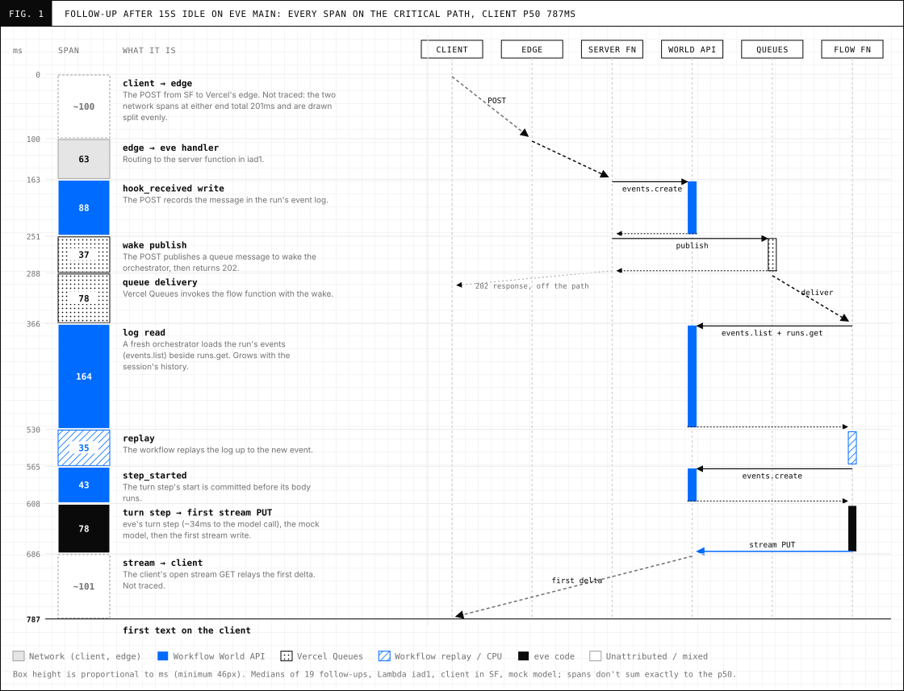
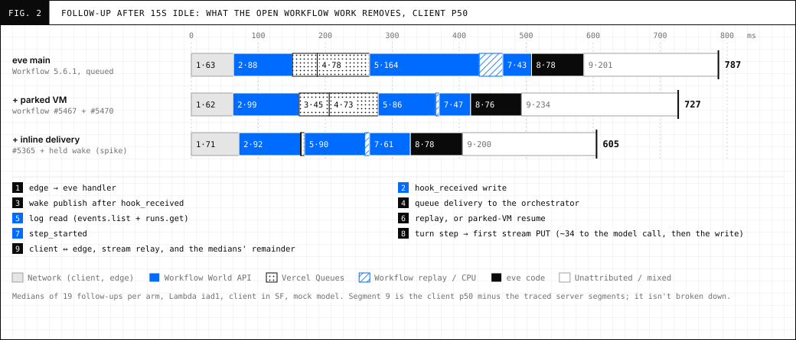
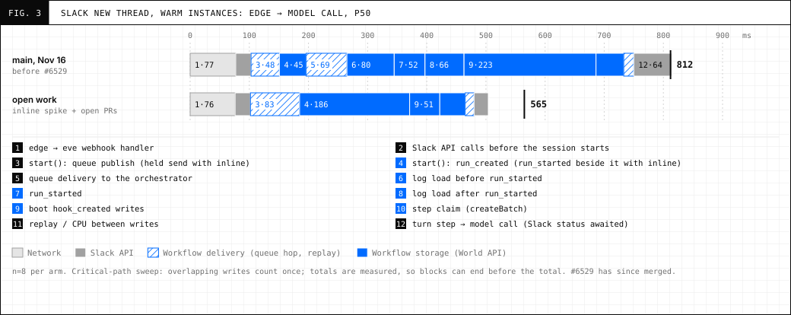
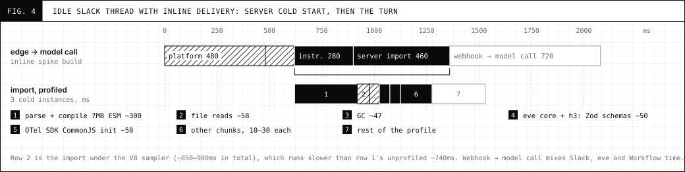

# Tracking down eve turn overhead

> **AI status:** Written entirely by AI; human review pending.

This is an analysis of the time between a message reaching a hosted eve agent and eve's first visible output: the first streamed text on web chat, or the model call on Slack. Every measurement uses a mock model that answers with no delay unless noted, so the numbers are overhead: network, eve, Workflow, Vercel Queues, and the platform.

The case that matters most is a follow-up that arrives after the previous turn's orchestrator has stopped. The hook lingers for 5s, and real replies almost always come later than that. On eve main, such a follow-up spends about 450ms in the Workflow runtime before eve's turn step starts. Most of the remaining room is there, followed by cold starts.

## A follow-up after 15s idle

The client sends a message to a session whose previous turn ended 15s earlier. Fig. 1 shows every span on the critical path, from the client's POST to the first streamed text, and which process is waiting on which.

The POST records the message and wakes the orchestrator through the queue, then returns. The client doesn't wait for that response, because it opens the stream alongside the send ([eve #6431](https://github.com/vercel/eve/pull/6431)). The orchestrator starts in a fresh VM in the flow function. It reads the run's log, replays it, commits `step_started`, and only then runs eve's turn step, whose first stream write reaches the client through the open stream.

Of the ~590ms that the trace attributes, about 445ms is the Workflow runtime: World writes and reads, the queue, and replay. The turn step to the first stream `PUT` takes 78ms: ~34ms of eve's work before the model call, then the mock model and the stream write. The two network spans at either end aren't traced; together they are the remaining ~200ms.

The totals vary between runs on the same build. eve main measured 787ms in the run in Fig. 1, and 860–940ms in later rounds. Compare builds within a round.

### What the open Workflow work removes

Fig. 2 is one round, with all three builds measured concurrently. The inline arm is a spike: [#5365](https://github.com/vercel/workflow/pull/5365) plus a held wake sent beside `hook_received`. Measured later with the real PRs on Workflow main:

| Build                                                                                                                                               | Client p50 |
| --------------------------------------------------------------------------------------------------------------------------------------------------- | ---------: |
| eve main (Workflow 5.6.1)                                                                                                                           |   ~860–940 |
| + [workflow #5467](https://github.com/vercel/workflow/pull/5467)/[#5470](https://github.com/vercel/workflow/pull/5470) (parked VM)                  |   ~670–720 |
| + [workflow #5365](https://github.com/vercel/workflow/pull/5365) + [#5573](https://github.com/vercel/workflow/pull/5573) (inline delivery, handoff) |       ~670 |

The sections below take the spans in order of size.

### Orchestrator log read and replay: ~200ms per follow-up

**Measured.** `events.list` plus `runs.get` took 164ms on main, and replay took 35ms. Both grow with the session's history.

**Why it's there.** Every queued delivery starts from a fresh VM. Before it can act on the one new event, it reads the log tail, loads the whole log and replays the workflow.

**Candidates, all drafts in Workflow:**

- **[#5468](https://github.com/vercel/workflow/pull/5468)** puts the `hook_received` event ID in the wake. A delivery that has already consumed the log skips the no-op tail read (40–104ms when it isn't resuming a parked VM). It is rebased onto main and can merge on its own.
- **[#5467](https://github.com/vercel/workflow/pull/5467)** parks a cleanly suspended VM per process. The next delivery reads only the new events and resumes it. On a follow-up after 15s idle, the log read dropped from 164 to 86ms and replay from 35 to 5ms. It resumed on all 19 turns. A resumed VM keeps the run's event ceiling (`maxEvents`), which landed on Workflow main since.
- **[#5470](https://github.com/vercel/workflow/pull/5470)** lets a stale parked VM catch up on events another orchestrator wrote, instead of falling back to a full replay.
- **[#5573](https://github.com/vercel/workflow/pull/5573)** resumes on the `hook_received` that this process just wrote, with no log read and no `runs.get`.
  - It only applies when the orchestrator runs in the process that wrote the event, so it needs inline delivery.
  - It also needs consecutive turns on the same Lambda instance. That held for 50–60% of turns. Every miss was an instance change.

[#5467](https://github.com/vercel/workflow/pull/5467)/[#5470](https://github.com/vercel/workflow/pull/5470) don't depend on inline delivery, and are worth ~200ms on a follow-up after 15s idle with today's queued path.

### The queue hop: ~115ms

**Measured.** The wake publish took 37ms and the queue delivery 78ms.

**Candidate: [workflow #5365](https://github.com/vercel/workflow/pull/5365) (draft).** It runs `start()` and `resumeHook()` deliveries inline, in the function that called them, using send-and-hold. The queue stays as the fallback.

**Measured with the real PRs, inline saves only ~35ms**, because the held wake is sent after `hook_received` settles:

- with [#5365](https://github.com/vercel/workflow/pull/5365): `hook_received` (~90ms), then the held send (~80ms), then the inline run (~5ms);
- without it: `hook_received`, then a plain publish (~50ms), then the queue delivery (~70ms).

A held send also costs more than a plain publish: ~65–130ms against ~45ms. A spike that sends the held wake beside the `hook_received` write, and consumes it once the write settles, is worth another 70–80ms per follow-up. That suggestion has not been raised on [#5365](https://github.com/vercel/workflow/pull/5365) yet.

**What eve needs for inline delivery:**

- **The inline entry.** `@workflow/core/inline-entry` stays external in the vendored Workflow bundle, and the Nitro host aliases it to the workflow handler. The server function already bundles the flow route, so this adds no code.
- **A run-ID option in Workflow.** `pinRunId()` in `internal/workflow/start-claim.ts` passes `start()` a World proxy. [#5365](https://github.com/vercel/workflow/pull/5365) treats that proxy as a custom World and refuses to inline. Every session start is affected until Workflow offers `start({ runId })`, or start Hook metadata computed from the run ID.
- **Start Hook inline** on the Workflow side, for new sessions.
- **A `maxDuration` for the server function.** Only the queue-triggered functions get `maxDuration: "max"` today. An inline delivery's budget is the calling function's remaining deadline minus 15s, so long turns would hand off to the queue mid-turn.

The `@vercel/queue` version is no longer a blocker: Workflow 5.6.1's `world-vercel` depends on 0.11.0, which supports holds.

### The `hook_received` write: ~90–120ms

**Measured.** This is now the largest single durable write on a web chat follow-up.

**Why it's there.** It can't join a `createBatch`. The backend gives it no entity condition, so a batch retry would deliver the message twice.

**Candidate.** Make `hook_received` idempotent, then batch it with the turn's creation batch, or make the write itself faster. Either is worth ~50–100ms per turn. Both are backend work.

### Waiting for `step_started` before the step body: ~25–70ms

**Why it's there.** On a run's first delivery, Workflow already starts an inline step body before its `step_started` commits. It turns that off once the run has a hook or a wait, because a hook resume gives the run other writers. So every follow-up waits for its creation batch, `step_created` plus `step_started`.

**Spike.** The spike allows the early start on resumes, and gates the body's stream and attribute writes on its own start committing. With a 400ms model time to first token:

- `hook_received` committed → model call went from 158 to 52ms;
- the client p50 of a follow-up after 15s idle went from 876 to 783ms;
- with 0ms to first token, the gain doesn't show, because the run waits on the gated first output anyway.

**What a real version needs: one early-start rule for both paths.**

1. The delivery holds the in-band fence on a log it knows is complete up to a slot.
2. The step allows retries.
3. Everything the body does that is visible outside it waits on one commit barrier.

Stream and attribute writes are gated today. Tool calls and channel deliveries are not. Workflow could expose the barrier to steps as a `stepStarted` promise. eve would await it before tool execution and channel delivery, and keep the model call outside it. A refused start then costs one wasted model call. This needs agreement with the Workflow owners.

### The turn step up to its first stream write: ~80ms

**Measured.** About 34ms from `turn-step.start` to the model call, with no dominant piece:

- AI SDK `ToolLoopAgent` setup and the mock: ~8ms;
- the settings build: ~5ms;
- definitions: ~5ms;
- admission publish: ~3ms;
- `requestRun`: ~3ms.

The first stream `PUT` takes ~45ms. About 15–20ms between the step's first line and that `PUT` is unexplained. It isn't the WebSocket fallback: forcing HTTP changed nothing. A real model's time to first token hides it.

## Other flows

Measured on 2026-11-12 (main at the start of this work), on 2026-11-16 (main), and on 2026-11-16 with the open work applied. The open-work build had the open eve PRs plus a Workflow spike: [#5365](https://github.com/vercel/workflow/pull/5365) inline delivery, start Hook inline, [#5448](https://github.com/vercel/workflow/pull/5448)/[#5450](https://github.com/vercel/workflow/pull/5450), [#5467](https://github.com/vercel/workflow/pull/5467)/[#5470](https://github.com/vercel/workflow/pull/5470)/[#5468](https://github.com/vercel/workflow/pull/5468), and a held wake sent beside `hook_received`.

| Flow                                 | Metric               | Nov 12 | Nov 16 | Nov 16, open work | Merged since Nov 16                                                                                                                                                                                                    |
| ------------------------------------ | -------------------- | -----: | -----: | ----------------: | ---------------------------------------------------------------------------------------------------------------------------------------------------------------------------------------------------------------------- |
| Web chat, right after a turn (n=20)  | send → first text    |    651 |    467 |               399 | [#6431](https://github.com/vercel/eve/pull/6431), [#6506](https://github.com/vercel/eve/pull/6506). These were the open-work build's main changes on this path, so main is probably close to 399 now; not re-measured. |
| Web chat, 35s after a turn (n=8)     | send → first text    |    947 |    978 |               537 | [#6506](https://github.com/vercel/eve/pull/6506), [#6508](https://github.com/vercel/eve/pull/6508) (~215ms off the Nov 16 number, estimated)                                                                           |
| Slack new thread, warm (n=8)         | edge → model call    |  1,048 |    812 |               565 | [#6529](https://github.com/vercel/eve/pull/6529) (~40ms)                                                                                                                                                               |
| Slack follow-up, 2s later (n=32)     | webhook → model call |    322 |    307 |               244 | [#6506](https://github.com/vercel/eve/pull/6506), [#6529](https://github.com/vercel/eve/pull/6529) (~90ms)                                                                                                             |
| Slack new thread, ~16 min idle (n=3) | edge → model call    |  4,370 |  3,995 |             2,303 | [#6529](https://github.com/vercel/eve/pull/6529) (~100ms)                                                                                                                                                              |

### New-session boot

A new Slack thread pays for creating the run as well as the turn.

**`start()` is serial by design.** The start Hook's queue publish comes first, then `run_created`, together ~90–130ms. Running them in parallel risks admitting a run whose publish then fails permanently, so it needs durable delivery recovery first. With inline delivery and start Hook inline, `run_started` is written while `run_created` is still in flight (segment 4 in Fig. 3).

**Workflow log loads.** The first delivery loads the log before `run_started` and again after it. [workflow #5448](https://github.com/vercel/workflow/pull/5448) → [#5450](https://github.com/vercel/workflow/pull/5450) remove both loads, ~80ms + ~66ms.

**Boot hooks.** These are written one at a time before the first step claim: 223ms for three on Nov 16 main.

- [eve #6477](https://github.com/vercel/eve/pull/6477) claims a continuation session's inbox after its first step instead. It is a draft and needs a rebase over [#6489](https://github.com/vercel/eve/pull/6489). Together with start Hook admission, it leaves one boot hook.
- Batching the last one, the turn-control abort hook, with the step claim is blocked: Workflow doesn't yet accept `hook_created` in event batches ([workflow#5449](https://github.com/vercel/workflow/issues/5449)).
- A lazily created abort hook was tried earlier, and it corrupted steered runs.

**[eve #6426](https://github.com/vercel/eve/pull/6426) and [#6446](https://github.com/vercel/eve/pull/6446)** apply to `create()` followed immediately by `send()`. [#6426](https://github.com/vercel/eve/pull/6426) starts a prewarmed session's idle timer with its first turn, and [#6446](https://github.com/vercel/eve/pull/6446) puts cancel and steer on one abort controller, which is one fewer boot hook.

### Cold starts

A server instance that cold-starts for a message takes ~1.35s before eve code runs:

- ~480ms of platform time;
- ~140ms of Node start;
- ~280ms for the instrumentation import;
- ~460ms for the rest of the server import.

Without inline delivery, an idle app pays a second cold start: the flow function's, ~1.3s, serially after the first. Inline delivery removes it by running the turn in the server function that just started.

**Where the import goes.** The V8 sampling profiler ran on three cold instances:

- Parse and compile of the 7MB ESM output is the largest piece, 263–334ms.
- Zod schema construction in eve's eagerly loaded chunks comes next, and the OTel SDK's bundled CommonJS initialization costs ~50ms.
- The instrumentation entry alone is 2.8MB: `ai`, `@ai-sdk/gateway`, Zod's JSON Schema code and the OTel SDK. On Vercel, eve always seeds the `agent-runs` provider, so OpenTelemetry loads on every deployment.
- The flow route has only 365KB of code of its own. Everything else is shared with the webhook and session handlers, so deferring the flow route alone saves little.

**Candidates:**

- **Bytecode caching.** A V8 code cache generated on the Vercel runtime cut import by 25–30% in an A/B on the same instance. Vercel's native bytecode caching is the platform vehicle, and is being pursued with the Compute team. eve's ESM output hits the default bytecode cache 1.9% of the time, against 54% for CommonJS Next.js routes.
- **Lazy Zod schemas** in eagerly loaded chunks, ~100–150ms.
- **Deferring OTel SDK initialization** until the first span, buffering earlier spans, ~50ms.

With inline delivery the server function runs turns, so deferring turn code out of the server import no longer helps.

**A new instance's first request** also loads the compiled agent (~100ms) and fetches OIDC discovery for static `oidc()` issuers (~145ms). TLS to Workflow and Queues is cheap (21–36ms per connection), so pre-connecting saves little.

### Slack through Vercel Connect

- **The forwarding hop.** Connect adds ~160ms between Slack sending an event and eve receiving it. The same messages took 295ms over a direct Slack app and 432ms through Connect.
  - Every trigger is handled in sfo1: api-proxy's regional rule matches `/connect`, but the trigger URL is `/v1/connex/trigger`. Apps in iad1 therefore pay about one more cross-country round trip than this measurement shows.
  - Routing triggers regionally would be slower today, because Connect's team lookups cross back to sfo1.
- **Cold instances.** These add ~250ms more. The forwarded webhook's OIDC check fetches Vercel's signing keys (~80–137ms), and only then is the bot token fetched from the Connect API (~133–191ms). [vercel-internal#2964](https://github.com/vercel/vercel-internal/pull/2964) (draft) starts the token fetch alongside the check, and shares one fetch between concurrent `getToken` calls. Its saving on a reply isn't measured yet.

### Open questions

- **The first queue publish after a deploy** took 1.3–2.9s, against 80–160ms normally. The first new conversations after every production deploy pay this.
- **A Slack thread dormant for 16 minutes** took ~3.0s from message to model call. Its next message started a new workflow run, with a queue hop and a full boot. eve's session timeout is the likely cause, but it isn't confirmed.

## What has been removed

| Change                                                                                                                                                                       | Effect                                                                                                                       | Ships in       |
| ---------------------------------------------------------------------------------------------------------------------------------------------------------------------------- | ---------------------------------------------------------------------------------------------------------------------------- | -------------- |
| [eve #6417](https://github.com/vercel/eve/pull/6417), [#6418](https://github.com/vercel/eve/pull/6418)                                                                       | Known sessions skip the stream version check, and the stream opens while the session check runs. Stream open −100 to −150ms. | eve 1.0.0      |
| [eve #6419](https://github.com/vercel/eve/pull/6419)                                                                                                                         | Usage tags are written behind the turn. −50ms per model call.                                                                | eve 1.0.0      |
| [eve #6420](https://github.com/vercel/eve/pull/6420)                                                                                                                         | Turns reuse unaborted turn controls. Two fewer Workflow writes per turn.                                                     | eve 1.0.0      |
| [eve #6421](https://github.com/vercel/eve/pull/6421)                                                                                                                         | Root sessions are created without a durable step. New session → first turn step 600 → 325ms.                                 | eve 1.0.0      |
| [eve #6473](https://github.com/vercel/eve/pull/6473), [#6474](https://github.com/vercel/eve/pull/6474)                                                                       | A new Slack thread starts its session without lookups, and before Slack's API calls. −120 to −170ms.                         | eve 1.0.2      |
| [eve #6506](https://github.com/vercel/eve/pull/6506)                                                                                                                         | The session inbox's owner is cached in process. −45 to −90ms per follow-up.                                                  | eve 1.0.2      |
| [eve #6507](https://github.com/vercel/eve/pull/6507)                                                                                                                         | The stream version check skips its tail lookup. Up to −290ms on an instance new to the session.                              | eve 1.0.2      |
| [eve #6508](https://github.com/vercel/eve/pull/6508)                                                                                                                         | `oidc()` refuses another issuer's token before fetching its keys. −130ms per request after 30s idle with two issuers.        | eve 1.0.2      |
| [eve #6431](https://github.com/vercel/eve/pull/6431)                                                                                                                         | The client opens the stream alongside the send, so one round trip leaves the critical path.                                  | main           |
| [eve #6529](https://github.com/vercel/eve/pull/6529) (re-land of [#6476](https://github.com/vercel/eve/pull/6476))                                                           | `ctx.waitUntil` for channel handlers. Slack's status updates no longer block the model call (−40 to −100ms).                 | main           |
| [eve #6561](https://github.com/vercel/eve/pull/6561)                                                                                                                         | Updates the vendored Workflow to 5.6.1.                                                                                      | main           |
| [workflow #5410](https://github.com/vercel/workflow/pull/5410), [#5386](https://github.com/vercel/workflow/pull/5386), [#5159](https://github.com/vercel/workflow/pull/5159) | Replay copies state once per op; startup retries a missing event history; send-and-hold on the queue.                        | Workflow 5.6.x |

## Open work, in merge order

| Order | Change                                                                                                                 | What it removes                                                 | State                                                                           |
| ----- | ---------------------------------------------------------------------------------------------------------------------- | --------------------------------------------------------------- | ------------------------------------------------------------------------------- |
| 1     | [workflow #5468](https://github.com/vercel/workflow/pull/5468)                                                         | The no-op tail read on a named wake                             | Mergeable on its own                                                            |
| 2     | [workflow #5467](https://github.com/vercel/workflow/pull/5467)                                                         | Log reload and replay on a follow-up (parked VM)                | Draft                                                                           |
| 3     | [workflow #5470](https://github.com/vercel/workflow/pull/5470)                                                         | Full replay when another instance ran the last turn             | Draft                                                                           |
| 4     | [workflow #5573](https://github.com/vercel/workflow/pull/5573)                                                         | The parked VM's read, when this process wrote the event         | Draft; pays off only with [#5365](https://github.com/vercel/workflow/pull/5365) |
| —     | [workflow #5365](https://github.com/vercel/workflow/pull/5365)                                                         | The queue hop                                                   | Draft (@pranaygp). The held wake should be sent beside `hook_received`.         |
| —     | [workflow #5448](https://github.com/vercel/workflow/pull/5448) → [#5450](https://github.com/vercel/workflow/pull/5450) | Two log loads on a new run's first delivery                     | Open                                                                            |
| —     | [eve #6426](https://github.com/vercel/eve/pull/6426), [#6446](https://github.com/vercel/eve/pull/6446)                 | Prewarm idle timer, one abort controller                        | Open, draft                                                                     |
| —     | [eve #6477](https://github.com/vercel/eve/pull/6477)                                                                   | One boot hook for continuation sessions                         | Draft; needs a rebase over [#6489](https://github.com/vercel/eve/pull/6489)     |
| —     | [vercel-internal#2964](https://github.com/vercel/vercel-internal/pull/2964)                                            | Serial OIDC check and bot token fetch on cold Connect instances | Draft                                                                           |

After these land, two design steps remain:

1. **Agree one early-start rule** and its barrier for step bodies, including a `stepStarted` promise for steps.
2. **Fold Workflow's fast paths into one known-log input.** The first delivery, the start Hook delivery, the parked VM, the named wake and the handoff each skip the log read in their own way. Each could instead give the delivery the events it already knows, up to a slot, and have it read only what's missing. This is a refactor, not a latency change.

## Tried and dropped

- **A 30s hook linger** ([eve #6509](https://github.com/vercel/eve/pull/6509), closed). It took 12s-gap follow-ups from ~870 to ~500ms. Replies usually come later than 30s, though, and the linger holds an invocation open.
- **Warming the flow function from the webhook** with a health-check queue message. Vercel started a second cold flow instance for the real message, which arrived ~200ms later, so nothing was saved.
- **One function for routes and the queue trigger.** Every route returned 404. A function with `experimentalTriggers` doesn't appear to be routable.
- **Lazy route loading** made the first message slower.
- **Minifying the server output** cut it from 9.9MB to 8.4MB, but changed import time by ~3ms.

## Method

- **Deployments.** Scratch Vercel projects in `vercel-internal-playground`, region iad1. The later runs are built on Vercel, so they run on the Lambda substrate like customer deploys.
- **Client.** A laptop in San Francisco. The round trip to iad1 is about 115–130ms.
- **Model and channels.** A mock model, with a 0ms time to first token unless noted. In the first-output probe deployments, Slack API calls are stubbed at 20ms. The Vercel Connect measurements use real Slack apps.
- **Tracing.** A patch logs route marks, every World call and every undici request, each with its duration. A script merges the Vercel runtime logs with client timestamps. For Slack new threads, a critical-path sweep counts overlapping writes once.
- **Workloads.**
  - Web chat follow-ups after 15s idle: 19 per build, after two warm turns.
  - Web chat follow-ups right after the previous turn: back-to-back turns.
  - Web chat follow-ups after 35s idle, in a 20-turn session.
  - Slack new thread, on warm instances and after ~16 minutes idle.
  - Slack follow-up, 2s after the previous reply.
- **Statistics.** All figures are medians in ms. Segment medians don't sum exactly to the total median.

The probe scripts and raw logs are kept outside this repository.

## Measurement notes

- **Logging cap.** Vercel keeps at most 256 log entries per invocation. A lingering orchestrator that serves several turns hits the cap, and the later turns' marks disappear. Count log lines per request before treating a turn as lost.
- **Stale remote builds.** Vercel-built deploys reused a stale `node_modules/eve` from the build cache when the dependency was a local tarball at the same path and version. Two early inline runs silently ran an older eve. Deploy with `--force`, and check what shipped.
- **Mock time to first token.** With 0ms to first token, changes that start the model earlier, such as the early step start, don't show. Compare those with a delayed mock.
